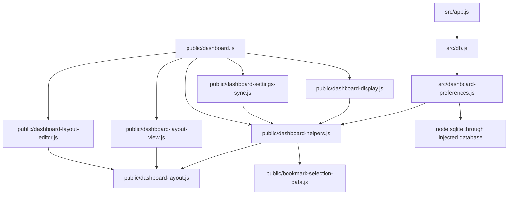

# Brooks-Lint Health Dashboard

## Table of Contents

- [Scope and Scores](#scope-and-scores)
- [Module Dependency Graph](#module-dependency-graph)
- [Top Findings](#top-findings)
- [Test Suite Map and Verification](#test-suite-map-and-verification)
- [Recommendation](#recommendation)

## Scope and Scores

**Mode:** Health Dashboard

**Scope:** All changes on `49-stackable-dashboard-widgets` relative to `main`, merge base `c877424263d997b4089485994702875aed4f1ec2` through `fa71e53`: two commits, 20 changed files. Supporting unchanged settings, display, persistence, and browser-fixture code was inspected for integration context. This is a branch-scoped review, not a whole-project audit. The working tree was clean before review.

**Composite Score:** 98/100

**Trend:** First Health Dashboard run; previous history entries use PR Review and are not comparable.

- Code Quality: 95/100. One R2 Warning: ordinary settings reads interfere with unfinished editor operations.
- Architecture: 100/100. No new dependency cycle or layering violation found in the touched modules.
- Tech Debt: 95/100. One R6 Warning: projected rectangle bounds omit the CSS padding floor.
- Test Quality: 100/100. No separate T1/T2 structural finding; missing regressions are included with the production findings below.

Balanced deductions apply: each Warning subtracts five points in its assigned dimension. The weighted composite is `95 × 0.25 + 100 × 0.30 + 95 × 0.25 + 100 × 0.20 = 97.5`, rounded half-up to 98. Findings are not charged to multiple dimensions. This abbreviated structural score is not release approval: two reproduced behavioral defects remain.

## Module Dependency Graph

The graph shows the relevant slice, not every existing coordinator dependency. The new model is a pure leaf shared by browser adapters and preference validation. Existing server-to-public helper imports remain deliberate shared-schema reuse, not a new dependency inversion. The editor owns drafts, the view owns DOM projection, and the existing synchronizer/store retain network and revision ownership. No new endpoint, database table, runtime dependency, or legacy-layout dependency was introduced. Proportional geometry, minimum clamping, internal scrolling, and decode-only coordinate migration are justified product tradeoffs rather than speculative complexity.

## Top Findings

### Warning

#### 1. R2 Change Propagation: Settings polling destroys unfinished editor work

**Dimension:** Code Quality.

**Locations:** `public/dashboard.js:240-247,254`; `public/dashboard-layout-editor.js:47-52,76-79,112-114`; supporting existing polling behavior in `public/dashboard-settings-sync.js:61,67-82`.

**Symptom:** Geometry inputs have no `form="preferences"` association and update the model only on `change`, so typing into a focused field does not mark the dashboard draft dirty. An unchanged settings poll can therefore call `fillForm()` and replace that unfinished value. Independently, every synchronization state emission calls `layoutEditor.setSaving(false)`, which unconditionally calls `render()` and rewrites focused values. Active gestures are also vulnerable: they do not mark the draft dirty until completion, so the next accepted snapshot invokes `setDraft()`, which cancels the gesture even when no preference changed. An owned real-server Chromium probe installed the browser clock, filled height with `177` without blurring, and advanced 5,000ms: the field reverted to `344`. Holding a moved pointer across another poll changed the width field from disabled to enabled before pointer release, demonstrating gesture cancellation.

**Source:** The Pragmatic Programmer — Orthogonality; A Philosophy of Software Design — Information Hiding and Leakage. Network loading-state emissions should not implicitly reset an editor's transient operation state.

**Consequence:** Normal five-second polling silently loses numeric entry and interrupts longer drag/resize operations. Failed reads can also overwrite raw fields through `onState`, even when the dirty-snapshot guard prevents `fillForm()`. The existing preservation test covers measurement-only rendering, not synchronization rendering.

**Remedy:** Track raw input edits and active gestures as protected editor work before they commit to canonical geometry. Prevent ordinary snapshot refreshes from replacing that work or silently advancing its base revision. Make unchanged saving-state notifications non-mutating, preserve focused raw values during unrelated state updates, and cancel gestures only for explicit cancellation, genuine surface/profile changes, or an actual save transition. Add deterministic browser-clock regressions for focused valid/invalid numeric input and held move/resize gestures across unchanged, changed, and failed polls. Keep the existing stale-save conflict behavior.

#### 2. R6 Domain Model Distortion: Tiny projected rectangles are smaller than their padded CSS boxes

**Dimension:** Tech Debt.

**Locations:** `public/dashboard-layout.js:39-44`; `public/dashboard.css:202`; `e2e/dashboard-layout.spec.js:102-110`.

**Symptom:** Projection deliberately reduces widget height below 100px when the usable surface is smaller. Custom cards nevertheless retain `.5rem` padding on both sides with `box-sizing: border-box`. CSS cannot shrink the rendered border box below that padding floor. In an owned Chromium probe at a 160×150 viewport, the usable surface was `{ x: 8, y: 132, width: 144, height: 10 }`; every widget rendered 16px tall, with top `126`, outside the surface's top `132`. The isolated stage clips the excess. The focused layout suite initially failed its existing containment assertion at line 109; a single-test rerun and the later full suite passed. The deterministic viewport probe captured the actual invalid rectangles, so this is not being attributed solely to test flakiness.

**Source:** Domain-Driven Design — invariant ownership; Code Complete — defensive programming. The promised physical bounds must apply to actual DOM rectangles, not only model outputs.

**Consequence:** The documented smaller-than-minimum behavior fails when either available axis is below the CSS padding floor. Widgets extend outside their projected rectangles and get clipped, violating the current-window containment contract. The occurrence depends on the measured tool/status height, which helps explain differing suite outcomes.

**Remedy:** Make card padding shrink with the projected dimensions, or explicitly disable rendering/editing for surfaces the CSS box cannot represent; retain the documented behavior consistently in the preview, model, and live view. Add deterministic real-browser coverage that forces usable widths/heights below 16px and asserts actual border-box containment. Keep normal 100px-card scrolling coverage.

## Test Suite Map and Verification

- Repository inventory: 47 Node test files and seven browser spec files. A file-level heuristic maps 24 Node files to unit-oriented tests and 23 to integration/process/API-oriented tests. Mixed files remain mixed; these are not claimed as exact per-test layer counts. There are 363 static Node `test(...)` declarations and 99 static browser declarations; loops expand runtime counts.
- Changed coverage: pure model/schema/projection tests, isolated view/observer tests, settings synchronization/cache tests, API/SQLite migration tests, and 13 layout browser scenarios. Browser tests verify hit testing, real pointer/touch input, persistence, conflicts, node identity, provider ownership, offline cache behavior, and Firefox/Chromium sharing. Boundary and migration assertions are meaningful; real browser rendering is justified for CSS and pointer risks.
- `npm test -- --test-timeout=10000`: 389 passed, zero failures/skips, about 10.5 seconds. This includes four fixture-module entries reported by Node's default discovery.
- `npm run check`: passed. Every changed JavaScript file also passed individual `node --check`; the wildcard package script alone is not treated as complete syntax verification.
- Initial focused browser run: 12 passed, one containment failure in `custom cards stay within each viewport without resize writes, including tiny surfaces and all-hidden editing`.
- Single containment-test rerun: one passed. Later complete `PLAYWRIGHT_PORT=43321 npm run test:browser`: 115 passed, zero failures/skips, about 1.4 minutes, including focused Firefox exchange coverage.
- Additional non-persisted, owned Chromium/SQLite probes reproduced polling-induced numeric loss, polling-induced gesture cancellation, and 16px rendered cards on a 10px-high surface. No implementation or test fixes were applied.
- `git diff --check`: passed before creating this report. No live provider, real Wake dispatch, user database, or user service was used.

## Recommendation

Fix editor operation ownership across routine synchronization first, then reconcile tiny-surface geometry with CSS box sizing. Add deterministic regressions for both before merging; the passing full suite does not negate the targeted reproductions. Architecture and existing persistence/migration boundaries are sound within this branch scope. A focused PR review of editor/synchronizer integration is the highest-value follow-up. This stage changes only the review report and review history, with no implementation fixes.
