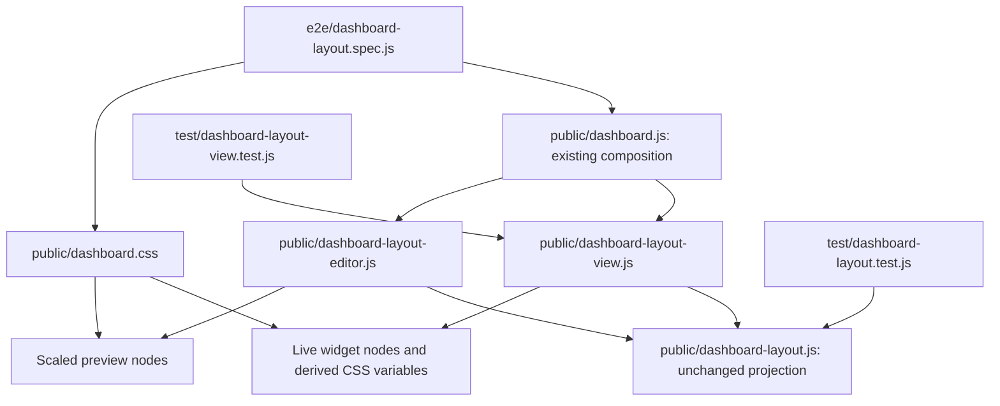

# Brooks-Lint Health Dashboard

## Table of Contents

- [Scope and Scores](#scope-and-scores)
- [Module Dependency Graph](#module-dependency-graph)
- [Top Findings](#top-findings)
- [Test Suite Map and Validation](#test-suite-map-and-validation)
- [Recommendation](#recommendation)

## Scope and Scores

**Mode:** Health Dashboard

**Scope:** Plan review of `tasks/50-tiny-widget-containment/2-plan.md` at `90af355`, checked against `1-goal.md`, the task 49 warning, and the existing layout model, view, editor, styles, and tests. This assesses the proposed change, not the health of the entire branch or an implemented fix. No `.brooks-lint.yaml` exists; balanced defaults apply.

**Composite Score:** 100/100

**Trend:** Previous Health Dashboard score 98 → 100 (+2). The previous run reviewed task 49 implementation changes; this run reviews a narrower implementation plan. The score change does not mean either existing warning has been fixed.

- Code Quality: 100/100. Planned changes stay within the presentation adapters and include explicit Automatic-mode cleanup.
- Architecture: 100/100. The pure model remains a dependency leaf; persistence and synchronization ownership do not change.
- Tech Debt: 100/100. Per-axis decoration bounds address the physical box invariant without changing stored geometry or introducing a framework.
- Test Quality: 100/100. Planned tests separate model invariants, adapter cleanup, real CSS geometry, and persistence side effects.

No Critical, Warning, or Suggestion findings. With all four dimensions applicable to the proposed changes and scoring 100, the weighted composite is `100 × 0.25 + 100 × 0.30 + 100 × 0.25 + 100 × 0.20 = 100`.

## Module Dependency Graph

CSS arrows indicate styling relationships, not JavaScript imports. The proposed variables carry projected dimensions from the DOM adapter into its CSS policy; they do not duplicate canonical model calculations. Explicit cleanup prevents presentation state leaking into Automatic layout. Replacing preview borders with non-layout decoration is local to the same geometry concern. No cycle, upward dependency, or new production test seam is proposed.

## Top Findings

None within the plan scope. The plan identifies the existing padding floor and the analogous preview border floor, preserves positive tiny-surface support, and explicitly excludes polling/editor ownership work. Coordinated edits to the view, CSS, and associated tests are cohesive feature work, not Shotgun Surgery. The controlled viewport fixture is justified because the defect depends on usable dimensions that native viewport wrapping does not deterministically produce; retaining native viewport checks limits the fixture's coverage claim.

The plan's one-pixel guarantee concerns actual outer rectangle containment and recovery, not readable content or useful pointer targets at one pixel. This distinction is explicit and consistent with the goal. The model's zero-surface deferral and shared revision ownership remain intact.

## Test Suite Map and Validation

- Unit/model: `test/dashboard-layout.test.js` checks canonical projection and edit semantics; the plan adds independent one-pixel axes and normal → tiny → normal invariance without moving CSS policy into the model.
- Unit/DOM adapter: `test/dashboard-layout-view.test.js` currently has three isolated tests. Planned variable assignment/update/removal assertions cover the added adapter state, while acknowledging that the fake DOM cannot validate actual CSS sizes.
- Browser/integration: `e2e/dashboard-layout.spec.js` currently contains 13 scenarios with owned real-server/SQLite fixtures. The plan adds deterministic live/preview border-box checks and keeps the existing native viewport, scrolling, touch, fullscreen, persistence, and cross-browser cases.
- New scenario counts are not fixed yet. The proposed browser tests are appropriate for a rendering defect; extra model cases verify a different failure mode rather than duplicating CSS assertions across layers. Named widgets, explicit measured preconditions, and tight subpixel tolerances support diagnosable failures rather than incidental wrapping assumptions.
- A non-persisted browser experiment checked the proposed padding expression in installed Chromium and Firefox. Real scrollable, border-box elements retained exact requested dimensions at 1×200, 10×200, 200×1, 200×10, 1×1, 10×10, and 100×100. A shadow-only preview element retained its requested 0.5×0.5px size in both engines. This supports the proposed mechanism; it is not a production-widget regression or an implementation verification.
- No application tests or full suites were rerun during this plan review. The full Node/browser runs, before-fix regressions, root-font variation, zero-surface recovery, normal scrolling, and no-write/revision assertions remain implementation-stage obligations.
- No implementation files, test files, package versions, user data, live services, or `todo.md` were changed. The plan itself remains unchanged by this review.

## Recommendation

Proceed with the plan. Select one controlled-viewport fixture approach, keep its manipulation test-local, and require the planned real-widget regressions to fail before applying the fix. Preserve both explicit style-variable cleanup and native viewport coverage. No plan revision is required by this review. Task 49 warning 1 remains unresolved and outside this task; this approval does not authorize merging the branch with that issue unaddressed.
