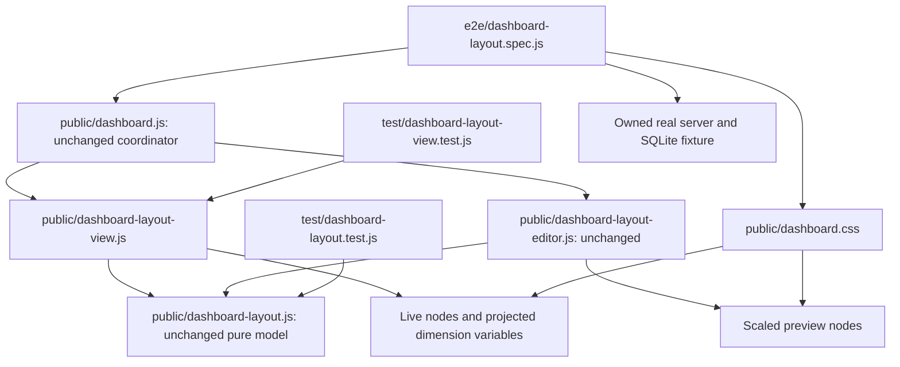

# Brooks-Lint Health Dashboard

## Table of Contents

- [Scope and Scores](#scope-and-scores)
- [Module Dependency Graph](#module-dependency-graph)
- [Top Findings](#top-findings)
- [Test Suite Map and Verification](#test-suite-map-and-verification)
- [Recommendation](#recommendation)

## Scope and Scores

**Mode:** Health Dashboard

**Scope:** All changes on `50-tiny-widget-containment` relative to its actual base branch, `49-stackable-dashboard-widgets`, from merge base `ddec073104f46870493f911c5c31df230ab572e3` through `0d4354d`: one implementation commit, 10 changed files, 200 insertions and eight deletions. The working tree was clean before review. The task goal, plan, and inherited layout/editor code were consulted for context. This stacked-branch review does not reclassify inherited changes as task 50 changes.

No `.brooks-lint.yaml` was found; balanced defaults apply.

**Composite Score:** 100/100

**Trend:** Stable at 100 compared with the previous Health Dashboard entry. That entry assessed the task 50 plan, so this is not a like-for-like runtime quality trend.

- Code Quality: 100/100. The small production diff preserves existing adapter responsibilities and explicitly clears added presentation state.
- Architecture: 100/100. No new import, cycle, infrastructure dependency, persistence owner, or production testing hook was introduced.
- Tech Debt: 100/100. The padding and preview border floors are removed without changing canonical geometry or minimum-size policy.
- Test Quality: 100/100. New tests exercise actual rendering with explicit preconditions and useful diagnostics; no actionable T1/T2 issue was found.

No Critical, Warning, or Suggestion findings in this diff. The weighted composite is `100 × 0.25 + 100 × 0.30 + 100 × 0.25 + 100 × 0.20 = 100`. This is a scoped review score, not a claim that the inherited branch has no known defects.

## Module Dependency Graph

CSS arrows describe styling relationships, not JavaScript imports. The only changed production JavaScript remains a DOM adapter. Its dimension variables carry existing projection results into the CSS padding rule; they do not duplicate model decisions or cross into saved preferences. Automatic-mode cleanup removes the variables alongside absolute geometry. The shared model remains a pure leaf.

## Top Findings

None in task 50's changes. The live padding rule bounds opposite edges to at most half the corresponding projected axis, preserves positive interior space, and keeps `.5rem` spacing on ordinary cards. Zero borders avoid another box-size floor. Preview inset shadows do not contribute to layout dimensions, so tiny cards and the preview frame retain the same coordinate contract. Existing scrolling, layering, and pointer tests remain meaningful rather than being relaxed.

The additional view/CSS coordination is intentional boundary glue, not Shotgun Surgery. The narrow controlled-viewport fixture is justified for a CSS defect that incidental tool/status wrapping could otherwise mask. It keeps real DOM/CSS rendering and asserts measured dimensions before checking cards. The documented tradeoff is appropriate: a one-pixel box must fit and recover, but is not expected to offer readable content or useful pointer targets.

**Inherited issue:** Warning 1 in `tasks/49-stackable-dashboard-widgets/5-code-review.md`, concerning polling-induced numeric input loss and gesture cancellation, remains unresolved. The responsible editor/synchronizer paths are unchanged by this diff. It is not counted as a new task 50 finding or silently considered fixed.

## Test Suite Map and Verification

- Changed unit-oriented files: two. `test/dashboard-layout.test.js` covers model bounds and exact source/projection preservation; `test/dashboard-layout-view.test.js` covers derived-variable updates and Automatic cleanup. Together they contain 30 runtime tests, including two added by this branch.
- Changed integration-only Node files: zero. Real HTTP/store integration remains exercised inside the existing browser fixture and the unchanged complete Node suite.
- Changed browser files: one, `e2e/dashboard-layout.spec.js`, with 16 scenarios, including three added here. The new cases cover independent one-pixel axes, desktop/mobile profiles, 16px/24px root fonts, edge anchoring, overlap/layers, subpixel preview rectangles, zero-surface deferral, normal-size recovery, unchanged canonical saves/revisions, and Automatic restoration. Native viewport and 100px scrolling cases remain intact.
- The viewport fixture controls only measurement and viewport events. Assertions compare actual border boxes with projected rectangles using a 0.1px tolerance and named geometry diagnostics. Browser checks do not rely solely on style variables or clipping. The fake DOM custom-property removal adjustment matches browser semantics and supports testing the new cleanup behavior.
- Review rerun: `npm test -- --test-timeout=10000 --test-reporter=dot` passed with exit code zero, covering the 391-test suite. Node's default discovery includes four fixture-module entries.
- Review rerun: `PLAYWRIGHT_PORT=43330 npm run test:browser -- e2e/dashboard-layout.spec.js`: 16 passed, zero failures/skips, about 18.7 seconds, including Firefox/Chromium layout sharing.
- Review rerun: `PLAYWRIGHT_PORT=43331 npm run test:browser -- --browser=firefox e2e/dashboard-layout.spec.js --grep 'tiny live|tiny preview|tiny and zero'`: three passed, zero failures/skips, about 6.4 seconds.
- Review rerun: `npm run check`, individual syntax checks for all four changed JavaScript files, and `git diff --check` passed.
- Earlier implementation-stage verification in this same session passed the complete 118-browser-test suite against the reviewed implementation. The review reran the focused browser suites rather than claiming another complete browser run. The implementation report also records the two failing-before-fix rendering regressions.
- Manifest versions consistently identify `0.17.19`; dependency declarations and locked dependency versions are unchanged. No implementation fix was applied during review.

## Recommendation

Accept task 50's containment fix relative to its task 49 base. No additional change is required by this review. Resolve the inherited polling/editor ownership warning separately before treating the combined task 49/50 branch as ready to release. Controlled viewport testing does not claim physical-device or Safari coverage; the existing native viewport tests remain complementary evidence.
