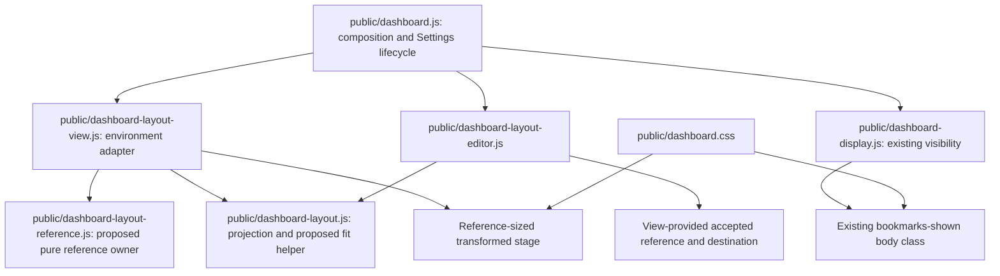

# Brooks-Lint Health Dashboard

## Table of Contents

- [Scope and Scores](#scope-and-scores)
- [Module Dependency Graph](#module-dependency-graph)
- [Top Findings](#top-findings)
- [Test Suite Map and Validation](#test-suite-map-and-validation)
- [Recommendation](#recommendation)

## Scope and Scores

**Mode:** Health Dashboard

**Scope:** Plan review of `tasks/51-fullscreen-reference-canvas/2-plan.md` at `ab3c9ba`, checked against the task goal and current custom layout, coordinator, display, and CSS behavior. This is a proposed-change assessment, not a completed implementation or whole-project audit. No `.brooks-lint.yaml` exists; balanced defaults apply. The working tree was clean before review.

**Composite Score:** 99/100

**Trend:** 100 → 99 (−1) compared with the latest Health Dashboard entry. That entry reviewed task 50 implementation changes; the scope differs, so this is not evidence of runtime deterioration.

- Code Quality: 95/100. One R2 Warning: global bookmark visibility still changes unrelated custom weather layout.
- Architecture: 100/100. The proposed pure reference owner and fitting helper preserve dependency direction and existing persistence ownership.
- Tech Debt: 100/100. No separate actionable finding; the new lifecycle state addresses actual reference estimation, confirmation, and editor-lock requirements.
- Test Quality: 100/100. The planned layered tests are appropriate; the missing content-reflow regression belongs to the R2 finding rather than a duplicate deduction.

Balanced scoring deducts five points for the Warning in Code Quality only. The weighted composite is `95 × 0.25 + 100 × 0.30 + 100 × 0.25 + 100 × 0.20 = 98.75`, rounded half-up to 99. The high score does not remove the need to address the Warning before implementation.

## Module Dependency Graph

Styling and injected-accessor arrows describe runtime relationships, not additional JavaScript imports. Reference observations stay behind the view adapter; neither model nor reference policy needs DOM, storage, network, or timers. Keeping one uniform transform and applying minimums only in reference space correctly separates fitting from canonical edits. The graph also exposes the existing visibility-to-content CSS coupling addressed below.

## Top Findings

### Warning

#### R2 Change Propagation: A canvas transform does not isolate weather content from fullscreen bookmark state

**Dimension:** Code Quality.

**Locations:** `2-plan.md:30,58-59,75-76,80,93`; existing `public/dashboard.css:70-73`, `public/dashboard-display.js:6,22`, and `public/dashboard.js:372`.

**Symptom:** The plan preserves fullscreen bookmark hiding and promises that the complete presentation scales uniformly, but it does not explicitly isolate custom card content from existing `.bookmarks-shown` rules. When `hideBookmarksFullscreen` is enabled, entering fullscreen removes that body class. This changes `#current-weather-values` from `flex: 1 1 10em` to its default flex behavior and changes `.forecast-temperature` from `white-space: normal` to `nowrap`. The current custom-surface selectors do not override those two decisions. A fixed reference-sized stage and `scale(s)` do not freeze stylesheet selection. The proposed child-size assertion can miss this if it observes an unaffected child rather than weather wrapping and flow.

**Source:** The Pragmatic Programmer — Orthogonality; A Philosophy of Software Design — Information Hiding and Leakage. Automatic group-composition decisions should not control the internal layout of independently positioned custom widgets.

**Consequence:** The outer rectangles can pass every uniform-fit assertion while weather content reflows or clips differently across fullscreen entry/exit. Users still see a rearranged widget despite the new canvas contract, and tests may attribute the change to legitimate scaling or bookmark hiding.

**Remedy:** Add an explicit plan step to audit and scope existing composition-dependent CSS for custom mode. Give custom weather values and forecast text a stable layout/wrapping policy independent of `.bookmarks-shown`; retain existing Automatic-mode behavior and intentional desktop/mobile differences. Add a browser regression with `hideBookmarksFullscreen: true`, visible weather/bookmarks, and representative long or narrow forecast content. Keep the same accepted reference and active profile, toggle the fullscreen bookmark state, and verify weather line wrapping, local child layout, and normalized child dimensions remain unchanged after accounting for the one canvas scale. Check the bookmark alone hides/restores, outer geometry fits, and no preference write occurs. Include this case in the deterministic fixture and retain real Fullscreen API transition coverage.

## Test Suite Map and Validation

- Existing model/DOM-adapter tests: two files with 30 runtime tests. They provide a starting point for pure fitting math, projection preservation, and view lifecycle checks, but cannot verify actual CSS wrapping through the fake DOM.
- Existing layout browser suite: one spec with 16 scenarios, including three tiny-surface cases. Its real-server/SQLite fixtures cover integration side effects; the proposed screen/reference fixtures and child-geometry assertions appropriately extend rendering coverage. Exact new scenario counts are not fixed yet.
- Proposed pure reference tests cover estimate/fallback validation, fixed reservations, confirmation retention, locked updates, context changes, and zero/invalid state. Proposed browser tests cover actual transformed boxes/content, editor coordinates, delayed fullscreen observations, tiny-surface fitting, no-write behavior, and cross-browser sharing. These layers protect different risks rather than duplicating the same assertion unnecessarily.
- A non-persisted Chromium experiment loaded the production stylesheet and a fixed 200×200 custom weather card at a fixed desktop viewport. Toggling only `bookmarks-shown` changed a long forecast temperature's actual height from 38px to 19px, changed `white-space` from `normal` to `nowrap`, and changed weather values flex from `1 1 160px` to `0 1 auto`. Card and viewport dimensions did not change. This demonstrates the existing coupling; it is not a test of the unimplemented reference canvas.
- The plan correctly documents screen-size estimation limits, first-confirmation correction, session-local references, fixed reservation tradeoffs, profile switching, and small scaled control targets. Those deliberate choices are not additional findings. Fullscreen settlement generation/cleanup and queued reference updates remain important implementation obligations, already covered in the plan.
- No application suite was rerun during this plan review. The proposed implementation does not exist yet. No implementation code, tests, package versions, plan text, user data, live services, or `todo.md` were changed.

## Recommendation

Update the plan to isolate custom widget content from Automatic-layout composition CSS and add the fullscreen bookmark-hiding weather regression before implementation. The reference/fitting architecture and canonical-data preservation strategy are otherwise suitable. Keep the inherited polling/editor ownership warning separate; this review neither resolves it nor authorizes expanding this task into its fix. Only this review report and review history are committed in this stage.
