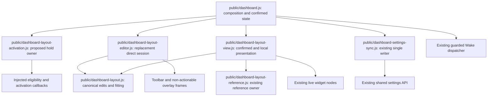

# Brooks-Lint Health Dashboard

## Table of Contents

- [Scope and Scores](#scope-and-scores)
- [Module Dependency Graph](#module-dependency-graph)
- [Top Findings](#top-findings)
- [Test Suite Map and Validation](#test-suite-map-and-validation)
- [Recommendation](#recommendation)

## Scope and Scores

**Mode:** Health Dashboard

**Scope:** Plan review of `tasks/52-direct-dashboard-layout-editing/2-plan.md` at `a727f0b`, checked against the task goal and existing layout, reference-lock, preference synchronization, Settings, and Wake action boundaries. This assesses the proposed replacement, not a completed implementation or the whole project. The working tree was clean before review. No `.brooks-lint.yaml` exists; balanced defaults apply.

**Composite Score:** 100/100

**Trend:** 99 → 100 (+1) compared with the most recent Health Dashboard entry. That entry reviewed an earlier task 51 plan; the scope differs, so the change does not demonstrate a runtime improvement or resolution of an inherited issue.

- Code Quality: 100/100. The plan makes draft, gesture, snapshot, and pending-write ownership explicit and removes the old Settings coupling rather than retaining two editors.
- Architecture: 100/100. Geometry, reference measurement, action dispatch, and shared persistence retain their existing owners; the new activation module has a narrow purpose.
- Tech Debt: 100/100. No speculative framework, duplicated writer, schema change, or unjustified cleanup is proposed.
- Test Quality: 100/100. Deterministic state tests and real-browser safety/geometry tests address distinct risks; existing behavioral coverage must migrate rather than disappear.

No Critical, Warning, or Suggestion findings within this plan scope. All four dimensions apply to the proposed changes, yielding `100 × 0.25 + 100 × 0.30 + 100 × 0.25 + 100 × 0.20 = 100`. This score is not implementation or release approval.

## Module Dependency Graph

Injected-callback and DOM arrows describe runtime relationships, not new JavaScript imports. The coordinator remains the composition root. The editor can request an existing save or a temporary projection without importing a server/store or owning another synchronizer. A shared fit/frame measurement contract avoids parallel live/overlay geometry algorithms. Exclusive Settings/direct sessions are especially important because the current reference owner uses a boolean lock, not nested lock ownership.

## Top Findings

None requiring a plan revision. The following high-risk boundaries have concrete treatment rather than being left to incidental implementation behavior:

- **Live action safety:** Real widget roots become inert, overlays contain no cloned actions, capture guards reject underlying activation, and the injected Wake callback has its own edit-state guard. This addresses the actual row handler in `public/dashboard-device-view.js:38`, which invokes its callback directly and can otherwise receive synthetic dispatch despite inertness. Pending controller/button state remains owned by its existing provider.
- **Revision integrity:** Layout Save uses the complete captured preference baseline and captured revision. A 409 can update confirmed global state without replacing the local draft, matching the existing synchronizer's acceptance-before-rejection behavior. Settings saves retain the layout from their own matching baseline after its controls are removed. Explicit Reload, not a successful poll, replaces the edit base.
- **Transient input ownership:** Polling/loading emissions cannot initialize the draft, re-render focused raw values, cancel a gesture, or advance its revision. True pending writes disable mutation and exit; no-op Save avoids a PUT. These requirements directly address the ownership failure that affected the previous Settings layout editor without authorizing a general synchronizer rewrite.
- **Gesture and coordinate safety:** Hold detection does not capture/prevent native scrolling, uses screen-space cancellation tolerance, rechecks hit eligibility, and suppresses only the consumed pointer sequence's click-through. Manipulation uses a fixed canonical start and locked reference with the actual fit scale. Fit/context changes cancel the gesture rather than encoding stale transforms.
- **Explicit product tradeoffs:** Automatic entry shows a temporary template but retains canonical `null` until a real change; inactive-profile/hidden-widget editing does not enable content demand; tiny destinations can require numeric controls. Those documented choices avoid pretending Automatic flow is invertible or that every small rectangle can provide usable drag targets.

Coordinated markup, coordinator, view, editor, style, and test edits are justified by replacing one user-facing workflow. They are not evidence of Shotgun Surgery merely because several files change. The long-press/compatibility-click state is necessary interaction complexity, with a separate activation owner and explicit teardown, not speculative generality.

## Test Suite Map and Validation

- Existing model/reference/view coverage: three Node files with 40 runtime tests, as recorded by task 51 verification. Keep pure canonical edit and fit invariants; extend view coverage for temporary overrides and exact reference/inert cleanup. New activation/editor unit-test counts are not fixed yet.
- Existing browser layout coverage: one spec with 22 scenarios. The plan explicitly migrates these claims to direct controls or view-only checks, preserving minimum-clamp behavior, field isolation, touch capture, pending actions, shared conflicts, offline caches, tiny/reference bounds, fullscreen confirmation, and weather content stability.
- Proposed unit tests use injected time and event inputs for activation/session ownership. Proposed browser/integration tests use actual DOM hit testing, trusted mouse/touch/keyboard input, navigation/action counters, complete preference payloads/revisions, and owned real-server/SQLite fixtures. These assertions verify behavior and side effects, not only mock calls or style strings.
- Planned tests specifically cover the dangerous transitions: release after chrome appears, second pointers, long-press context menus, native scrolling, focused invalid fields across polls, a pending Wake completing during editing, a remote layout update while unrelated Settings is dirty, pending-save exit refusal, explicit Reload after conflict, and stale callbacks after teardown. The test portfolio fits the rendering/action risk; fake DOM tests alone are not treated as sufficient.
- This review inspected the written plan and existing ownership boundaries. No application suite or browser experiment was run during this plan review because the proposed direct editor does not exist yet. Prior suite counts are context, not a new verification claim.
- The plan remains unchanged. No implementation, tests, dependencies, package versions, user data/configuration, live services, or `todo.md` were modified in this stage.

## Recommendation

Proceed with the plan; no plan revision is required by this review. Establish the activation/session safety tests before connecting real direct manipulation or Save, and retain action counters and complete revision assertions throughout the migration. Keep the reference lock single-owner, publish only explicit changed saves, and require evidence that removal of the old Settings editor does not recreate its polling ownership bug. Final implementation review must verify those guarantees in working code; this review does not declare the inherited warning resolved.
