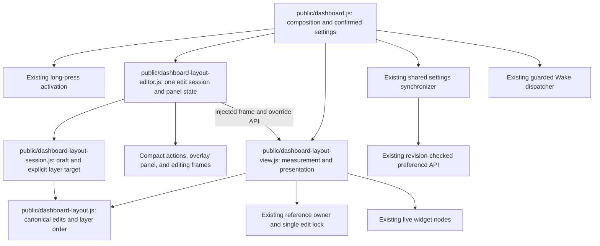

# Brooks-Lint Health Dashboard

## Table of Contents

- [Scope and Scores](#scope-and-scores)
- [Module Dependency Graph](#module-dependency-graph)
- [Top Findings](#top-findings)
- [Test Suite Map and Validation](#test-suite-map-and-validation)
- [Recommendation](#recommendation)

## Scope and Scores

**Mode:** Health Dashboard

**Scope:** Plan review of `tasks/53-dashboard-size-editing-toolbar/2-plan.md` at `7b9e852`, compared with the revised task goal and the current view, editor, session, geometry, and test boundaries. Code Quality evaluates the committed plan change and its proposed change surface, not a completed application PR. The working tree was clean before review. No `.brooks-lint.yaml` exists; balanced defaults apply.

**Composite Score:** 100/100

**Trend:** Stable at 100 compared with the previous Health Dashboard entry, which reviewed task 52's plan. These are different plan scopes; this is not evidence of runtime improvement or implementation correctness.

- Code Quality: 100/100. The change is bounded to editing chrome, destination measurement, explicit widget targeting, and their regressions. Existing manipulation and save ownership remain explicit.
- Architecture: 100/100. Panel visibility is presentation state, canonical layer ordering stays in the existing model/session, and persistence remains behind the coordinator's single writer.
- Tech Debt: 100/100. The plan removes the measurement coupling responsible for shrinking without introducing frozen destinations, a separate z-index representation, another editor, or a generic interaction framework.
- Test Quality: 100/100. Before/after live geometry and content assertions, pure target/order invariants, raw-input transitions, and retained real-browser action/save regressions match the proposed risks.

No Critical, Warning, or Suggestion findings in this plan scope. Applying all four dimensions to the proposed plan change yields `100 × 0.25 + 100 × 0.30 + 100 × 0.25 + 100 × 0.20 = 100`. This score does not approve an implementation that has not yet been written.

## Module Dependency Graph

Arrows describe relevant ownership/runtime dependencies as well as imports; the editor's view API and save callback remain injected. The composition root's concrete fan-out is intentional. Neither the panel nor the layer controls add a dependency from canonical geometry to DOM, network, or database details. Both inline and panel layer buttons converge on one command path instead of owning separate ordering rules.

## Top Findings

None requiring a plan revision. The principal change risks are already diagnosed and given concrete ownership, behavior, and verification requirements:

- **Stable geometry:** `public/dashboard-layout-view.js:15-18,105` currently measures and observes the toolbar. The plan removes both links and preserves the ordinary page-tools footprint, including its hidden-but-measured edit state. It also explicitly rejects freezing the destination, so viewport, caption/status, safe-area, and fullscreen changes still work. This treats chrome visibility and dashboard fitting as separate concerns rather than merely hiding the visible shrinking symptom.
- **Unchanged manipulation:** The plan retains the existing move button, selected upper-right resize handle, fixed-start scale conversion, pointer capture, and cancellation rules. Layer controls are separate buttons, with their own boundary/tiny-surface eligibility rather than reuse of the editor's current all-buttons geometry-disable loop. Toggling details is a visibility operation, not a call to draft initialization, projection, or gesture cancellation.
- **Raw fields and focus:** `public/dashboard-layout-editor.js:125-127` commits and validates on native change. Hiding a focused field can therefore invoke existing behavior at the wrong boundary. Plan lines 38-40,65,80,107 explicitly require preserving raw values, preventing hidden validation refocus, revealing invalid fields on Save, and testing close/reopen across polls. This remains an implementation checkpoint, but the plan does not leave the failure mode unrecognized or require an unrelated input-framework rewrite.
- **Per-widget model integrity:** The session currently targets `selected` in `layer(action)`. The planned explicit-target extension, previous-selection validation, and per-widget boundary computation address nonselected row buttons without translating Up/Down into position edits. Canonical array order remains the sole z-index representation. Boundary identity and Automatic no-op semantics stay intact; all button variants share the same mutation handler.
- **Access versus target size:** Inline pairs can be hidden when they would crowd move/resize targets, while six stable panel rows preserve hidden/covered/tiny-widget access. The nonmodal overlay may cover part of the dashboard, an explicit tradeoff for unchanged sizing; the plan provides dismissal, exposed-handle interaction, and a selector rather than moving widgets to compensate.
- **Save/action isolation:** Panel state cannot release inert roots, rebase the captured preferences/revision, configure providers, or create writes. Closed-panel saving/error/offline feedback remains visible. Pending writes retain mutation/exit protection, and the plan preserves stale row dispatch, pending Wake completion, no-autosave, conflict, offline Reload, and disposal tests instead of assuming a chrome change cannot affect them.

Coordinated edits to markup, CSS, view, editor, session, and their tests belong to the same layout-editing context; they are not unrelated change propagation. Repeating Up/Down affordances in frames and the panel is justified by accessibility and overlap, provided the planned single command path owns their behavior. Retaining existing selected-widget front/back actions preserves the goal's existing capabilities rather than adding speculative abstraction.

## Test Suite Map and Validation

- Existing pure tests cover activation timers/events, session baselines and Automatic transitions, model geometry/layers, reference acceptance, and DOM-like view ownership in five focused files. Task 52 recorded 68 focused tests and 429 total Node tests. New coverage extends these established seams for explicit target IDs and chrome-independent measurements rather than mocking an entire dashboard to prove pixels.
- Existing browser layout coverage consists of 34 scenarios in `e2e/dashboard-layout.spec.js`, including an isolated real-DOM editor fixture and real-server/SQLite cases. Task 52 recorded 136 total browser tests and 10 focused Firefox cases. Counts describe inherited verification only; the number of new task 53 scenarios is not yet fixed.
- Geometry tests will compare actual canvas transforms, live border boxes, and representative child/text measurements before entry, after entry, with details open/closed, and after Cancel. They distinguish Automatic templates, inactive profiles, queued reference acceptance, and real viewport changes from prohibited chrome-induced scaling. A failing characterization before the fix is explicitly required.
- Interaction tests cover mouse, touch, keyboard, native short windows, fullscreen, fit-preserving toggles during capture, invalid/partial raw inputs, focus restoration, dynamic boundary buttons, and all six layer targets. Stable frame/row identities and real hit testing provide stronger evidence than mock call counts alone.
- Persistence/action assertions retain complete preference payloads, captured revisions, exact untouched geometry/profile records, real store revisions, zero unintended requests, provider/timer owners, bookmark popups, and detached stale Wake handlers. These are observable side effects, not private callback-order contracts.
- The helper migration explicitly separates entering editing from opening details. This avoids a helper that always opens the panel and accidentally leaves closed-panel manipulation untested. Keeping the original 34 behavioral claims does not require retaining obsolete selectors or entry-focus assumptions.
- This review read the plan, revised goal, and relevant existing implementation/tests. No application tests or browser experiments were run during this documentation-only review. The plan, implementation, dependencies, versions, user data/configuration, historical task records, and `todo.md` were not changed; only this review and the required health-history entry are recorded.

## Recommendation

Proceed with the plan; no revision is required by this review. Start with the before/after canvas-and-content regression, then isolate panel visibility from measurement/session mutation before adding per-widget buttons. Implementation review should verify native blur/change dismissal ordering, per-widget target and boundary states, stable focus/DOM identity, and real short-window access rather than treating this plan score as proof those guarantees already work.
