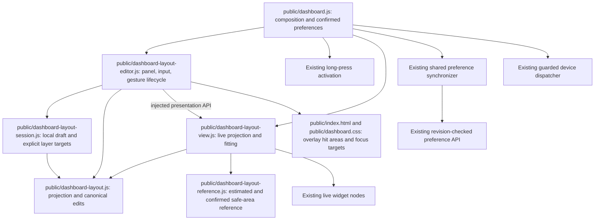

# Brooks-Lint Health Dashboard

## Table of Contents

- [Scope and Scores](#scope-and-scores)
- [Module Dependency Graph](#module-dependency-graph)
- [Top Findings](#top-findings)
- [Test Suite Map and Verification](#test-suite-map-and-verification)
- [Recommendation](#recommendation)

## Scope and Scores

**Mode:** Health Dashboard

**Scope:** Current branch `53-dashboard-size-editing-toolbar` relative to its actual base, `52-direct-dashboard-layout-editing` at `6643f46`. The reviewed snapshot includes committed implementation `800fa1c` and all 11 pre-existing uncommitted fullscreen/full-canvas follow-up files, totaling 18 changed paths relative to the base. This is not a review of every earlier task on the accumulated branch chain. No `.brooks-lint.yaml` exists; balanced defaults apply.

**Composite Score:** 99/100

**Trend:** 100 → 99 (−1) compared with the previous Health Dashboard entry, task 53's plan review. A plan review and implementation review have different evidence; the score change is not a measured runtime quality trend.

- Code Quality: 94/100. One Warning and one Suggestion concern interaction behavior introduced by the uncommitted fullscreen/full-canvas follow-ups.
- Architecture: 100/100. Canonical layer order, geometry, reference ownership, injected presentation, and the existing sole preference writer retain their boundaries.
- Tech Debt: 100/100. No additional systemic decay finding. Repeated layer affordances share one command path rather than separate ordering models.
- Test Quality: 100/100. No separate T1/T2 structural finding in the abbreviated scan. The runtime findings below expose missing interaction regressions; a passing suite does not establish their absence.

Balanced scoring deducts 5 for the Warning and 1 for the Suggestion from Code Quality only. The weighted result is `94 × 0.25 + 100 × 0.30 + 100 × 0.25 + 100 × 0.20 = 98.5`, rounded half-up to 99. Global finding counts are zero Critical, one Warning, and one Suggestion; the same defect is not deducted again in another dimension.

## Module Dependency Graph

Arrows include injected runtime and DOM ownership as well as module imports. The changed modules add no database/network dependency to geometry or session policy and introduce no import cycle. Overlay hit testing and focus eligibility are the remaining cross-boundary integration problems, not a reason to introduce another editor or interaction framework.

## Top Findings

### Warning

**F1 — R2 Change Propagation: the transparent windowed tools header blocks newly reachable widget content**

- **Location:** `public/dashboard.css:10,218-219`; `public/dashboard-layout-view.js:9-14`. Introduced by the uncommitted full-canvas follow-up.
- **Symptom:** Custom widgets can now occupy the entire viewport, but `.page-tools` is a full-width fixed header above them with default pointer hit testing. Its transparent left/empty area intercepts clicks even where there is no button. In an owned 1280 × 720 windowed fixture, a diagnostic bookmark anchor inside a full-canvas Bookmarks widget had its center near `(83.2, 21.5)`. Both Chromium and Firefox returned `HEADER.page-tools` from `elementFromPoint()` there; a trusted mouse click left the anchor's click counter at zero. Editing was not active, so inert action blocking was not responsible.
- **Source:** *The Pragmatic Programmer* — Orthogonality. Expanding layout geometry has become accidentally coupled to unrelated normal widget navigation through an invisible overlay hit region.
- **Consequence:** A bookmark or device control placed beneath the empty top header area can appear available but fail to respond in normal windowed mode. The fullscreen Save hit-test regression does not catch this because ordinary page tools are hidden in fullscreen and editing intentionally disables live actions.
- **Remedy:** Make unused normal-tools overlay space pointer-transparent while retaining pointer handling on its real interactive children. Keep the buttons above widgets and preserve background-only fullscreen Settings/Exit controls. Add trusted windowed widget-link/action tests beneath the empty header region, plus checks that the actual page-tools buttons still work. No fix was applied during this review.

### Suggestion

**F2 — R2 Change Propagation: fullscreen hiding invalidates the edit-exit focus fallback**

- **Location:** `public/dashboard.css:222`; `public/dashboard-layout-editor.js:111-116,118-125`. Introduced by the uncommitted fullscreen hiding change interacting with the existing restoration policy.
- **Symptom:** `restoreFocus()` checks the original target's visibility but falls back unconditionally to `#edit-layout`, including a second unconditional focus attempt after removing a temporary anchor. That button is now `display: none` in fullscreen. Reproduction in both Chromium and Firefox: enter editing through Edit layout while windowed, request fullscreen, click Cancel, then wait two animation frames. The editor is closed, Edit layout has no visible box, and `document.activeElement` is `BODY` rather than a visible restored focus target.
- **Source:** *Code Complete* — Defensive programming and boundary validation; *The Pragmatic Programmer* — Orthogonality. A presentation visibility change invalidated an assumption in a separate lifecycle path without updating its fallback eligibility.
- **Consequence:** Keyboard focus loses its editing context after fullscreen Cancel. Successful Save shares the same exit/restoration path, although the focused reproduction exercised Cancel. This is not a keyboard trap or a demonstrated data-loss issue, hence Suggestion severity.
- **Remedy:** Validate fallback visibility/focusability as well as the original target. Choose a visible, safe destination when Edit layout is intentionally hidden, without releasing action blocking early or leaking temporary attributes. Add fullscreen Cancel and successful/no-op Save focus assertions after rendering settles, not only a post-exit-windowed assertion. No fix was applied during this review.

## Test Suite Map and Verification

- The Node runner combines pure unit, DOM-like lifecycle, database/API integration, and process tests rather than tagging them into separately countable levels. This review reran `npm test -- --test-timeout=10000`: **433 passed**, zero failed/skipped/canceled. Relevant small tests cover explicit layer targets, unchanged canonical rectangles and profiles, Automatic boundaries, safe-only reference dimensions, visual viewport offsets, and chrome-independent measurement.
- Browser coverage currently contains **143 scenarios overall**, including **41 layout scenarios**. The preceding implementation verification recorded the full Chromium suite passing and six focused Firefox cases passing; those full-suite counts are prior verification, not new full runs in this review.
- This review freshly reran five Chromium scenarios covering fullscreen edge drag/save, raw dismissal, capture-preserving toggles, all-widget layers, and native short-window controls: **5 passed**. The existing tests use observable geometry, payload/store revisions, hit testing, and real input rather than only mock call order.
- Additional review-only diagnostics ran against the current application with an owned in-memory SQLite server and actual Chromium/Firefox. A bookmark anchor was injected into the existing Bookmarks widget to isolate native hit testing and trusted click dispatch; no live provider account or real Wake packet was used. Both engines reproduced F1. Both reproduced F2 after two settled animation frames. The temporary diagnostic script lives outside the repository at `/tmp/opencode/task53-review-probe.mjs`; reproduction details are retained above rather than depending on that temporary file's continued existence.
- The positive regression suite and these negative probes are compatible: current coverage verifies editing chrome above widgets, but not normal windowed controls' empty hit area; it verifies focus after exiting fullscreen before Cancel, but not Cancel while the fallback remains hidden. Add those missing assertions with the fixes rather than treating the aggregate score/counts as approval.
- `git diff --check` passed during review. No implementation or test source was modified in this stage. Only this review and the required health-history record are committed. The 11 uncommitted follow-up files remain unchanged and uncommitted; `4-implemented.md` remains the historical record of `800fa1c`, not a rewritten report of later work.

## Recommendation

Fix F1 before merging the reviewed full-canvas follow-up: allowing geometry beneath a decorative overlay should not disable ordinary widget interactions beneath its empty area. Address F2 in the same narrow interaction-safety follow-up and add settled focus coverage. Keep the current model/session/synchronizer boundaries, immutable save baseline, no-autosave behavior, and existing action guards; these findings do not justify a broader redesign. No fixes, version changes, push, merge, or release were performed in this review.
