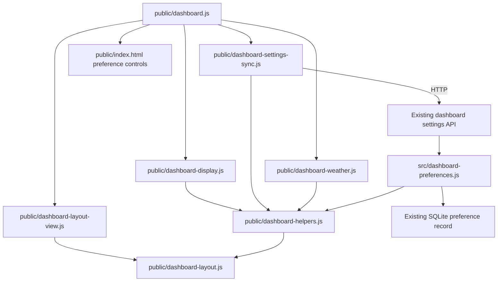

# Brooks-Lint Health Dashboard

- [Brooks-Lint Health Dashboard](#brooks-lint-health-dashboard)
  - [Scope and scores](#scope-and-scores)
  - [Module Dependency Graph](#module-dependency-graph)
  - [Top Findings](#top-findings)
  - [Test suite map and validation](#test-suite-map-and-validation)
  - [Recommendation](#recommendation)

## Scope and scores

**Mode:** Health Dashboard

**Scope:** Plan review of `tasks/54-widget-forecast-visibility/2-plan.md` at `46b8943`, checked against `1-goal.md` and the existing preference, display, weather, and layout boundaries. All four dimensions assess the proposed change, not whole-project health or an implementation that does not yet exist. The working tree was clean. No `.brooks-lint.yaml` exists; balanced defaults apply.

**Composite Score:** 100/100

**Trend:** Stable at 100 against the last comparable plan review, task 53. The latest Health Dashboard entry is a different branch review scored 99; neither comparison demonstrates runtime improvement.

- Code Quality: 100/100. The plan names the preference fields, defaults, UI placement, update paths, and acceptance criteria. Coordinated edits remain within the dashboard feature rather than unrelated modules.
- Architecture: 100/100. Shared schema decoding, pure display projection, DOM rendering, layout geometry, and integration request ownership retain separate responsibilities.
- Tech Debt: 100/100. The design extends existing bookmark fullscreen behavior without a second preference store, new fullscreen layout model, or speculative framework.
- Test Quality: 100/100. Proposed coverage addresses migration, save conflicts, remote updates, actual browser visibility, Custom layout preservation, and unintended request/timer side effects.

No Critical, Warning, or Suggestion findings. Weighted score: `100 × 0.25 + 100 × 0.30 + 100 × 0.25 + 100 × 0.20 = 100`. Code Quality assesses the committed plan and proposed change surface, so its weight is retained.

## Module Dependency Graph

Arrows represent relevant imports and runtime ownership, not a complete import graph. Display projection stays independent of database and request details. Server reuse of the browser-safe schema is an established boundary, not a new dependency inversion.

## Top Findings

None requiring a plan revision. The following material risks already have concrete safeguards:

- **Schema expansion:** `public/dashboard-helpers.js:64-73` rejects incomplete writes and explicitly upgrades stored records. Plan lines 24-25 and 52 preserve this separation, including shared caches, explicit false values, invalid values, and revisions. This addresses backward compatibility without weakening validation, consistent with *Software Engineering at Google*.
- **Visibility precedence:** `public/dashboard-display.js:4-23` owns effective visibility and collapsed groups. Plan lines 37-41 apply fullscreen flags after the active profile and recompute wrappers from effective values. Centralizing the decision follows Orthogonality in *The Pragmatic Programmer* and avoids duplicate fullscreen rules in layouts or service controllers.
- **Weather callback consistency:** `public/dashboard.js:94-127` renders forecasts independently of layout application. Plan lines 45-48 put list visibility in this render path and require re-rendering on confirmed preference changes, preventing subsequent weather callbacks from restoring hidden lists. Existing `[hidden] { display: none !important; }` in `public/dashboard.css:8` already covers forecast flex rules; additional CSS is not currently indicated.
- **Layout and lifecycle isolation:** The layout view reparents live widgets for Custom profiles, while `fullscreenState` already invokes display application. Plan lines 39-41 and 56 preserve these paths and saved geometry without changing timer or integration ownership. Retaining clock activity when only fullscreen-hidden is deliberate presentation-only behavior, not a missing timer optimization.
- **Scope and simplicity:** Per-widget fullscreen hiding and shared forecast flags are explicit interpretations of the goal. Preserving existing bookmark preferences and filename captions avoids inventing another fullscreen mode. These bounded additions do not exhibit the Second-System Effect from *The Mythical Man-Month*.

## Test suite map and validation

- Static inventory: `test/` contains 50 JavaScript files and 351 statically declared test calls across unit, DOM-adapter, and real-server/SQLite integration coverage. `e2e/` contains eight JavaScript files, including support setup, and 114 statically declared browser test calls. Loop-generated cases mean these are not runtime test totals.
- Existing seams include pure display projection, injected settings synchronization dependencies, isolated SQLite stores, deterministic browser routes, and real fullscreen/layout tests. The plan extends these rather than introducing test-only production APIs.
- Schema/cache tests protect upgrade and authority boundaries; display tests protect precedence and wrapper invariants; browser tests protect actual fullscreen, markup controls, and Custom layout behavior. These layers target distinct risks rather than merely repeating line coverage.
- Proposed unavailable-data, later-callback, remote-save, dirty-draft, and stale-revision scenarios cover meaningful failure transitions. Request and persisted-geometry assertions protect observable side effects, not private callback order.
- No application tests were run: this is a documentation-only plan review. No implementation, plan, version, dependencies, user configuration, or `todo.md` was modified.

## Recommendation

Proceed without a required plan revision. Implement schema/default decoding first, then effective widget projection and forecast rendering, followed by controls and regression tests. During implementation review, verify real fullscreen transitions, updates while already fullscreen, retained dirty drafts, and unchanged provider/timer ownership; this plan score is not proof of implementation correctness.
