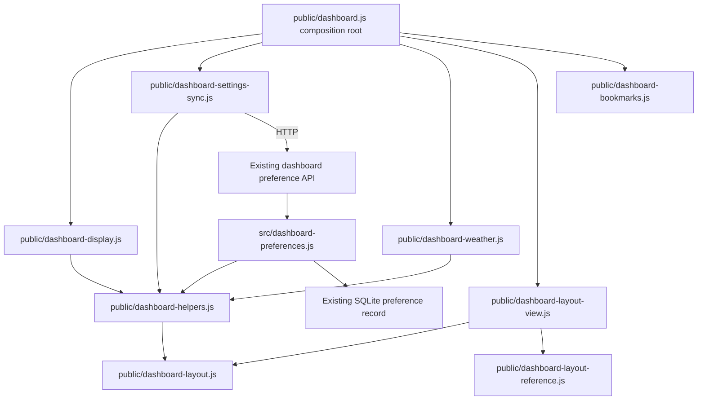

# Brooks-Lint Health Dashboard

- [Brooks-Lint Health Dashboard](#brooks-lint-health-dashboard)
  - [Scope and scores](#scope-and-scores)
  - [Module Dependency Graph](#module-dependency-graph)
  - [Top Findings](#top-findings)
  - [Test suite map and validation](#test-suite-map-and-validation)
  - [Recommendation](#recommendation)

## Scope and scores

**Mode:** Health Dashboard

**Scope:** All changes on `54-widget-forecast-visibility` relative to its base `main`: `d00c8f2...c9405d4`, one commit, 16 changed files. Reviewed production changes, surrounding display/weather/layout lifecycle code, all test changes, documentation, version files, and the implementation record. Working tree was clean before review. No `.brooks-lint.yaml` exists; balanced defaults apply.

**Composite Score:** 100/100

**Trend:** Stable at 100 against the previous Health Dashboard entry, task 54's plan review. Plan and implementation are different review scopes; this does not establish complete runtime correctness.

- Code Quality: 100/100. Changes are small extensions of existing preference, render, and snapshot paths. No unrelated propagation or new cognitive-overload finding.
- Architecture: 100/100. No new production imports or dependency cycles. The pure projection owns fullscreen precedence; weather rendering owns forecast list visibility; existing storage and request owners remain intact.
- Tech Debt: 100/100. No new persistence mechanism, alternate layout geometry, or speculative abstraction. Existing compatibility fields remain supported without obsolete visible controls.
- Test Quality: 100/100. Added tests distinguish pure precedence, stored upgrades, cache authority, real controls, remote drafts, and Custom geometry. No concrete new T1/T2 finding was identified. Browser execution remains blocked as described below.

No Critical, Warning, or Suggestion code findings. Composite calculation: `100 × 0.25 + 100 × 0.30 + 100 × 0.25 + 100 × 0.20 = 100`. Scores describe diagnosed structural risks, not a successful browser test run.

## Module Dependency Graph

Arrows include relevant imports and runtime dependencies, not a complete graph. Composition-root fan-out is intentional. Neither display policy nor geometry gained dependencies on database or network details, consistent with the Dependency Rule in *Clean Architecture*.

## Top Findings

None identified within the branch scope. Material checks completed:

- `public/dashboard-display.js:4-17` applies fullscreen flags to a newly resolved display object before calculating wrapper and column visibility. Existing settings remain unchanged, disabled profile widgets stay disabled, and all-hidden/caption-only states retain background-only handling. Both Automatic and Custom layouts receive the same effective projection. This preserves Orthogonality from *The Pragmatic Programmer* rather than duplicating fullscreen policy in layout renderers.
- `public/dashboard-helpers.js:42-45,73-75` adds defaults only before stored values are spread, then validates the complete record. Explicit values override defaults; invalid booleans and unknown fields remain errors. Existing server storage and shared browser caches use this decoder. Current writes still require the complete schema, matching the deliberate upgrade contract rather than silently accepting incomplete old-client writes. This follows backward-compatibility discipline in *Software Engineering at Google*.
- `public/dashboard.js:107-110,215,232` reapplies forecast visibility during every weather render and on confirmed preference changes. Fullscreen flags use the existing visibility/layout path without reconfiguring weather, calendar eligibility, clock timers, or photos. The global hidden-attribute CSS rule overrides forecast flex display. Current conditions, air quality, and successful update timestamps are not made dependent on forecast-list flags.
- `public/index.html:92-100,131-135,156` provides one form-associated control per preference and retains the hidden compatibility field. Existing browser tests were updated to select General before changing bookmark fullscreen visibility; bookmark selection and disclosure checks remain present.
- The schema and render extensions stay within one dashboard context. Their file count alone is not Shotgun Surgery, and adding a generic preference/layout framework would not be justified by this feature, consistent with *Refactoring* and the Second-System Effect caution in *The Mythical Man-Month*.

## Test suite map and validation

- Focused Node coverage spans four pure/DOM-adapter display tests, fourteen schema/API/SQLite tests, and thirteen injected settings-sync tests. These 31 tests exercise distinct boundaries; shared migration cases are not redundant browser tests.
- Full Node suite: `npm test` passed all 436 tests with zero failures or skips during this review. Output: `/tmp/opencode/54-review-node-tests.log`. This total includes unit, integration, lifecycle, and discovered fixture modules; it is not a pure unit-test count.
- Browser suite: 151 discovered scenarios across the existing eight JavaScript files, including setup support. Eight new scenarios cover fullscreen widgets at 1200/601/600px, fullscreen remote drafts, forecast combinations at 601/600px, later forecast updates, and Custom profile geometry/layers. Existing slideshow/timer coverage is extended separately.
- `npm run check` passed. `git diff --check` passed for the reviewed branch. Source inspection confirms both version files agree on `0.17.23` and no dependency versions changed.
- A read-only Node VM experiment evaluated the actual `renderWeather` function body with minimal DOM adapters. All sixteen combinations of hourly/daily visibility and populated/empty/missing/later forecast states passed. This checks render decisions but cannot validate CSS layout, browser focus, fullscreen policy, or real event ordering.
- `npm run test:browser -- --max-failures=1` was attempted again. Chromium could not launch because `/home/container/.cache/ms-playwright/chromium_headless_shell-1243/chrome-headless-shell-linux64/chrome-headless-shell` is missing. One test failed before application execution and 150 did not run. This is an environment verification blocker, not evidence that those behavioral assertions pass or fail.
- No fixes, implementation edits, dependency installations, version changes, or changes to `todo.md` were made during review. Only this report and the required health-history entry are recorded.

## Recommendation

No code changes are required by this review. Browser sign-off remains outstanding: install the matching browser with `npx playwright install chromium`, then run `npm run test:browser` before treating the branch as fully verified. Prioritize actual fullscreen transitions, remote updates while fullscreen, and Custom layout restoration; passing Node tests and the structural score do not replace those checks.
