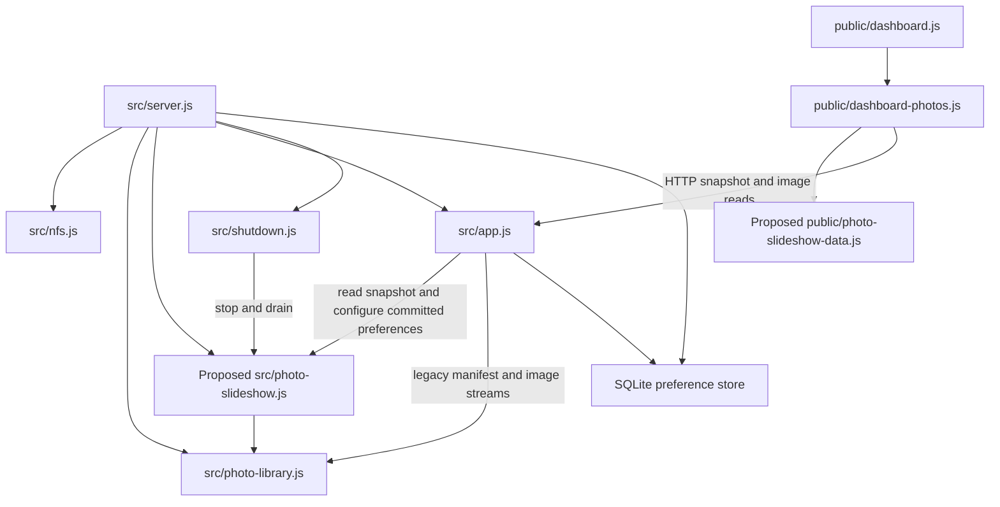

# Brooks-Lint Health Dashboard

- [Brooks-Lint Health Dashboard](#brooks-lint-health-dashboard)
  - [Scope and scores](#scope-and-scores)
  - [Module Dependency Graph](#module-dependency-graph)
  - [Top Findings](#top-findings)
    - [Warning](#warning)
  - [Test suite map and validation](#test-suite-map-and-validation)
  - [Recommendation](#recommendation)

## Scope and scores

**Mode:** Health Dashboard

**Scope:** Plan review of `tasks/55-server-managed-photo-rotation/2-plan.md` at `727a20d`, checked against `1-goal.md`, photo discovery/streaming, server startup/shutdown, settings routes, browser control, and existing test fixtures. Scores assess the proposed change, not implemented behavior or whole-project health. The initial working tree was clean. No `.brooks-lint.yaml` exists; balanced defaults apply.

**Composite Score:** 99/100

**Trend:** 100 → 99 compared with the latest Health Dashboard record. That record reviews task 54's branch, so this difference does not establish codebase regression.

- Code Quality: 100/100. The plan specifies ownership, lifecycle operations, state relationships, configuration effects, and acceptance criteria. Coordinated edits belong to one feature migration.
- Architecture: 100/100. One process-owned service controls selection; HTTP exposes snapshots; browsers own decoding and presentation. The composition root and shutdown coordinator retain resource ownership.
- Tech Debt: 95/100. One Warning: discovery and transport limits lack an explicit producer-side compatibility rule.
- Test Quality: 100/100. Injected clocks/randomness, real API/store coverage, and browser convergence scenarios protect distinct risks. No additional T1/T2 finding is supported by the proposed test design.

One Warning, no Critical or Suggestion findings. Balanced scoring deducts five points from Tech Debt only. Weighted score: `100 × 0.25 + 100 × 0.30 + 95 × 0.25 + 100 × 0.20 = 98.75`, rounded half-up to 99. Code Quality evaluates the committed plan and proposed change surface, so its weight is retained. The same finding is not deducted again from another dimension.

## Module Dependency Graph

Arrows represent relevant existing and proposed imports or runtime dependencies, not a complete import graph. The shared contract should also govern server-published records; its exact server call site remains an implementation choice. No proposed cycle or domain dependency on browser DOM APIs is apparent. The composition root's concrete dependencies are intentional.

## Top Findings

### Warning

**R2 — Change Propagation: align accepted filenames with the bounded snapshot contract.**

- **Symptom:** Plan lines 26–28 require bounded, strictly valid current-photo metadata, and line 66 caps the response body at 8 KiB. However, lines 35–43 do not specify how the service handles library records outside those bounds before selecting them. `src/photo-library.js:32–64,81` accepts nested relative names without a transport-length or control-character restriction. Filesystem-valid names can therefore fail the new schema; deeply nested names containing JSON-escaped control characters can also exceed the body cap. Existing browser filtering at `public/dashboard-photos.js:39` is not a producer guarantee.
- **Source:** *A Philosophy of Software Design* — Information Hiding and Leakage; *The Pragmatic Programmer* — DRY. The accepted-photo decision crosses discovery, sequence ownership, and browser validation without one explicitly enforced transport contract.
- **Consequence:** The server can select a record that every browser rejects. Browsers then retain a prior background or show fallback while the server reports an available current image. With a single unrepresentable photo, retries never recover; with mixed pools, display failures recur on each traversal. Parser-only rejection tests do not prove the producer emits valid snapshots.
- **Remedy:** Amend steps 1, 2, and 6 to define concrete relative-name and serialized UTF-8 byte limits and apply the shared record contract before records enter the service's eligible pool. Preserve opaque streaming identity and define deterministic handling of unrepresentable names, including the all-rejected case and reported count. Keep the legacy manifest contract intact. Add a library/service/API round-trip test using valid deep paths, non-ASCII names, and JSON-escaped characters; prove every published snapshot validates and remains within 8 KiB. The client must continue rejecting malformed external responses.

## Test suite map and validation

- Existing unit/controller coverage: `test/dashboard.test.js` includes injected photo decoding and scheduling; `test/shutdown.test.js` covers lifecycle ownership. These files also contain other test layers, so file totals are not unit-case totals.
- Existing integration coverage: `test/photo-library.test.js` has six real-filesystem cases. `test/dashboard.test.js` includes a protected photo API case; HTTP/server shutdown and settings tests cover real owner/store boundaries.
- Existing browser coverage: seven `.spec.js` files plus `e2e/server-setup.js`. Global setup starts the production server with NFS disabled. `e2e/background-display-options.spec.js:12–21` already demonstrates isolated in-process server/store fixtures, a suitable pattern for a real slideshow fixture with injected time.
- Planned additions: two focused unit files for service/schema behavior, one real-server API file, and one browser spec, with extensions to library/controller/shutdown coverage. Exact new case counts are not specified. Keep sequence combinatorics in unit tests, authority/persistence/security in API tests, and actual decoding/convergence/resume in browser tests.
- The plan explicitly avoids statistical randomness, wall-clock sleeps, and testing only callback invocation. Assertions about reads not advancing state, unchanged snapshots not decoding twice, and shutdown not succeeding before actual drain protect observable contracts.
- Already addressed risks include late scans, zero-viewer startup, configuration no-ops, corrupt preferences, restart identity, stale last-good state, empty-state clearing, and decode completion after disposal. These safeguards support the current score rather than additional findings.
- Validation was static inspection only. No application or browser tests were run for this documentation-only review. Browser dependency availability was not rechecked. Implementation, plan, version, and `todo.md` remain unchanged.

## Recommendation

Resolve the producer/consumer size contract before implementation. Then follow the planned contract → service → lifecycle/API → browser migration order. The single server authority, bounded polling, retained legacy streams, and in-memory restart state are proportionate to the goal; preserving saved name/date modes is an explicit compatibility decision. No broader architectural redesign is indicated. Verify the size-bound round trip alongside the planned deterministic service and browser tests; this score does not certify future implementation correctness.
