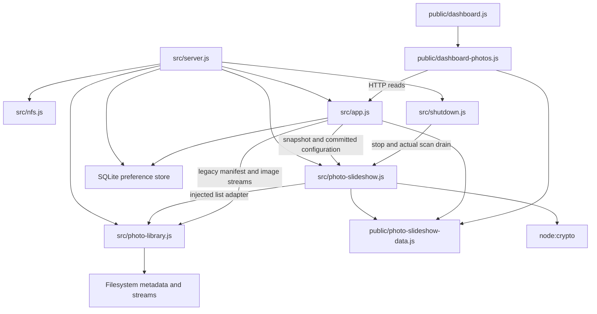

# Brooks-Lint Health Dashboard

- [Brooks-Lint Health Dashboard](#brooks-lint-health-dashboard)
  - [Scope and scores](#scope-and-scores)
  - [Module Dependency Graph](#module-dependency-graph)
  - [Top Findings](#top-findings)
    - [Warning](#warning)
  - [Test suite map and validation](#test-suite-map-and-validation)
  - [Recommendation](#recommendation)

## Scope and scores

**Mode:** Health Dashboard

**Scope:** All changes on `55-server-managed-photo-rotation` relative to local `main`, whose merge base is `4702f46c1a91990c2437e743654b35c502af65cd`. The branch contains one implementation commit, `2b2c02c`, with 28 changed files, 797 insertions, and 136 deletions. The working tree was initially clean. No `.brooks-lint.yaml` exists; balanced defaults apply. This review assesses the branch change surface and relevant existing boundaries, not whole-project health.

**Composite Score:** 99/100

**Trend:** Stable at 99 against the latest Health Dashboard entry, task 55's plan review. The plan and implementation have different evidence and findings; this is not proof of stable runtime quality.

- Code Quality: 100/100. No actionable R1/R2 finding in the changed production paths. Configuration effects and selection ownership are explicit; the multi-file migration remains one cohesive feature.
- Architecture: 100/100. No new dependency cycle or inappropriate layer inversion found. The process composition root owns service startup, adapters provide discovery/streaming, HTTP reads snapshots, and the browser owns presentation.
- Tech Debt: 100/100. No actionable R1–R6 finding in scope. The prior plan-review transport mismatch is addressed through shared validation before selection and at the API/browser boundaries. Legacy manifests retain their own intentional compatibility contract.
- Test Quality: 95/100. One T2 Warning: a real-filesystem integration wait depends on a fixed count of event-loop turns rather than confirmed completion or an elapsed-time deadline.

One Warning, no Critical or Suggestion findings. The capped finding set deducts five points from Test Quality only. Weighted score: `100 × 0.25 + 100 × 0.30 + 100 × 0.25 + 95 × 0.20 = 99`. Missing browser prerequisites are recorded separately rather than counted as a code defect.

The reviewed file inventory comprises nine runtime JavaScript files; seven Node test files plus one support fixture; four browser specs plus one support fixture; three user documents plus `4-implemented.md`; and the two package/version manifests. The goal, plan, and plan review already belong to the base branch and are context rather than new branch changes.

## Module Dependency Graph

Arrows represent relevant imports and runtime dependencies, not an exhaustive import graph. Composition-root dependencies on concrete infrastructure are intentional. Shared schema code has no DOM or filesystem dependency. The single selection owner preserves Conceptual Integrity from *The Mythical Man-Month*, and injected discovery/timing seams support the dependency boundaries described in *Clean Architecture*.

## Top Findings

### Warning

**T2 — Test Brittleness: fixed event-loop-turn budget can reject a correct filesystem refresh.**

- **Symptom:** `test/photo-slideshow-api.test.js:92–94` advances the injected slideshow clock, waits at most 2,000 `tick()` calls while `snapshot().loading` is true, then requires the real filesystem scan to have finished. `tick()` is a `setImmediate` turn, not a duration or filesystem-completion signal. `test/fixtures/photo-slideshow.js:13–20` advances only service timers; real filesystem work still depends on libuv scheduling. A controlled temporary probe using the real library/service and the same loop exhausted the budget after 21ms with `loading: true` and the previous one-photo pool. Once the busy worker completed, the same scan correctly published an available empty pool.
- **Source:** *xUnit Test Patterns* — Erratic Test. The assertion depends on incidental scheduler/worker progress instead of the observable behavior's completion boundary.
- **Consequence:** Worker contention or slower storage can make this regression test fail even though discovery, empty-state publication, and drain ownership are correct. Increasing the turn count only moves the scheduling dependency, making CI failures harder to diagnose and trust.
- **Remedy:** Replace the fixed-turn loop with a bounded predicate wait for the observable settled state, using an independent monotonic real-time deadline and an explicit timeout diagnostic, or await an already-owned completion seam in the test fixture. Keep the production clock injected, retain actual scan drainage during cleanup, and avoid adding a test-only production API or launching another scan merely to wait. Repeat the case with delayed/contended filesystem work to verify that ordinary pending work is not mistaken for failure and that genuinely stuck work still times out.

The probe used only temporary local files: start the real library/service with one image; remove that image; occupy a single libuv worker with asynchronous `pbkdf2` under `UV_THREADPOOL_SIZE=1`; advance the injected clock by 60 seconds; run the exact 2,000-turn wait; then let the worker and scan finish. The observed final state was `available: true`, `loading: false`, `count: 0`, `current: null`. The ordinary checked-in tests passed; the probe establishes the wait's timing assumption, not a production scan defect.

## Test suite map and validation

- Pure service/schema coverage: eight service cases and two schema cases. These protect zero-client rotation, name/date/random traversal, no-op configuration, late timers, coalesced scans, stale/empty recovery, UTF-8 eligibility, and impossible snapshots.
- Browser-controller coverage: nine photo-follower cases within the 35-case mixed `test/dashboard.test.js` file. Injected fetch/decode/timers exercise late responses, same-selection deduplication, fresh instances, failure retention, body/decode deadlines, suspension, and server-relative polling without depending on a browser clock to choose images.
- Resource and integration coverage: 12 coordinator cases, seven real-filesystem library cases, six real-server slideshow API cases, five HTTP-drain cases, and 15 normal/development process cases in the focused command. Some cases predate this task; these totals describe the reviewed verification cohort, not newly added case counts. Concurrent snapshot/stream tests protect actual admission behavior, not only mock-call wiring.
- Browser additions: seven real-service scenarios in `e2e/server-photo-rotation.spec.js`, plus explicit snapshot fixtures in the three existing affected home/layout/background specs. Server time and browser polling time remain separate. Unit/controller and browser cases address distinct risks; no new mock-abuse, duplicated-scenario, or inverted-pyramid finding is supported by this change surface.
- Fresh review verification: `node --test test/photo-slideshow.test.js test/photo-slideshow-data.test.js test/photo-slideshow-api.test.js test/photo-library.test.js test/dashboard.test.js test/shutdown.test.js test/http-shutdown.test.js test/server-shutdown.test.js` passed all 90 tests, with no failures or skips.
- Fresh review verification: `npm run check` and `git diff --check` passed. The implementation record reports 464 passing full-suite Node tests and individual syntax checks; this review reran the focused cohort rather than repeating that entire unchanged suite.
- Fresh browser prerequisite check: `npm run test:browser -- e2e/server-photo-rotation.spec.js --max-failures=1` failed before assertions because `/home/container/.cache/ms-playwright/chromium_headless_shell-1243/chrome-headless-shell-linux64/chrome-headless-shell` does not exist. One launch failed and six scenarios did not run. This independently confirms the implementation record's browser blocker; no rendering, transition, reduced-motion, or multi-browser assertion is certified by this review.
- Static checks found the intended process-owned startup, read-only metadata route, committed-preference notification isolation, pre-selection eligibility filtering, metadata-sensitive tokens, and actual scan drain before SQLite closure. The no-viewer process fixtures preserve the ordinary server/supervisor ownership paths while injecting mount/timing details into temporary copies; they do not verify a live NFS deployment.
- No implementation fixes, test edits, version changes, plan edits, dependency installation, or `todo.md` changes were made during this review. Persisted repository changes are this review and its health-history record.

## Recommendation

Replace the integration test's turn-count wait before relying on it under CI load. No production correctness or architecture defect was established in this scoped review. Browser verification remains incomplete: the operator must install Chromium with `npx playwright install chromium`, then run `npm run test:browser`; existing cross-engine scenarios also require Firefox. Keep actual browser decoding, canceled-transition cleanup, and multi-client resumption as explicit outstanding verification. For a deeper quality pass, focus `brooks-test` on asynchronous wait ownership rather than redesigning the service boundaries.
