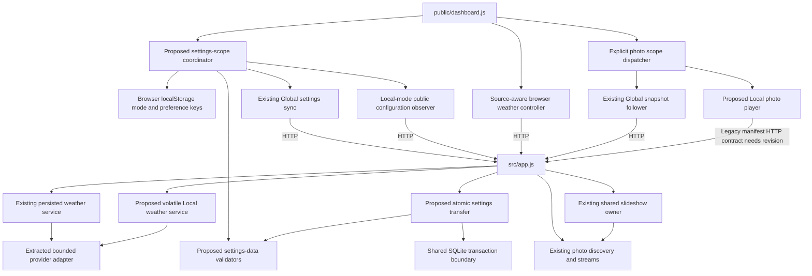

# Brooks-Lint Health Dashboard

- [Brooks-Lint Health Dashboard](#brooks-lint-health-dashboard)
  - [Scope and scores](#scope-and-scores)
  - [Module Dependency Graph](#module-dependency-graph)
  - [Top Findings](#top-findings)
    - [Warning](#warning)
  - [Test suite map and validation](#test-suite-map-and-validation)
  - [Recommendation](#recommendation)

## Scope and scores

**Mode:** Health Dashboard

**Scope:** Plan review of `tasks/56-local-global-settings/2-plan.md` at `c8c10b1`, checked against `1-goal.md`, including the user's clarification that switching one browser to Local must leave other Global browsers in Global mode. Relevant existing preference, weather, photo, SQLite, layout, integration-observer, and test boundaries were inspected. Scores assess the proposed change, not an implementation or whole-project health. The initial working tree was clean. No `.brooks-lint.yaml` exists; balanced defaults apply.

**Composite Score:** 99/100

**Trend:** Stable at 99 against the latest Health Dashboard entry, task 55's branch review. Different tasks and review scopes make this an informational comparison rather than a runtime quality trend.

- Code Quality: 100/100. The plan specifies per-browser ownership, active-source epochs, independent persistence, error behavior, and save routing. Coordinated changes span one intentional ownership migration rather than unrelated feature work.
- Architecture: 100/100. The proposed coordinator separates preference authority from integration metadata, while explicit Local weather/photo owners preserve the existing Global owners. Atomic transfer remains inside the SQLite boundary. No proposed dependency cycle or inappropriate direction was identified.
- Tech Debt: 95/100. One R2 Warning: the new Local photo consumer depends on a legacy manifest whose byte and source-state contract does not support the planned behavior.
- Test Quality: 100/100. The proposed three-context isolation matrix, same-profile tab cases, stale-source races, rollback tests, and service budgets target distinct failure modes. No independent T1/T2 finding is supported by the planned test structure; extend the transport round trip as part of the Warning remedy.

One Warning, no Critical or Suggestion findings. Balanced scoring deducts five points from Tech Debt only. Weighted score: `100 × 0.25 + 100 × 0.30 + 95 × 0.25 + 100 × 0.20 = 98.75`, rounded half-up to 99. The same transport gap is not deducted again from another dimension. Code Quality evaluates the committed plan and proposed change surface, so its weight is retained.

## Module Dependency Graph

Arrows show relevant imports or runtime dependencies, not an exhaustive module graph. Separate Local and Global policies are justified by current consumers: Local city/order/interval cannot reconfigure the shared server owner without violating isolation. Sharing validators, provider mechanics, and rendering rather than selection/location authority preserves Orthogonality from *The Pragmatic Programmer*. The composition root's existing concrete service ownership is intentional, consistent with *Clean Architecture*.

## Top Findings

### Warning

**R2 — Change Propagation: define a producer-side Local photo manifest contract before adopting the legacy endpoint.**

- **Symptom:** Plan lines 65–67 require the new Local player to consume `/api/dashboard/photos`, cap its response at 256 KiB, filter through the shared current-photo validator, and distinguish confirmed empty/disabled sources from transient failures. However, `src/app.js:400–402` returns the raw legacy library result. `src/photo-library.js:32–84` bounds file count/depth/bytes but does not apply slideshow filename eligibility before serializing the manifest; filesystem-valid control-character names remain in it and expand through JSON escaping. The legacy unavailable shape at `src/photo-library.js:15,122–123` also has no `enabled` field, so intentional disable and a failed source are indistinguishable to that consumer.
- **Source:** *A Philosophy of Software Design* — Information Hiding and Leakage; *The Pragmatic Programmer* — DRY. The accepted/displayable-photo decision and source-state meaning cross a legacy producer/new-consumer boundary without one enforceable transport contract.
- **Consequence:** A Local browser can reject an entire scan before it can extract a valid photo or recognize an all-rejected empty pool. Since Local becomes the default, mixed libraries can lose working backgrounds even though Global's compact snapshot remains usable. After a source is disabled, a returning Local browser cannot reliably choose between clearing the previous photo and retaining it as last-good outage state. Simply increasing the body cap or filtering only after decoding does not establish consistent producer/consumer behavior.
- **Remedy:** Amend step 5 to introduce a dedicated bounded Local manifest projection before response serialization, reusing the shared photo validator and preserving exact accepted names/opaque URLs. Define its version, configured enablement, availability, eligible-only records/count, successful all-rejected empty state, and serialized UTF-8 cap. Pass configured source enablement independently of failed preparation. Preserve the default legacy endpoint's compatibility contract. Extend step 8 with a real library → Local manifest API → browser-parser round trip containing a valid image plus many deep/control-character names, all-rejected scans, and disabled-versus-unavailable transitions. Prove the server emits a valid capped projection before the client reads it and that none of these reads reconfigures the Global cursor.

A read-only in-memory serialization probe modeled 100 library records: one valid `valid.png` and 99 regular-image relative names beneath eight 100-byte control-character directory segments. Those segments are within the existing filesystem/depth bounds but fail slideshow eligibility. The raw legacy manifest occupies **487,508 UTF-8 bytes**, exceeding the proposed **262,144-byte** reader cap; the projection containing the one eligible image occupies **141 bytes**. This demonstrates the protocol mismatch without a live export or implementation changes. Global's existing pre-selection filtering already solves its compact-snapshot case; the newly proposed manifest consumer needs its own matching producer projection.

## Test suite map and validation

- Existing unit/controller seams include `test/dashboard-settings-sync.test.js`, `test/configuration-observers.test.js`, weather/photo controller cases in `test/dashboard.test.js`, and layout session/editor tests. The plan appropriately reuses strict preference decoding and captures source identity in addition to numeric revisions.
- Existing integration coverage includes `test/dashboard-settings-api.test.js`, weather persistence/API tests, `test/photo-library.test.js`, `test/photo-slideshow-api.test.js`, and coordinator/HTTP/process shutdown cases. The proposed transfer tests add real transaction rollback and two-revision conflicts; Local weather tests add independent cache/admission/shutdown budgets rather than only mock-call checks.
- Existing browser coverage includes shared-settings, layout/display, integration/device/bookmark, and server-photo rotation specs. The plan explicitly opts existing shared-behavior fixtures into Global while leaving new default-Local cases unseeded. This protects the changed default rather than disguising it with universal Global setup.
- Planned browser additions are `e2e/settings-scope.spec.js` and `e2e/global-settings-transfer.spec.js`. Three isolated contexts verify A's Local independence and continued B/C Global propagation; same-profile multi-tab cases exercise the distinct browser-storage sharing boundary. Real download/upload and displayed weather/photo/layout assertions protect behavior that pure schema tests cannot establish.
- Proposed test case totals are not specified, and no future unit/integration/E2E execution ratio can be scored as observed coverage. The layered distribution is appropriate to the current risks: pure storage/epoch tests for state combinations, real API/store tests for persistence and contracts, and browser tests for context isolation and actual presentation.
- The plan already calls for deterministic clocks and bounded real-time predicate waits for actual filesystem work. This avoids repeating task 55's diagnosed fixed-event-loop-turn assumption. Add the new manifest producer/parser round trip rather than only a consumer oversized-body rejection case.
- Static diagnosis also confirms useful explicit safeguards: scope is absent from global payloads/import files; Global startup stops publishing legacy Local values; Local weather location is distinct from the global record; imports are atomic across preferences/location; existing transaction wrappers must not be nested; and metadata observation remains usable when global preferences are corrupt. These are addressed risks rather than extra findings.
- No application or browser suite was run for this documentation-only plan review. The only executable check during diagnosis was the in-memory transport-size/eligibility probe. Browser dependency availability was not rechecked; the implementation plan already requires an honest prerequisite check before claiming browser verification.
- No implementation, plan, goal, version, tests, dependencies, or `todo.md` changes were made. Persisted repository changes are this review and the required health-history entry.

## Recommendation

Revise the Local photo manifest boundary before implementation. The per-profile mode key, separate local preference record, captured source epochs, independent Local weather/photo behavior, and atomic Global import are coherent with the user's requested isolation. Preserve those boundaries while adding a compatible producer projection and its round-trip/state tests. The remaining plan is actionable; this score is not proof of implementation correctness or completed browser verification.
