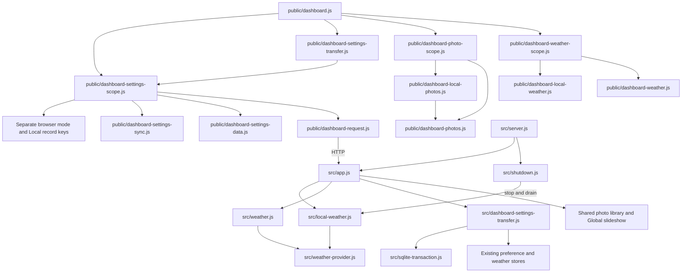

# Brooks-Lint Health Dashboard

- [Brooks-Lint Health Dashboard](#brooks-lint-health-dashboard)
  - [Scope and scores](#scope-and-scores)
  - [Module Dependency Graph](#module-dependency-graph)
  - [Top Findings](#top-findings)
    - [Warning](#warning)
  - [Test suite map and validation](#test-suite-map-and-validation)
  - [Recommendation](#recommendation)

## Scope and scores

**Mode:** Health Dashboard

**Scope:** All changes on `56-local-global-settings` relative to local `main`, with merge base `a14d331a845cffca379b84df6a4a811d4e692233`. One implementation commit, `7c0dc0c`, changes 58 files with 1,281 insertions and 163 deletions. The initial working tree was clean. No `.brooks-lint.yaml` exists; balanced defaults apply. The goal, plan, and plan review are context already present in the base branch. This review assesses the branch and relevant existing boundaries, not whole-project health.

**Composite Score:** 98/100

**Trend:** 99 → 98 (−1) against the latest Health Dashboard entry, task 56's plan review. Different evidence and scopes make this an informational comparison rather than a measured runtime regression.

- Code Quality: 95/100. One R2 Warning: the provider adapter's completion contract excludes pending body cancellation, but the new Local service relies on that completion for admission and shutdown.
- Architecture: 100/100. No new dependency cycle or inappropriate layering direction found. Scope policy, shared schema/provider mechanics, SQLite transfer, and process lifecycle have identifiable owners; the composition roots' concrete dependencies are intentional.
- Tech Debt: 100/100. No additional systemic R1–R6 finding in scope. Local/Global policy separation is justified by actual city/photo requirements rather than speculative generality. The provider lifecycle finding is counted once under Code Quality.
- Test Quality: 95/100. One T2 Warning: the browser restart fixture changes the dashboard origin before asserting persistence of origin-scoped Local settings.

Two Warnings, no Critical or Suggestion findings. Each Warning deducts five points from its assigned dimension. Weighted score: `95 × 0.25 + 100 × 0.30 + 100 × 0.25 + 95 × 0.20 = 97.75`, rounded half-up to 98. Missing browser executables are recorded separately rather than scored as a code defect.

The reviewed inventory comprises 29 runtime assets (27 JavaScript files, HTML, and CSS), seven Node test files, 12 browser spec/support files, eight documentation/implementation-record files, and two package manifests. Version `0.17.25` is consistent across the project manifest entries.

## Module Dependency Graph

Arrows show relevant imports and runtime dependencies, not every import. Browser HTTP access also exists inside the retained Global controllers. Local photo playback reuses decoding/presentation mechanics with automatic follower polling disabled rather than giving Local control of the shared cursor. Shared browser-safe schemas have no filesystem/DOM dependency. These boundaries support Orthogonality from *The Pragmatic Programmer* and the Dependency Rule from *Clean Architecture*; the provider completion boundary below needs a stronger lifecycle contract.

## Top Findings

### Warning

**R2 — Change Propagation: pending provider-body cancellation escapes Local admission and shutdown ownership.**

- **Symptom:** `src/weather-provider.js:14,16,22` starts response/reader cancellation with `void ...cancel().catch(() => {})`, excluding cancellation completion and rejection from `providerJson`'s returned promise. `src/local-weather.js:16–25` treats that promise as the actual job and removes it from `active` on settlement; `stop()` at lines 46–50 waits only for those jobs. The shutdown coordinator then considers Local weather drained before store closure and successful completion at `src/shutdown.js:43–49`. A controlled probe returned two HTTP-503 responses whose streams had deferred cancellation. Both cancellation operations started, neither finished, but the coordinator closed its store resource and returned `{ code: 0, cleanupSafe: true, forced: false }` before either deferred cancellation resolved.
- **Source:** *A Philosophy of Software Design* — Information Hiding and Leakage; *Code Complete* — Defensive Programming and Error Handling. The shared adapter hides cancellation initiation but leaks its completion obligation to callers that reasonably use the returned work promise as a drain boundary.
- **Consequence:** Slow or rejecting body cleanup can release provider admission slots and allow a clean shutdown result before cleanup is confirmed. Catching every cancellation error also prevents the resource owner from distinguishing an ordinary unavailable forecast from a failed cleanup. This weakens the new service's stated two-request/actual-drain guarantees precisely on rejected/aborted response paths.
- **Remedy:** Make cancellation/drain completion part of the provider ownership contract, either by joining it before the actual work promise settles or by exposing a separately owned drain promise. Keep Local admission reserved until that drain is confirmed, and make cleanup rejection/unconfirmed work reach the coordinator's unsafe/nonzero outcome instead of being swallowed as a forecast failure. Preserve bounded caller-visible deadlines without replacing them with abandoned cleanup. Add deferred/rejecting cancellation cases for rejected/oversized responses and aborted reads, asserting no early slot reuse, no early store closure/clean result, successful settlement only after cleanup, and unsafe global-deadline expiry when it remains unresolved.

The probe used injected `fetchImpl`, real `Response`/`ReadableStream` objects, and the actual Local service/coordinator. Before resolving the cancellation gate it observed `started: 2`, `finished: 0`, and `closed: 1` with a successful cleanup result; after resolving it, `finished` became 2. Existing tests at `test/local-weather.test.js:30–44` and the added shutdown cases hold the fetch promise or make stream cancellation settle immediately, so they do not cover this ownership gap. This finding concerns resource-drain accuracy and provider admission.

**T2 — Test Brittleness: restart fixture changes the Local storage origin.**

- **Symptom:** `e2e/settings-environment.js:21–32` runs `server.listen(0, '127.0.0.1')` on every `start()`, including restart, and replaces `base` with the new ephemeral port. `e2e/settings-scope.spec.js:23` navigates the same browser context to that new base and requires the prior Local background value. Browser storage is scoped to scheme/host/port, as the implementation and documentation correctly specify. An independent fixture probe observed `http://127.0.0.1:41955` before restart and `http://127.0.0.1:44015` afterward, with `sameStorageOrigin: false`.
- **Source:** *xUnit Test Patterns* — Erratic Test; *The Art of Unit Testing* — Test Isolation. The fixture changes an essential precondition of the behavior it claims to verify, so correct storage isolation becomes a false failure.
- **Consequence:** Once Chromium is available, the restart persistence case can read an empty Local storage area on the new origin and fail against the expected `#123456` value. Such a failure would not demonstrate lost same-origin persistence in the application, and it currently prevents the proposed browser scenario from validating the intended restart contract.
- **Remedy:** Allocate the fixture's port once, then bind the restarted server to that same port while preserving the database/image fixtures. Assert that the base origin remains unchanged before checking Local storage persistence. Keep the independent-context tests as separate profile-isolation cases; do not copy Local records between origins to make this restart assertion pass.

The origin probe invoked the existing fixture's start/restart/close methods without a browser and cleaned its temporary resources normally. Browser rendering assertions were not run or claimed by that probe.

## Test suite map and validation

- Scope and Global synchronization: ten scope/storage/epoch cases and 13 retained/adapted Global sync cases use injected storage, clocks, requests, and source transitions. Tests cover independent mode keys, no legacy global publication, matching-number revision collisions, delayed reads/imports, and already-observed stale drafts.
- Store/API contracts: four transfer cases use real SQLite/HTTP for consistent export, no-op/null-location import, dual-revision conflicts, rollback between component writes, maximum selections, method/origin validation, and post-commit notification failure. The Local weather API case checks unchanged Global rows/registrations/cursor, including a corrupt Global preference getter.
- Local weather: five service/controller cases cover matching-source coalescing, partial failures, retained-key retry deadlines, 16-key/two-request admission, eviction, response limits, and old-city/visibility guards. Their cancellation seam must be extended as described above rather than treating the current passing drain tests as complete cleanup evidence.
- Local photos: four mixed schema/controller/API cases include real filesystem metadata whose raw legacy manifest exceeds the client cap, server-side eligible projection, disabled/unavailable distinctions, Local timing, and unchanged Global selection. The plan-review manifest warning is addressed in the producer boundary and round-trip test.
- Coordinator coverage: 14 focused shutdown cases include the two new Local weather paths and retained HTTP/weather/slideshow lifecycle checks. Focused verification totals describe the reviewed cohort, not only newly added cases.
- Browser portfolio: six new scenarios in `settings-scope.spec.js` and `global-settings-transfer.spec.js`; the eight existing spec files explicitly use Global fixtures. This preserves default-Local coverage while retaining prior shared assertions. The implementation record reports 164 total collected scenarios; their existence is not evidence that browser assertions passed. The restart-origin Warning applies to the new scope fixture specifically.
- Fresh review verification: `node --test test/dashboard-settings-scope.test.js test/dashboard-settings-transfer.test.js test/local-weather.test.js test/local-weather-api.test.js test/local-photo-manifest-api.test.js test/dashboard-settings-sync.test.js test/shutdown.test.js` passed all **51 tests**, with no failures or skips. `npm run check` and `git diff --check` passed. The implementation record reports 490 passing full-suite Node tests; this review did not repeat that unchanged full suite.
- Fresh browser prerequisite check: `npm run test:browser -- e2e/settings-scope.spec.js --max-failures=1` stopped at one launch failure because `/home/container/.cache/ms-playwright/chromium_headless_shell-1243/chrome-headless-shell-linux64/chrome-headless-shell` does not exist; three selected cases did not run. Actual Local/Global UI propagation, rendering, upload/download behavior, and cross-engine assertions remain unverified in this environment.
- Additional verification consisted of the deferred-body-cancellation probe and the fixture-origin probe above. Both exercised existing seams without modifying implementation/tests. No live provider or NFS mount was used.
- No implementation, test, plan, version, dependencies, user configuration, or `todo.md` changes were made in this review stage. Persisted repository changes are this review and its health-history entry.

## Recommendation

Address provider cancellation ownership first, then stabilize the browser restart fixture's origin. Extend the focused shutdown/provider tests with asynchronous cleanup completion and rerun the restart case after the operator installs browsers with `npx playwright install chromium firefox`. Keep the per-profile scope key, source-aware saves, atomic import, and producer-filtered Local manifest boundaries. The architecture does not need a broader redesign; the outstanding work is a concrete lifecycle-contract correction, a fixture correction, and actual browser verification.
