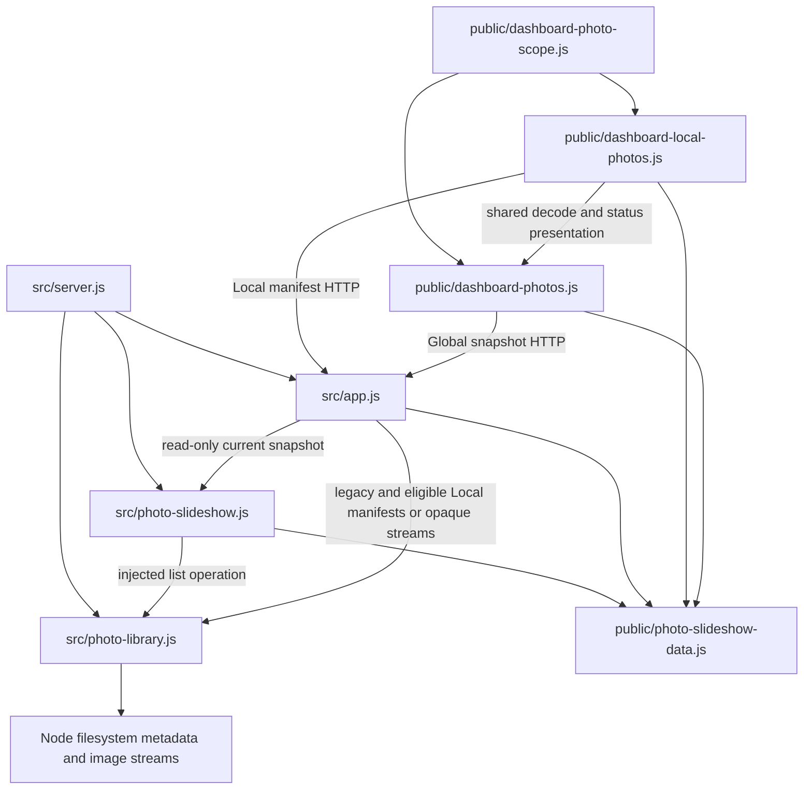

# Brooks-Lint Health Dashboard

- [Brooks-Lint Health Dashboard](#brooks-lint-health-dashboard)
  - [Scope and scores](#scope-and-scores)
  - [Module Dependency Graph](#module-dependency-graph)
  - [Top Findings](#top-findings)
  - [Test suite map and validation](#test-suite-map-and-validation)
  - [Recommendation](#recommendation)

## Scope and scores

**Mode:** Health Dashboard

**Scope:** Plan review of `tasks/57-large-photo-library-scan/2-plan.md` at `d4d3a7d`, checked against `1-goal.md`, existing library traversal/streaming, Local manifest and Global slideshow consumers, strict photo schemas, and relevant tests/documentation. All dimensions assess the proposed change rather than an implementation or whole-project health. The initial working tree was clean. No `.brooks-lint.yaml` exists; balanced defaults apply.

**Composite Score:** 100/100

**Trend:** 98 → 100 (+2) against the latest Health Dashboard entry, task 56's branch review. Different tasks, evidence, and scopes make this informational rather than evidence that existing runtime defects were fixed.

- Code Quality: 100/100. The plan distinguishes admission, processing, and pool selection, names the faulty cutoff, and specifies parent-frame continuation and cleanup. No actionable R1/R2 plan finding is supported.
- Architecture: 100/100. Discovery remains in one library used by existing consumers. The plan adds no new selection authority, per-browser scan subsystem, database contract, or dependency cycle.
- Tech Debt: 100/100. The repair targets the existing boundary without increasing limits, weakening guards, or adding speculative configuration. Status/help changes explain the actual bounded result rather than inventing a complete inventory.
- Test Quality: 100/100. Threshold, unsupported-first-entry, nested-continuation, budget-preservation, and real-consumer cases protect distinct failure modes. Controlled clocks, owned temporary fixtures, and explicit ordering constraints address T1/T2 risks.

No Critical, Warning, or Suggestion findings. Weighted score: `100 × 0.25 + 100 × 0.30 + 100 × 0.25 + 100 × 0.20 = 100`. Code Quality evaluates the committed plan and proposed change surface, so its weight is retained.

## Module Dependency Graph

Arrows show relevant imports or runtime dependencies, not every import. The proposed traversal repair stays behind the current library interface. HTTP readers retain existing authority boundaries; UI text changes reuse the common follower rather than duplicating Local/Global count semantics. Concrete composition-root dependencies are intentional, consistent with *Clean Architecture*.

## Top Findings

None requiring a plan revision. Material risks already have concrete treatment:

- **Correct diagnosis and narrow repair:** `src/photo-library.js:42–61` counts directory entries before processing the collected children, then breaks processing when the already-full counter is observed. This affects exactly 5,000 entries as well as larger directories. Plan lines 24–33 separate stopping new admission from finishing admitted work, including already-collected parent siblings after nested exhaustion. This removes the conflicting guard meaning rather than adding consumer-specific workarounds, consistent with Information Hiding in *A Philosophy of Software Design*.
- **Budget preservation:** Plan lines 24–28 and 44 retain a single recursive admission budget, depth bounds, and skipped descent when no quota remains. Counting the 5,001st entry is explicitly addressed without claiming exact kernel read counts. The negative subtree case guards against accidentally turning continuation into an unlimited scan.
- **Failure and ownership semantics:** Plan lines 28 and 34–35 keep real I/O/deadline failure distinct from an available capped result, retain descriptor cleanup, and preserve coalescing of actual scan work. `src/photo-slideshow.js:46–58,74–80` already owns that scan promise and retains last-good state on failure. The plan does not replace real completion with a timeout race or an abandoned scan.
- **Stable transport and limits:** `public/photo-slideshow-data.js:22,32` bounds Global and Local counts at 100. Plan lines 18, 36, and 76 preserve these contracts and the producer-filtered Local projection. The separate 5,000-entry/100-photo decisions are reviewed explicitly rather than silently expanded. Schema/API compatibility follows the backward-compatibility discipline in *Software Engineering at Google*.
- **Meaningful counts:** Plan lines 50–54 distinguish accepted/eligible pool size, a single selected current image, and total export contents. Empty status wording is also bounded-scan wording, so a capped scan missing deeper photos is not mislabeled a complete empty NAS inventory. Sharing count presentation between existing Local/Global consumers preserves DRY from *The Pragmatic Programmer*.
- **Deterministic regression design:** Plan lines 40–46 use all-valid flat fixtures, below/exact/over-limit thresholds, and controlled nested batches. They avoid assuming globally alphabetical membership before bounded directory admission. The injected clock separates traversal correctness from local filesystem speed while independent deadline tests remain required. This addresses Erratic Test risks from *xUnit Test Patterns* without a test-only production API.

## Test suite map and validation

- Existing focused Node files contain seven library cases (six using real filesystem fixtures), eight injected-clock slideshow cases, six real-server slideshow API cases, four mixed Local manifest/controller/schema cases, and 35 mixed dashboard/helper/controller/static-server cases. These 60 cases are context before proposed additions, not a count of pure unit tests or future verification results.
- Planned additions target the missing large-directory behavior: four independent flat thresholds, an exactly-full unsupported-first-entry case, parent continuation after nested exhaustion, exhausted-budget subtree exclusion, concurrent large reads, and a dedicated real-library/API regression. Exact implemented case totals remain unspecified.
- The proposed API scenario uses `order: 'name'`, `interval: 5`, and a fifteen-second advance below the sixty-second rescan cadence. This cleanly separates already-running Global rotation from request-triggered discovery or extra scans. Startup is awaited before advancing the service clock; representative image streams and Local manifest validation protect adapter behavior.
- Existing browser targets are `e2e/dashboard-home.spec.js` and `e2e/server-photo-rotation.spec.js`. They cover status wording, real rendering/playback, and existing request-owner behavior. The plan appropriately keeps thousands of files in filesystem/API fixtures rather than creating thousands of browser layers or duplicating the traversal matrix in E2E tests.
- Keeping symlink/containment, token continuity/replacement, byte limits, deadlines, and stream admission cases protects meaningful side effects. Real filesystem assertions and consumer round trips complement injected-clock service cases; they do not substitute a line-coverage percentage for change protection, consistent with *How Google Tests Software*.
- No application suite, large-directory reproduction, browser launch, or live NFS operation was run during this documentation-only plan review. Source inspection establishes the existing guard conflict; only implementation can establish that the proposed fix and tests pass. Browser availability and deployment NFS latency were not rechecked. The plan already requires honest reporting of missing dependencies and real deadline outcomes.
- No implementation, goal, plan, tests, version, dependencies, user configuration, or `todo.md` changes were made. Persisted repository changes are this review and its health-history entry.

## Recommendation

Proceed with the planned bounded traversal correction. First make the exactly-full/over-budget regression fail against the existing cutoff, then separate admission termination from admitted processing, validate parent continuation and budget preservation, and finish with consumer/status/documentation checks. Retaining the 5,000-entry and 100-photo caps is an explicit scoped decision; this approval does not promise full-export discovery or deployment performance. No required plan revision was identified, and the score does not certify an implementation that has not yet been written.
