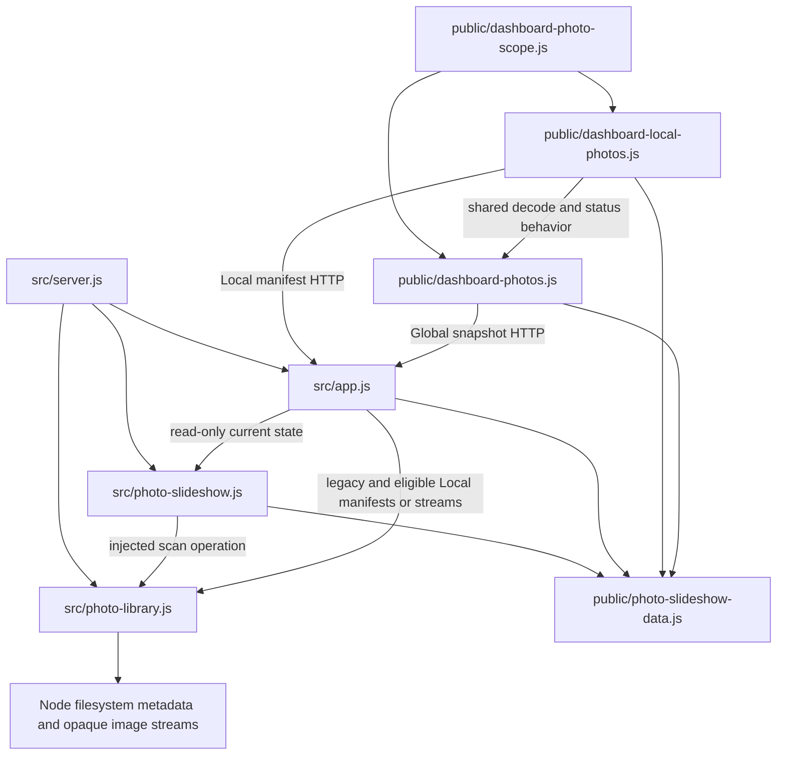

# Brooks-Lint Health Dashboard

- [Brooks-Lint Health Dashboard](#brooks-lint-health-dashboard)
  - [Scope and scores](#scope-and-scores)
  - [Module Dependency Graph](#module-dependency-graph)
  - [Top Findings](#top-findings)
  - [Test suite map and validation](#test-suite-map-and-validation)
  - [Recommendation](#recommendation)

## Scope and scores

**Mode:** Health Dashboard

**Scope:** All changes on `57-large-photo-library-scan` relative to local `main`, whose merge base is `49b48f25119fdd9836fe9407e991fbd5907f8718`. One implementation commit, `0e8d16b`, changes 14 files with 176 insertions and 10 deletions. The initial working tree was clean. No `.brooks-lint.yaml` exists; balanced defaults apply. The goal, plan, and plan review belong to the base branch and provide context. This assesses the branch change surface and relevant existing boundaries, not whole-project health.

**Composite Score:** 100/100

**Trend:** Stable at 100 against the latest Health Dashboard entry, task 57's plan review. The plan and implementation have different evidence; this is not proof that unrelated existing runtime issues were resolved.

- Code Quality: 100/100. No actionable R1/R2 finding in the changed paths. Enumeration termination and admitted processing now have distinct control flow, with a concise comment explaining the invariant.
- Architecture: 100/100. The repair stays behind the existing library interface, retains selection ownership and protocol shapes, and introduces no new runtime import or dependency cycle.
- Tech Debt: 100/100. No additional R1–R6 finding in scope. The implementation corrects the common producer rather than compensating in individual clients or expanding resource limits.
- Test Quality: 100/100. Threshold and nested regressions cover the reported defect and its parent-frame variant; a real API/service case checks downstream behavior. Fixtures own their resources and avoid unstable complete-export membership assumptions.

No Critical, Warning, or Suggestion findings. Weighted score: `100 × 0.25 + 100 × 0.30 + 100 × 0.25 + 100 × 0.20 = 100`. The browser executable blocker is recorded separately, not counted as a code defect or treated as a passing check.

The reviewed inventory comprises three runtime assets (`src/photo-library.js`, `public/dashboard-photos.js`, `public/index.html`), three Node test files plus a support fixture, one browser spec, three user documents, two package manifests, and `4-implemented.md`. Project version entries consistently use `0.17.26`.

## Module Dependency Graph

Arrows show relevant imports or runtime dependencies rather than every import. The follower's HTTP arrow describes Global operation; Local reuse supplies an in-memory snapshot adapter with automatic follower polling disabled. Production dependencies are unchanged by this branch. Composition roots intentionally wire concrete services, consistent with *Clean Architecture*.

## Top Findings

None requiring a code change. The following review checks support that result:

- **Admission versus processing:** `src/photo-library.js:32–63` keeps one recursive admission counter. Enumeration now stops immediately after admitting the last allowed entry, and no processing-loop counter break discards already-collected children. Serial recursion cannot admit additional descendants once the shared guard is exhausted, while collected parent file siblings still run. The comment at line 48 documents the distinction rather than adding another hidden cutoff. This improves the routine's invariant clarity, consistent with *Code Complete*.
- **Cleanup and failure boundaries:** Deadline checks remain during enumeration/processing; metadata and directory descriptors retain their `finally` closures. Early exit uses the normal async iterator break path. `list()` still coalesces the actual scan promise, and the service's existing last-good/stop ownership is unchanged. The new fixture reader waits for stream `close`; the API fixture drains HTTP/service owners before SQLite closure and root removal.
- **One repair for all consumers:** The existing Global service and Local/legacy manifest paths share the corrected library. `src/app.js:365–370` still applies eligible-only Local projection, and Global selection remains service-owned. No preference writes, extra cursor, mount change, or protocol expansion was introduced. Repairing the producer without duplicated client workarounds supports Orthogonality from *The Pragmatic Programmer*.
- **Counts and compatibility:** The follower reports a bounded pool and distinguishes confirmed empty from unavailable state; the added controller case checks both copy and retention behavior. Help/docs distinguish total files, admitted entries, accepted/eligible pools, and one displayed current image. Limits, validators, opaque URLs, and snapshot formats remain compatible, matching the backward-compatibility discipline in *Software Engineering at Google*. The reviewed scope intentionally retains the 5,000-entry/100-photo limits.
- **Regression protection:** Four flat thresholds, unsupported-first-entry, nested exhaustion, excluded descendants, and shared large reads address different control-flow risks. Assertions sort the returned admitted subset without assuming its membership equals the first names from the complete directory. The real 7,001-image API case verifies three no-viewer rotations, bounded manifests, stream bytes, and read purity. These are change-risk assertions rather than line-coverage or private-call-order proxies, consistent with *How Google Tests Software* and the Erratic Test guards in *xUnit Test Patterns*.

## Test suite map and validation

- Library coverage: 15 cases, including 14 real-filesystem scenarios and one unavailable-source case. Eight new large-directory cases use tiny owned fixtures and controlled scan clocks; independent existing deadline, containment, replacement-token, and stream admission cases remain active.
- Consumer coverage: one new real-library/HTTP/SQLite/Global-service integration case; eight existing injected-clock slideshow cases; six existing slideshow API cases; and four mixed Local manifest/controller/schema cases. The new integration case advances only fifteen seconds with a five-second interval, avoiding a sixty-second periodic rescan while measuring rotation and read purity.
- Dashboard coverage: 36 mixed helper/controller/static-server cases, including the new bounded-status case. It verifies a 100-photo metadata count does not decode 100 images and that unavailable state does not repeat an authoritative-empty clear. The home browser assertion was updated to match the new empty-state wording.
- Fresh review verification: `node --test test/photo-library.test.js test/large-photo-library-api.test.js test/photo-slideshow.test.js test/photo-slideshow-api.test.js test/local-photo-manifest-api.test.js test/dashboard.test.js` passed all **70 tests**, with no failures, cancellations, or skips. This includes the final committed stream-close cleanup helper.
- Fresh review verification: `npm run check`, individual `node --check` invocations for all seven changed/new JavaScript files, and `git diff --check` passed. The implementation record reports 501 passing full-suite Node entries and the red-before/green-after evidence; this review did not repeat that broader unchanged suite. The 501 total includes automatic discovery of support modules, as the implementation record explains.
- Fresh browser prerequisite check: `npm run test:browser -- e2e/dashboard-home.spec.js --max-failures=1` failed before assertions because `/home/container/.cache/ms-playwright/chromium_headless_shell-1243/chrome-headless-shell-linux64/chrome-headless-shell` is missing. One launch failed and 56 selected cases did not run. The implementation record separately documents all 64 attempted home/rotation scenarios failing at launch. Actual browser status rendering, decoding, geometry, and playback remain unverified in this environment.
- The Node fixtures use temporary local files and loopback services, not a live NAS or mount. Injected scan clocks validate traversal independently of filesystem speed; their timings do not establish deployment NFS performance. The existing cooperative production deadline and capped discovery semantics still apply.
- No implementation, tests, plan, version, dependencies, user configuration, or `todo.md` changes were made in this review stage. Persisted repository changes are this review and its health-history entry.

## Recommendation

No additional code correction was identified in this scoped review. The branch addresses the reported first-file truncation with direct regression and real-consumer evidence while preserving bounds and ownership. Install browser prerequisites through the operator with `npx playwright install chromium firefox`, then rerun the relevant home/rotation checks before claiming browser verification. A successful bounded 100-photo pool does not certify complete 7,000-image discovery, uniform full-export randomness, or production NAS latency; the updated user-facing language correctly preserves that distinction.
