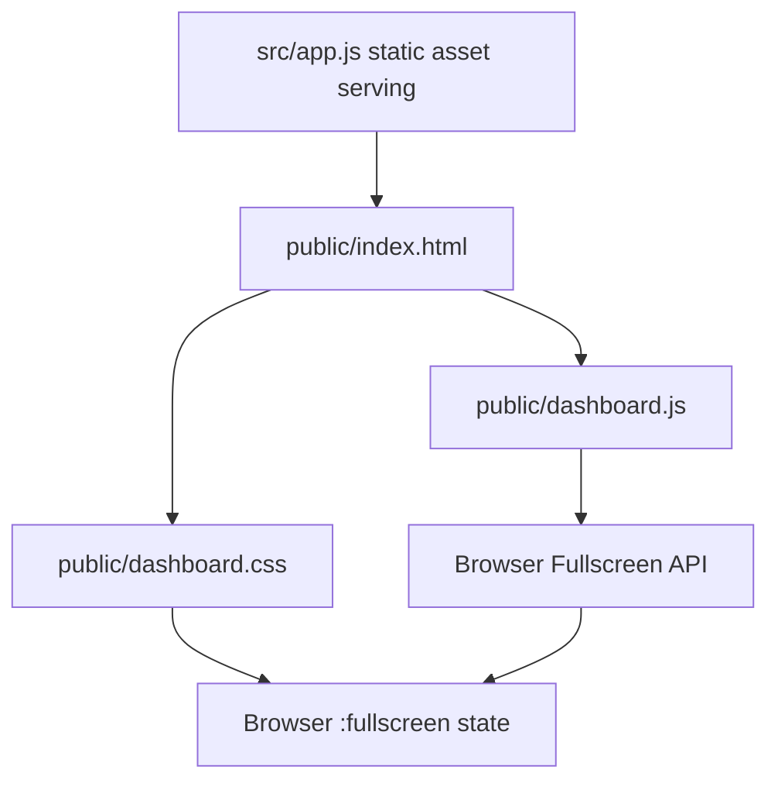

# Brooks-Lint Health Dashboard

- [Brooks-Lint Health Dashboard](#brooks-lint-health-dashboard)
  - [Scope and scores](#scope-and-scores)
  - [Module Dependency Graph](#module-dependency-graph)
  - [Test Suite Map](#test-suite-map)
  - [Top Findings](#top-findings)
  - [Verification and limits](#verification-and-limits)
  - [Recommendation](#recommendation)

## Scope and scores

**Mode:** Health Dashboard

**Scope:** All changes on `58-hide-fullscreen-cursor` relative to `main`, merge base `ebdd8d1`, reviewed head `7481e07`. Reviewed both commits, `9d4f715` and `7481e07`, and all four changed files: `public/dashboard.css`, `package.json`, `package-lock.json`, and `tasks/58-hide-fullscreen-cursor/4-implemented.md`. Goal and plan documents already exist on the base branch and were read as requirements context.

**Composite Score:** 100/100

**Trend:** Stable at 100 compared with the previous Health Dashboard record; prior reviews cover different scopes.

No `.brooks-lint.yaml` exists. Applied balanced defaults with all risks enabled. Scores describe this small branch change, not overall project health.

- Code Quality: 100/100, weight 0.25. The single presentation rule directly expresses the requested behavior without adding state, timers, or handlers.
- Architecture: 100/100, weight 0.30. Fullscreen state remains browser-owned; styling stays in the existing stylesheet. No imports, packages, dependency edges, or layer boundaries change.
- Tech Debt: 100/100, weight 0.25. No new R1–R6 findings. The scoped `!important` is justified by existing explicit descendant cursors, including higher-specificity move/resize rules later in the stylesheet.
- Test Quality: 100/100, weight 0.20. No changed test files or introduced T1/T2 issues. Existing focused browser scenarios and isolated computed-style inspection provide proportionate verification for this reversible CSS change.

Each dimension starts at 100 with zero deductions. Weighted composite: `100 × 0.25 + 100 × 0.30 + 100 × 0.25 + 100 × 0.20 = 100`.

## Module Dependency Graph

Arrows show serving, loading, and browser-state dependencies in the affected presentation slice, not a complete application import graph. `public/index.html:8` loads the stylesheet. `public/dashboard.js:424–431` already enters document fullscreen, exits through the browser API, and listens for state changes. The new CSS does not duplicate that lifecycle or add dependency cycles.

## Test Suite Map

Scoped verification portfolio, rather than whole-project counts:

- Unit/controller checks: 24 cases in `test/dashboard.test.js`, covering helpers and controllers with controlled inputs.
- HTTP/asset integration checks: 12 cases in the same file, exercising real local server responses, markup, styles, modules, and injected photo serving. Combined Node test total: 36.
- Browser E2E checks: two selected existing cases, one for fullscreen entry/exit in `e2e/dashboard-home.spec.js:594–611` and one for background-only tool reachability in `e2e/background-display-options.spec.js:145–154`.
- Temporary browser inspection: one script outside the repository, `/tmp/opencode/inspect-fullscreen-cursor.mjs`, checks actual computed cursors, repeated transitions, mouse movement, layout handles, keyboard focus, tool clicks, and input restoration.

The E2E cases have clear behavioral names and observe real browser state and visible controls. No new mocks, shared fixtures, or implementation-coupled test assertions were introduced. The temporary script is verification evidence, not durable regression coverage: the committed browser tests do not assert the new cursor values. Given the one-line, low-impact presentation change and successful direct inspection, this is a proportionate tradeoff rather than an actionable defect.

## Top Findings

No Critical, Warning, or Suggestion findings in the reviewed branch changes.

`public/dashboard.css:11` applies `cursor: none` to both the fullscreen root and its descendants. This correctly overrides explicit pointer, disabled, move, and resize declarations rather than relying on cursor inheritance. Because the selector only matches actual fullscreen state, normal cursor declarations become effective again on exit. The change does not modify pointer events, focus outlines, visibility, or layout.

The patch version is consistent at `0.17.27` in `package.json` and both root version fields of `package-lock.json`; dependency versions remain unchanged. The implementation report accurately distinguishes computed-style verification from manual physical cursor observation.

## Verification and limits

Reviewed the complete branch diff, relevant fullscreen handlers, asset loading, cursor declarations, selected test bodies, and temporary inspection script. Verification results from the implementation session apply to the reviewed head; no production changes occurred afterward, so checks were not repeated during this documentation-only review.

- `node --test test/dashboard.test.js`: 36 passed.
- `npm run test:browser -- e2e/dashboard-home.spec.js -g 'fullscreen enters and exits'`: one passed.
- `npm run test:browser -- e2e/background-display-options.spec.js -g 'background-only fullscreen tools remain reachable'`: one passed.
- `node /tmp/opencode/inspect-fullscreen-cursor.mjs`: passed after inspection harness timing and panel-visibility corrections.
- `git diff --check`: passed during implementation and review.

Browser results cover headless Chromium and Fullscreen API mode. Physical cursor appearance, browser-owned Escape handling, and other engines were not manually verified. F11 browser-window fullscreen is outside the plan's defined scope. These limits are explicitly recorded and do not indicate an observed implementation defect.

## Recommendation

Ready to merge within the stated scope. No fixes are required from this review. Retain the documented distinction between successful computed-style checks and unperformed physical cursor/Escape observation.
