# Brooks-Lint Health Dashboard

- [Brooks-Lint Health Dashboard](#brooks-lint-health-dashboard)
  - [Dimension Assessment](#dimension-assessment)
  - [Module Dependency Graph](#module-dependency-graph)
  - [Test Suite Map](#test-suite-map)
  - [Top Findings](#top-findings)
    - [Suggestion](#suggestion)
  - [Recommendation](#recommendation)

**Mode:** Health Dashboard

**Scope:** Plan review of `tasks/59-restore-dashboard-images/2-plan.md` at `7b4de72`, checked against `1-goal.md` and the relevant photo source, API, controller, presentation, and test boundaries. Scores assess the proposed work, not the whole project's implementation health.

**Composite Score:** 100/100, rounded from 99.8.

**Trend:** Stable at 100 compared with the last Health Dashboard record. That record reviewed a different task and scope, so this is not evidence of unchanged project health.

**Verdict:** Approve with one nonblocking test suggestion. No Critical or Warning findings.

No `.brooks-lint.yaml` exists; balanced deductions and default risk selection apply. The reviewed change is the plan-only commit, so all four dimensions participate with weights 0.25, 0.30, 0.25, and 0.20. The single Suggestion deducts one point from Test Quality only: `100 × 0.25 + 100 × 0.30 + 100 × 0.25 + 99 × 0.20 = 99.8`.

## Dimension Assessment

- **Code Quality: 100/100.** The plan starts with observed failures, chooses changes only after reproduction, and identifies concrete files and diagnostic boundaries. Its breadth is justified by the unlocalized report; it does not require editing every named module.
- **Architecture: 100/100.** The proposed fix preserves source preparation, bounded library discovery, API projection, shared contracts, scope ownership, and presentation responsibilities. No new abstraction or dependency direction is proposed. Startup's concrete dependencies are composition-root wiring, and pure contracts under `public/` are deliberately shared with the server.
- **Tech Debt: 100/100.** The plan avoids speculative compatibility patches, limit increases, format expansion, or controller rewrites. It treats `isWellFormed()` support and retry cadence as leads rather than established defects and retains existing filename and streaming invariants.
- **Test Quality: 99/100.** Temporary local images, existing clock seams, real API/browser decoding, scope isolation, and failure-before/fix-after verification fit the risk. The missing explicit same-selection first-load recovery case is the sole finding below.

## Module Dependency Graph

This is the relevant existing photo dependency slice, not a complete project graph. Solid arrows represent imports, including dynamic imports; dotted arrows represent injected collaborators or HTTP calls. No cycle is evident within this inspected slice.

```mermaid
graph TD
  Server["src/server.js"] --> Config["src/config.js"]
  Server --> Nfs["src/nfs.js"]
  Server --> Library["src/photo-library.js"]
  Server --> Slideshow["src/photo-slideshow.js"]
  Server --> App["src/app.js"]
  App --> Library
  App --> Contract["public/photo-slideshow-data.js"]
  App -. "injected slideshow" .-> Slideshow
  Slideshow --> Contract
  Slideshow -. "injected library" .-> Library
  Dashboard["public/dashboard.js"] --> Scope["public/dashboard-photo-scope.js"]
  Scope --> Local["public/dashboard-local-photos.js"]
  Scope --> Follower["public/dashboard-photos.js"]
  Local --> Follower
  Local --> Contract
  Follower --> Contract
  Local -. "Local manifest HTTP" .-> App
  Follower -. "Global snapshot HTTP" .-> App
  Dashboard -. "image HTTP" .-> App
```

## Test Suite Map

Counts describe the nine existing test files explicitly named for extension or focused browser execution, not individual cases or a whole-project census.

- **Unit-focused: 2 files.** `test/photo-slideshow-data.test.js` checks the shared photo contract; `test/nfs.test.js` checks mount parsing/preparation through injected operations.
- **Filesystem integration: 1 file.** `test/photo-library.test.js` checks discovery and opaque streams using temporary files.
- **Mixed unit/API integration: 2 files.** `test/dashboard.test.js` covers HTTP behavior and the shared follower with controlled clocks; `test/local-photo-manifest-api.test.js` covers real Local projection and Local controller behavior.
- **Browser end-to-end: 4 files.** `e2e/settings-scope.spec.js`, `e2e/server-photo-rotation.spec.js`, `e2e/dashboard-home.spec.js`, and `e2e/background-display-options.spec.js` cover scope, decoding/rotation, dashboard initialization, and presentation. `e2e/settings-environment.js` provides an existing isolated real-server fixture.

The layers protect distinct risks rather than repeat identical assertions. Existing shared-follower unit coverage already retries an unchanged selected image (`test/dashboard.test.js:427-433`); the Local controller case injects an always-successful decode (`test/local-photo-manifest-api.test.js:35-42`). Existing browser decode recovery advances to another selection (`e2e/server-photo-rotation.spec.js:75-82`). These observations support the narrow suggestion below.

This was a static plan review. No application tests or live NFS checks were run, and the reported deployment cause remains unconfirmed.

## Top Findings

### Suggestion

**T5 — Coverage Illusion: Make first-load recovery independent of rotation.**

**Symptom:** `2-plan.md:32` calls for first-load and later failure checks, and `2-plan.md:47,57` requires automatic recovery, but neither specifies an unchanged single-image selection or a recovery deadline. The existing browser recovery test reaches a different image, while Local disables follower polling (`public/dashboard-local-photos.js:10`), has no rotation timer for a one-image pool (`:19-23`), and ordinarily revisits the follower through its 60-second manifest refresh (`:43-46`).

**Source:** *The Art of Unit Testing* — Test completeness; *How Google Tests Software* — Change coverage rather than execution coverage.

**Consequence:** A recovery test can pass because rotation selects a healthy image while leaving first-load retry of the original image unproved. An unspecified deadline also makes a long blank-screen delay compatible with the acceptance criteria.

**Remedy:** If decoding/retry is implicated, specify a one-photo scenario for both scopes: fail the first image request/decode, restore valid bytes at the same opaque URL, leave metadata and selection unchanged, then advance controlled time through an explicitly documented retry bound. Assert actual decoded visible display without reload, scope change, or selection advance. Verify disposal or hiding stops any added retry owner. Reuse the follower's existing unchanged-selection unit case and add the missing Local/browser evidence instead of duplicating all layers.

## Recommendation

Proceed with the evidence-first diagnosis and targeted fix. Clarify the same-selection recovery scenario and its acceptable delay when retry behavior is part of the confirmed defect. Keep deployment verification separate from fixture results, as the plan already requires. Test Quality is the only dimension with a finding; its narrow gap can be addressed directly in the plan without a broader test audit.
