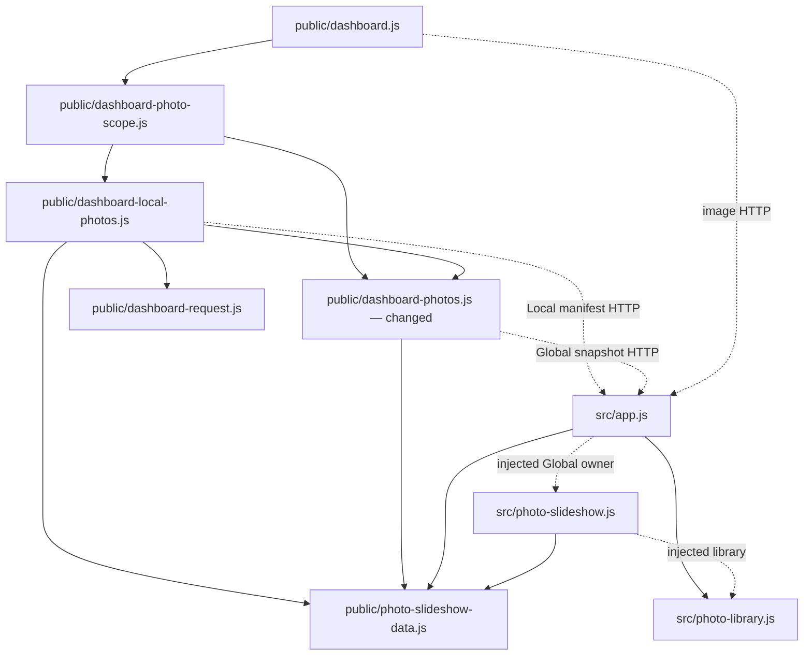

# Brooks-Lint Health Dashboard

- [Brooks-Lint Health Dashboard](#brooks-lint-health-dashboard)
  - [Scope And Scores](#scope-and-scores)
  - [Module Dependency Graph](#module-dependency-graph)
  - [Test Suite Map](#test-suite-map)
  - [Top Findings](#top-findings)
    - [Warning](#warning)
  - [Verification](#verification)
  - [Recommendation](#recommendation)

**Mode:** Health Dashboard

**Scope:** All changes on `59-restore-dashboard-images` relative to base branch `main`: `230422f...7a3ac86`, one implementation commit, 11 changed files. `main` is the branch creation point and merge base; the working tree was clean before review. Planning and plan-review commits are already on the base branch.

**Composite Score:** 99/100.

**Trend:** 100 → 99 (−1) against the latest Health Dashboard record. That record evaluated this task's plan, so the scores do not represent repeated measurement of identical code.

**Verdict:** One reproducible status-reporting Warning remains. Image retry, cancellation, and scope isolation pass the focused checks.

## Scope And Scores

No `.brooks-lint.yaml` exists; defaults and balanced deductions apply. Each dimension starts at 100. The single Warning is counted in Code Quality only, avoiding duplicate deductions for its missing regression: `95 × 0.25 + 100 × 0.30 + 100 × 0.25 + 100 × 0.20 = 98.75`, rounded half-up to 99.

- **Code Quality: 95/100.** Production changes are confined to `public/dashboard-photos.js`; the new retry owner reuses existing lifecycle retirement. However, the success callback writes source status from the last successful snapshot without preserving a later metadata-read failure. This couples two independent completion paths, as detailed below.
- **Architecture: 100/100.** No runtime import, public contract, endpoint, persistence schema, or server rotation owner changed. Retry state remains inside the shared follower used by both scopes; Local discovery and Global selection retain separate ownership. No cycle or new dependency-direction violation was found in the inspected slice.
- **Tech Debt: 100/100.** The branch adds one bounded retry timer rather than another playback subsystem, shares the source-status formatter, and retains filename, stream, scan, and decode limits. Changes to version metadata, documentation, and the existing test fixture are consistent with the patch release. No independent R1–R6 debt finding was identified beyond the already-counted status coupling.
- **Test Quality: 100/100.** The added tests use controlled clocks, relevant temporary files, visible decoded images, and observable scope/selection behavior. Failure scenarios and cleanup are named explicitly. The two scope-test corrections preserve origin-based Local storage and replace a transient-message assertion with retained scope/photo assertions. No independent T1/T2 obscurity or brittleness finding was identified; the missing status-race case belongs to the production finding's remedy.

The complete changed-file inventory is `public/dashboard-photos.js`; `test/dashboard.test.js`; `test/local-photo-manifest-api.test.js`; `e2e/photo-display-recovery.spec.js`; `e2e/settings-environment.js`; `e2e/settings-scope.spec.js`; `docs/nfs-backgrounds.md`; `docs/testing.md`; `package.json`; `package-lock.json`; and `tasks/59-restore-dashboard-images/4-implemented.md`. All were inspected. Versions agree at `0.17.28`.

## Module Dependency Graph

This graph shows the relevant runtime slice. Solid arrows represent imports; dotted arrows represent HTTP or injected collaborators. The branch adds no runtime dependency edges. Existing server adapters share the pure photo contract deliberately; browser code does not import server infrastructure.



## Test Suite Map

This is a branch-focused map, not a whole-project case census.

- **Unit and API integration: 2 changed files, 45 existing/resulting cases.** `test/dashboard.test.js` combines HTTP and browser-controller tests; `test/local-photo-manifest-api.test.js` combines real Local projection and controlled controller scenarios. The branch adds five controller cases covering same-image recovery, deadline recovery, metadata stalls, cancellation, and scope replacement.
- **Browser end-to-end: 2 changed specs, 7 resulting cases.** The new `e2e/photo-display-recovery.spec.js` contributes three cases; `e2e/settings-scope.spec.js` contains four. `e2e/settings-environment.js` is their shared real-server/SQLite/local-PNG fixture, not another test suite.
- **Adjacent browser regression: 1 unchanged spec, 7 cases.** `e2e/server-photo-rotation.spec.js` retains zero-viewer rotation, multi-client convergence, visibility resume, decode failure retention, and source fallback coverage.

Fake decoding in unit cases isolates deadline/ownership behavior; real Chromium decoding verifies the complete browser/server/image boundary. Those layers protect different risks rather than duplicate identical assertions. Test names and fixture seams make the relevant failure stories explicit without contacting the NAS.

## Top Findings

### Warning

**R2 — Change Propagation: Image recovery overwrites a newer metadata outage.**

**Location:** `public/dashboard-photos.js:55`, interacting with `:43-44` and `:96`.

**Symptom:** The new image-success path unconditionally calls `reportSource(snapshot)`. A failed metadata read reports unavailable but does not update that last successful snapshot. If the image retry then resolves, it replaces the newer outage message with `Using 1 NFS background from the bounded photo pool.` despite no successful metadata recovery. The new stalled-metadata test (`test/dashboard.test.js:468-475`) asserts rendering and cleanup, but not status precedence.

**Source:** *The Pragmatic Programmer* — Orthogonality; *Code Complete* — Error-handling discipline. Successful image decoding and successful metadata retrieval are separate facts; completion of one should not erase a failure of the other.

**Consequence:** Global Images status can imply source recovery while selection metadata remains unreachable. The warning disappears until a later failed poll, obscuring diagnosis during precisely the mixed outage/recovery scenario this branch introduces. The background itself renders correctly, and no data-loss or unsafe-file-access issue was observed.

**Remedy:** Preserve current metadata transport failure independently of the cached selection and image decode state. On image success, clear the image-specific error while retaining any newer metadata-unavailable/stale indication; clear that transport failure only after an accepted successful metadata read. Add a controlled-clock regression that fails the first decode, fails the next metadata read, resolves the second decode, verifies that the image displays while the outage status remains, then verifies normal status after a fresh metadata success. Keep this state within the existing controller rather than introducing another service.

The review reproduced this with the unchanged exported controller and existing `slideshowClock`, `slideshowSnapshot`, `deferred`, and `tick` fixtures. After one healthy snapshot, the first decode failed; after advancing five seconds, the next metadata request failed while the retry decode remained pending. Resolving that decode produced:

```text
After metadata failure: reads=2, attempts=2, status="NFS backgrounds are unavailable. Retrying automatically."
After image success without metadata recovery: reads=2, attempts=2, status="Using 1 NFS background from the bounded photo pool."
```

This was an in-memory probe; no implementation or test files were modified to reproduce it.

## Verification

- Review-run `node --test test/dashboard.test.js test/local-photo-manifest-api.test.js`: all 45 passed, with no skips.
- Review-run `npm run test:browser -- e2e/photo-display-recovery.spec.js e2e/settings-scope.spec.js e2e/server-photo-rotation.spec.js`: all 14 passed in Chromium.
- Review-run `npm run check` and `git diff --check`: passed. The glob-based syntax command's limits remain as documented; implementation-stage individual checks are recorded in `4-implemented.md`.
- The independent controlled-clock status-race probe above reproduced the Warning despite the passing focused suites.
- The implementation stage recorded all 506 Node tests passing and a broader browser result of 75 passed/5 failed. All five broader failures were reproduced there with the original production controller: two stale-save message assertions, one General-panel focus assertion, and two fullscreen-exit errors. This review inspected those results rather than rerunning the broader group or attributing those failures to this branch.
- No live deployment/NFS verification was performed. The affected URL, browser/version, and Images status remain unavailable, so the confirmed Local retry defect is not proof of the deployed report's cause. The implementation record states this limitation accurately.

## Recommendation

Correct the status-precedence race and add its narrow controller regression before treating the new source-status restoration as complete. The independent retry owner, ten-second decode deadline, obsolete-work guards, and five-second single-image recovery are otherwise supported by the focused evidence. Code Quality is the only dimension with a finding; a broader architectural refactor or test-suite audit is not needed to address it. Keep the known broader-browser failures and pending deployment diagnosis separate from the verified retry behavior. This review changes only the review document and health-history record; it implements no fixes.
