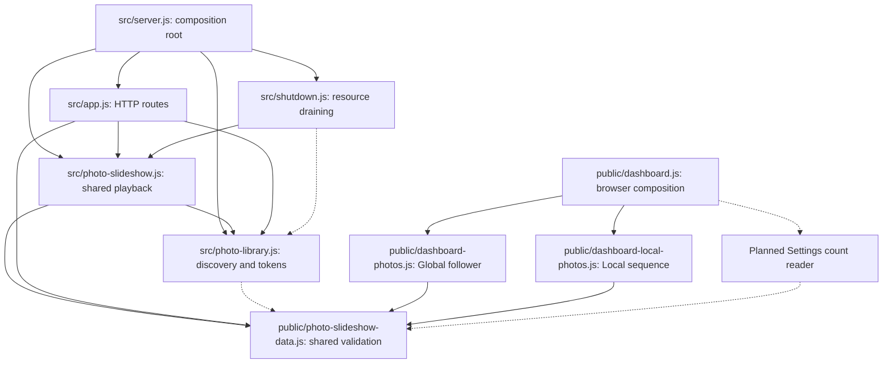

# Brooks-Lint Health Dashboard

- [Brooks-Lint Health Dashboard](#brooks-lint-health-dashboard)
  - [Dimension Scores](#dimension-scores)
  - [Module Dependency Graph](#module-dependency-graph)
  - [Test Suite Map](#test-suite-map)
  - [Top Findings](#top-findings)
    - [Warning](#warning)
    - [Suggestion](#suggestion)
  - [Recommendation](#recommendation)

**Mode:** Health Dashboard

**Scope:** Plan review of `tasks/60-image-count-full-global-library/2-plan.md` at `a04ce80`, checked against `1-goal.md` and the current photo discovery, slideshow, API, startup, shutdown, and test seams. Scores assess implementation readiness of the plan, not implemented runtime quality.

**Composite Score:** 94/100

**Trend:** Previous Health Dashboard score 99 → 94 (−5); the previous record covers another branch, so this is not a same-scope regression measurement.

The plan addresses the real Global limits, but discovery ownership and scan/projection contracts need clarification before implementation.

## Dimension Scores

- Code Quality: Not scored. The working tree has no implementation diff; this is a design review. The PR dimension is omitted under the skill's no-diff rule.
- Architecture: 95/100. One Warning: cached discovery depends on slideshow preference availability.
- Tech Debt: 90/100. Two Warnings: unspecified per-entry error handling and unspecified deterministic bounded projections.
- Test Quality: 99/100. One Suggestion: memory verification lacks a repeatable measurement and acceptance protocol.
- Calculation: Balanced deductions of five points per Warning and one per Suggestion. Redistributed weights are Architecture `0.30 / 0.75`, Tech Debt `0.25 / 0.75`, and Test Quality `0.20 / 0.75`. Composite `(95 × 0.30 + 90 × 0.25 + 99 × 0.20) / 0.75 = 94.4`, rounded to 94. No project `.brooks-lint.yaml` exists; defaults apply.

## Module Dependency Graph

Arrows indicate dependency or ownership. Dashed arrows describe planned additions; the graph is scoped to this task, not a whole-project cycle audit.

The existing injected library and shared pure validators are useful seams. Splitting complete inventory from bounded manifests is justified by the current Global requirement; a disk-backed catalog is reasonably deferred. No speculative framework or proposed dependency cycle was identified.

## Test Suite Map

- Discovery and contract tests: `test/photo-library.test.js`, `test/photo-slideshow-data.test.js`, and `test/photo-slideshow.test.js` cover inventory eligibility, compact contracts, sequence behavior, and virtual-time refresh ownership. Existing `test/fixtures/photo-slideshow.js` supplies the clock seam.
- HTTP integration tests: `test/large-photo-library-api.test.js`, `test/local-photo-manifest-api.test.js`, and `test/photo-slideshow-api.test.js` exercise bounded manifests, shared snapshots, and actual image streaming. Their current 100-photo assumptions require deliberate updates rather than wholesale removal.
- Lifecycle tests: `test/shutdown.test.js` and `test/server-shutdown.test.js` provide resource-drain coverage. Add the library owner and preference-unavailable startup cases here or in narrowly scoped service tests.
- Browser tests: `e2e/server-photo-rotation.spec.js` and `e2e/photo-display-recovery.spec.js` protect shared selection and display recovery; new Settings assertions should protect count visibility and lifecycle behavior.
- This is a file-level map of the relevant verification portfolio, not a count of test cases. Large traversal coverage belongs in service/integration tests with virtual time; browser coverage should remain focused on user-visible behavior. No tests were run because only the plan is under review.

## Top Findings

### Warning

**1. R5 — Dependency Disorder: inventory refresh still depends on Global preferences.**

- Symptom: `2-plan.md:25,30,47-49` makes API reads cache-only and assigns startup/periodic discovery to the slideshow, without specifying discovery when Global preferences are unavailable. Currently `src/photo-slideshow.js:46-47` returns before scanning when `settings` is missing. `src/server.js:71-73` explicitly permits preference loading to fail, and `test/photo-slideshow.test.js:67-70` characterizes the resulting no-scan state.
- Source: *Clean Architecture* — Single Responsibility and dependency boundaries; discovery availability should not depend on playback configuration.
- Consequence: After a preference-store failure, the new Settings count and Local bounded manifests can remain unknown/unavailable indefinitely despite a readable photo source. Previously, manifest reads could initiate their own discovery.
- Remedy: State explicitly that enabled discovery starts and refreshes even when Global playback preferences cannot load, while shared rotation remains paused. Keep one scheduler, either by separating discovery gating from rotation gating in the slideshow owner or by moving the scheduler into the library. Add a test with unavailable Global preferences that obtains a completed cached count and Local manifest, then restores preferences without creating another scan owner.

**2. R6 — Domain Model Distortion: individual file errors and incomplete traversal have no distinct policy.**

- Symptom: `2-plan.md:26-29,78,82` promises all readable eligible files and truthful completeness, but does not define what happens when an admitted file vanishes, becomes unreadable, or changes type during the scan. Currently a file open/stat failure propagates through `src/photo-library.js:54-65` and rejects the entire scan. Complete longer scans increase exposure to these ordinary races.
- Source: *Code Complete* — Defensive Programming and error-handling discipline; *Domain-Driven Design* — Ubiquitous Language for complete, excluded, and unavailable states.
- Consequence: One persistently unreadable file can prevent the first inventory from ever publishing. Blindly changing all errors into exclusions would instead hide directory/NFS failures and falsely claim a complete inventory.
- Remedy: Define a small error-policy matrix before implementation. Skip/count explicitly handled file-local races and exclusions; distinguish permission exclusions from traversal completeness according to the chosen user-visible policy. Fail or mark incomplete on unreadable directories, root loss, and source-level I/O errors, preserving last-good data. Add deterministic tests for a disappearing file, an unreadable file, an unreadable subtree, and an NFS-style I/O failure. Use an injected filesystem seam where permission tests would otherwise depend on the test account.

**3. R6 — Domain Model Distortion: bounded Local and legacy projections lack stable membership rules.**

- Symptom: `2-plan.md:26-27` removes collection and sorting of directory children, while `2-plan.md:25,43` retains bounded Local/legacy projections without specifying their ordering or exact legacy selection limits. Currently `src/photo-library.js:66-70` sorts relative names before applying the 100-file and 200 MiB limits. Filesystem enumeration order is not a stable replacement for this behavior.
- Source: *Software Engineering at Google* — Hyrum's Law and Backward Compatibility; *Domain-Driven Design* — invariant ownership at the inventory boundary.
- Consequence: An unchanged tree can produce different Local subsets across refreshes if the first 100 encountered records are returned. This can reset Local traversal and make its subset/count disagree with documented legacy behavior even though Global playback is fixed.
- Remedy: Specify deterministic projections derived from the completed inventory, independent of enumeration order. Define whether legacy retains its 200 MiB aggregate bound as well as the 100-file bound, and preserve its filename treatment deliberately. Select the Local subset after shared eligibility validation using a stable relative-name order. Keep these rules owned by the library projection, not copied into route handlers. Test two equivalent inventories presented in different enumeration orders and assert identical projections and unchanged Local playback continuity.

### Suggestion

**4. T2 — Test Brittleness: memory acceptance depends on unspecified runtime noise.**

- Symptom: `2-plan.md:59,74` requires no cumulative memory growth and recorded peaks, but supplies no warm-up, sampling boundaries, garbage-collection policy, tolerance, or peak-memory acceptance threshold. The stated 64 MiB metadata accounting budget is expressly not a heap ceiling.
- Source: *xUnit Test Patterns* — Erratic Test; *The Art of Unit Testing* — Test Isolation.
- Consequence: Normal garbage collection and process startup can look like a leak, while a large but flat memory footprint can satisfy the written criterion without demonstrating Raspberry Pi suitability.
- Remedy: Add a repeatable benchmark protocol with the Node version, isolated process, warm-up, sampling points, and an explicit peak/headroom target. Compare settled retained memory at equivalent refresh/generation states using a documented tolerance. Test budget admission, generation expiry, and retained-owner counts deterministically; keep noisy RSS checks as recorded benchmark evidence rather than exact unit-test assertions. Record browser memory separately if measured, and keep unavailable target-device verification pending.

## Recommendation

Revise the plan before implementation. First make discovery independent of preference loading, then define file-error classification and deterministic bounded projections. Tighten the memory protocol alongside those changes. The complete-inventory approach, compact Global snapshots, active-token ownership, and layered verification remain sound. Architecture and domain contracts are the highest-priority gaps; a focused architecture review of the revised discovery lifecycle would provide the most useful follow-up. This review records findings only; `2-plan.md` and implementation code are unchanged.
