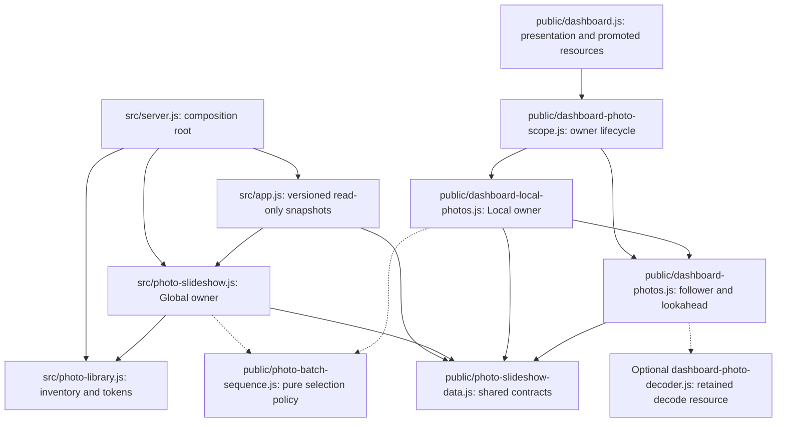

# Brooks-Lint Health Dashboard

- [Brooks-Lint Health Dashboard](#brooks-lint-health-dashboard)
  - [Dimension Scores](#dimension-scores)
  - [Module Dependency Graph](#module-dependency-graph)
  - [Test Suite Map](#test-suite-map)
  - [Top Findings](#top-findings)
    - [Warning](#warning)
  - [Recommendation](#recommendation)

**Mode:** Health Dashboard

**Scope:** Plan review of `tasks/61-prepare-next-random-photo/2-plan.md` at `0bb2b02`, checked against `1-goal.md`, existing slideshow owners, snapshot validation, browser polling, presentation, scope replacement, and resource benchmarks. Scores describe plan readiness, not measured implementation quality. No project `.brooks-lint.yaml` exists; balanced defaults apply.

**Composite Score:** 98/100

**Trend:** Previous Health Dashboard record 94 → 98 (+4). That record reviews task 60, so this is not a same-scope improvement measurement.

The plan establishes sound sequencing and resource boundaries, but needs an explicit delivery path for asynchronously prepared previews.

## Dimension Scores

- Code Quality: Not scored. There is no implementation diff; omit the PR dimension under the no-diff rule.
- Architecture: 100/100. Shared selection policy remains separate from discovery, transport, decoding, and presentation. No proposed cycle or unjustified dependency inversion was identified.
- Tech Debt: 95/100. One R2 Warning: preview consumers can remain unaware of completed preparation until the next rotation.
- Test Quality: 100/100. The proposed deterministic sequence tests, API checks, deferred-resource controller tests, focused browser checks, and separate memory measurements address distinct risks. These are planned checks, not executed results.
- Calculation: One balanced Warning deducts five points from Tech Debt. Redistributed weights are Architecture `0.30 / 0.75`, Tech Debt `0.25 / 0.75`, and Test Quality `0.20 / 0.75`. Composite `(100 × 0.30 + 95 × 0.25 + 100 × 0.20) / 0.75 = 98.333…`, rounded to 98. No finding is counted in multiple dimensions.

## Module Dependency Graph

Arrows indicate imports or ownership; dashed arrows indicate planned dependencies. This graph covers the task's boundaries, not a whole-project dependency audit.

Sharing browser-safe selection policy between server and Local playback removes duplicated traversal decisions without sharing their cursors. The optional decoder extraction has a concrete resource-ownership purpose. Filename identity, active-inventory URL resolution, independent current/preview revisions, and bounded presentation overlap are explicitly justified.

## Test Suite Map

- Unit/service: One new `test/photo-batch-sequence.test.js`, plus existing `test/photo-slideshow.test.js` and `test/photo-slideshow-data.test.js`, cover selection invariants, reconciliation, timing, and strict versioned contracts.
- API integration: Existing `test/photo-slideshow-api.test.js` and `test/local-photo-manifest-api.test.js` cover negotiation, bounded projections, pure reads, and independent playback pools. Local browser sequencing also needs the controller coverage already requested in plan step 5.
- Controller/lifecycle: Existing `test/dashboard.test.js`, related scope/Local coverage, and `test/shutdown.test.js` provide deferred decoding, cancellation, ownership, and drainage seams.
- Browser: Two named existing specs, `e2e/server-photo-rotation.spec.js` and `e2e/photo-display-recovery.spec.js`, cover visible playback, actual requests, element promotion, and shared Global authority.
- Resource evidence: `scripts/benchmark-photo-library.js` supplies isolated server measurements; separate browser measurements address decoded images and detached resources. Target-device verification can remain explicitly pending when inaccessible.
- Counts above identify named files, not test cases or measured pyramid ratios. No implementation tests or benchmarks were run during this document-only review. The missing delayed-preview scenario is included in the Warning's remedy rather than scored twice.

## Top Findings

### Warning

**1. R2 — Change Propagation: asynchronous preview completion has no explicit consumer wake-up contract.**

- Symptom: `2-plan.md:29,36,44-48,53` allows cooperative preparation after the first selection and nullable `next`, but does not specify how a completed preview reaches waiting followers before rotation. Currently `public/dashboard-photos.js:87-98` polls after up to five seconds, or at the next deadline. `public/dashboard-local-photos.js:10,25,45` disables follower polling and delivers snapshots on selection or manifest refresh. A `queueRevision` change is observable only after another snapshot read; it does not itself wake either consumer.
- Source: *A Philosophy of Software Design* — Information Hiding and Leakage; *The Pragmatic Programmer* — Orthogonality. Preparation timing must have an explicit handoff across the sequencer, playback owner, and follower boundaries rather than relying on their existing unrelated timers.
- Consequence: At the supported five-second interval, a Global response with `next: null` can schedule its next read for the selection deadline. If preparation consistently completes after each response, the browser can repeatedly learn an image only after it becomes current. Local playback can miss newly completed previews until its next selection because its follower has no automatic poll. Queue correctness can therefore pass while one-image-ahead decoding fails to occur.
- Remedy: Specify a bounded readiness-delivery contract. When visible Global playback has multiple images and `next` is pending, poll for preview readiness sooner than the normal rotation poll, with one owned timer and an explicit bounded cadence; reads must remain pure. On Local queue completion or reconciliation that changes advertised metadata, notify its follower through the existing snapshot-consumption boundary without advancing selection or restarting the rotation deadline. Cancel those notifications/retries on suspension, scope retirement, and disposal. Add deterministic Global and Local tests where the first snapshot has no preview, a deferred fill completes afterward, and the next image is requested before the five-second selection deadline. Repeat across a batch boundary and verify that notification changes neither current revision nor displayed frame. If preparation finishes too late to decode ahead, retain the already specified current-priority fallback.

## Recommendation

Clarify preview delivery before implementation. Keep the existing sequencing, reconciliation, version negotiation, and retained-element design. Add the delayed-fill tests alongside the delivery contract; the existing test and benchmark plan otherwise provides appropriate verification. The highest-value focused follow-up is a review of the owner-to-follower timing boundary after that clarification. This review does not modify `2-plan.md` or implementation code.
