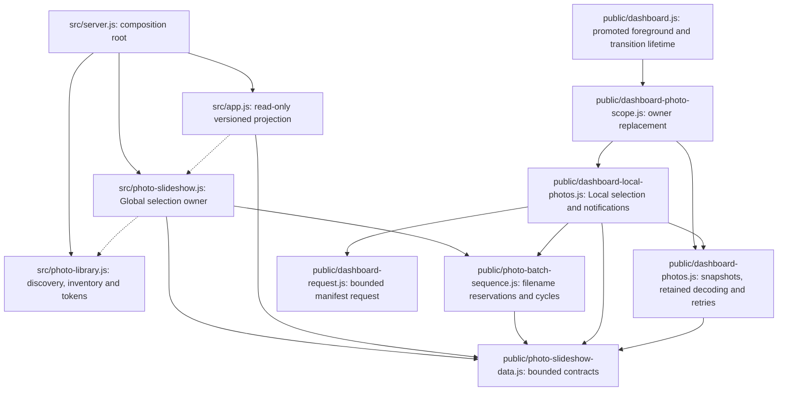

# Brooks-Lint Health Dashboard

- [Brooks-Lint Health Dashboard](#brooks-lint-health-dashboard)
  - [Scope and base](#scope-and-base)
  - [Dimension Scores](#dimension-scores)
  - [Module Dependency Graph](#module-dependency-graph)
  - [Test Suite Map](#test-suite-map)
  - [Top Findings](#top-findings)
    - [Warning](#warning)
    - [Suggestion](#suggestion)
  - [Verification](#verification)
  - [Recommendation](#recommendation)

**Mode:** Health Dashboard

**Scope:** All 25 changed files on `61-prepare-next-random-photo` relative to its actual base branch, `60-image-count-full-global-library` (`bdf21ac...b504516`). No `.brooks-lint.yaml` exists; balanced defaults apply.

**Composite Score:** 99/100

**Trend:** Previous Health Dashboard 98 → 99 (+1). The previous record reviews task 61's plan, not this implementation, so this is not a measured code-quality improvement.

The shared sequencing and resource boundaries are sound, but singleton-to-multiple inventory growth can consume a duplicate selection and delay the new image by an extra interval.

## Scope and base

- The task implementation record, branch pointers, and merge-base identify `60-image-count-full-global-library` at `bdf21ac` as the branch base. `git merge-base 60-image-count-full-global-library HEAD` returns that exact commit.
- Reviewed the sole branch commit, `b504516 feat: prepare nonrepeating photo batches and decoded lookahead`, and its complete diff: 25 files, 657 insertions, and 89 deletions. Seven runtime files cover Global/Local ownership, shared sequencing/contracts, HTTP negotiation, follower decoding, and DOM presentation. Remaining changes comprise one benchmark, seven Node test modules and their fixture, two browser specs and their fixture, README/two docs, two version manifests, and the implementation record.
- `main` is behind the actual base. Its merge-base is `162fe96`; `main...HEAD` contains 42 changed files, including inherited task-60 work and task-61 planning records. Those inherited changes were read as dependency/context where relevant, rather than attributed to this task.
- Working tree was clean before review. This stage changes only this report and the review history; it does not implement remedies.

## Dimension Scores

- **Code Quality: 100/100.** The abbreviated R1/R2 scan found no separate actionable cognitive-load or unrelated change-propagation issue. Added state supports concrete queue, retry, decoding, and lifetime requirements; the number of coordinated files is appropriate for one photo-playback boundary.
- **Architecture: 100/100.** No new import cycle, upward infrastructure dependency, or unjustified fan-out was found in the affected graph. Shared policy remains browser-safe and independent of filesystem discovery, HTTP, DOM rendering, and SQLite.
- **Tech Debt: 94/100.** One R6 Warning deducts five points for singleton growth consuming a duplicate current filename. One R6 Suggestion deducts one point for reversing stable name/date tie ordering. Both findings are assigned here once; they are not deducted again from other dimensions.
- **Test Quality: 100/100.** The abbreviated T1/T2 scan found no separate obscurity or brittleness finding. Tests expose deterministic clocks, randomness, deferred preparation, retained resources, actual transport, and real-browser presentation. The two reproduced edge cases below are not covered by the existing assertions; that observation does not make the entire test portfolio brittle.
- **Calculation:** `100 × 0.25 + 100 × 0.30 + 94 × 0.25 + 100 × 0.20 = 98.5`, rounded half-up to `99`. The two findings remain below the dashboard caps. This weighted score is not a release-approval gate.

## Module Dependency Graph

Solid arrows represent imports/composition. Dashed arrows represent injected runtime dependencies, not reverse imports. The graph focuses on modules touched by this branch and their playback boundaries.

Independent Global/Local cursors are intentional. The shared sequencer hides random selection and reservation state, while followers receive only current/next metadata. The DOM adopts a promoted image through callbacks and owns its eventual release. Version-1 compatibility and bounded version-2 negotiation avoid a coordinated client/server upgrade requirement. Data-only snapshot records are appropriate transport objects, not an anemic domain model.

## Test Suite Map

Counts describe the complete changed test modules, not only assertions added by this commit. Parameterized cases are expanded. Fixtures are not counted as tests.

- **Unit/service/controller: 95 cases.** `test/photo-batch-sequence.test.js` has 25; `test/photo-lookahead.test.js` has nine; `test/photo-slideshow.test.js` has 14; `test/photo-slideshow-data.test.js` has three; `test/shutdown.test.js` has 18; and the pure/helper/controller portion of `test/dashboard.test.js` has 26. These protect sequencing, resource promotion, revisions, notifications, retries, deadlines, and actual queue-drain ownership through injected seams.
- **HTTP integration: 19 cases.** `test/photo-slideshow-api.test.js` has seven, and `test/dashboard.test.js` has 12 real-server API/static-document cases. They cover version negotiation, strict schemas, request purity/protection, initialization, and actual eligible-library transport.
- **Browser: 15 cases across two changed specs.** `e2e/server-photo-rotation.spec.js` has 11 and `e2e/photo-display-recovery.spec.js` has four. They cover Global convergence, Local isolation, delayed preview delivery across metadata boundaries, retained DOM element adoption, failure recovery, and larger-image transition/resource ownership.
- **Resource checks:** `scripts/benchmark-photo-library.js` remains an opt-in server benchmark with an additional unique batch traversal. The larger-image browser case verifies pixel-resource ownership and reports actual decode durations separately. Their different observations justify both layers; tiny server fixtures are not substituted for browser decoding evidence.

## Top Findings

### Warning

**1. R6 — Domain Model Distortion: a completed singleton cycle reserves the displayed filename again before the inventory grows.**

- **Symptom:** `public/photo-batch-sequence.js:35-40` clears a completed cycle and fills another batch even when its only eligible filename is already displayed. `reconcile()` at lines 47–52 preserves that reservation when a second file is discovered. The candidate therefore still equals the current filename. `src/photo-slideshow.js:14-17` and `public/dashboard-local-photos.js:23-26` hide it by advertising `next: null`, but their next rotation still commits it through the queue. This is a second committed selection, not a recovery hold caused by missing metadata.
- **Source:** *Domain-Driven Design* — Aggregate Roots and invariant ownership. The sequencer owns cycle/reservation invariants, but the owners' preview filtering only masks a queue head that becomes invalid after the singleton-to-multiple transition. The plan explicitly requires single-image pools not to invent duplicate work and multi-image cycle boundaries to avoid immediate repeats.
- **Consequence:** After discovery changes `[a.png]` to `[a.png, b.png]`, completed preparation still yields no usable preview for `b.png`. The first due rotation reselects `a.png`, keeps current revision unchanged, and rearms a full interval. `b.png` is selected only at the second deadline. This adds an unnecessary configured interval, up to 3,600 seconds, and keeps Global followers on pending-preview polling until the hidden duplicate is consumed. Both owners reproduce the issue.
- **Evidence:** With random order, deterministic randomness, and a five-second interval, start on `a.png`, settle preparation, add `b.png`, and advance the discovery clock by 60 seconds. Global snapshots at `t=1060000`, `1065000`, and `1070000` respectively report `(current=a, revision=1, next=null)`, `(current=a, revision=1, next=b)`, and `(current=b, revision=2, next=a)`. The first deadline was `1065000`. The independent Local controller similarly displays only `a.png` at the first deadline and displays `b.png` at the second. Its upcoming-image decode does not begin until that first deadline.
- **Remedy:** Keep the singleton selection dormant rather than reserving it as another playable cycle, or reconcile that provisional reservation before arming multi-image rotation. Preserve valid surviving reservations and make the newly eligible different filename the advertised/committed next selection. Add Global and Local regressions for one-to-two growth, including growth after shrink-to-one, and verify that the new file is prefetched before and selected at the first due deadline without a duplicate commitment.

### Suggestion

**2. R6 — Domain Model Distortion: reverse sorting followed by removal from the end reverses stable collation ties.**

- **Symptom:** `public/photo-batch-sequence.js:8-17` sorts remaining names using a descending comparator and then draws from the end. JavaScript's stable sort preserves input order for equal comparisons, so drawing backward reverses those equal groups. Distinct accepted filenames `e\u0301.png` and `\u00e9.png` compare equal with `localeCompare`; with equal dates, this affects both name and date modes. The former ascending stable sort preserved their inventory order.
- **Source:** *Domain-Driven Design* — Ubiquitous Language and identity. Filename identity deliberately distinguishes these two names, while ordered traversal must preserve the previously defined comparison/tie semantics. The new bag representation changes that observable ordering even though the plan calls for retaining the existing sort semantics.
- **Consequence:** Valid non-ASCII files with equal collation values are presented in the opposite tie order after this upgrade. Ordinary ASCII and distinct-date cases pass, so the existing large traversals and Unicode validation checks do not expose the difference. Coverage and filename uniqueness remain intact; this is a narrow compatibility issue, not lost images.
- **Evidence:** For inventory `["e\u0301.png", "\u00e9.png"]` with equal modification times, the old ascending comparison produces that same order in both modes. The new sequencer produces `["\u00e9.png", "e\u0301.png"]`; `localeCompare` returns `0` for the pair.
- **Remedy:** Preserve ascending stable comparison order when building the pop-oriented bag, including equal-comparison groups. Add a focused name/date regression with canonically equivalent but distinct filenames. If a new total-order tie breaker is preferred instead, make that an explicit compatibility decision rather than an incidental consequence of reverse consumption.

## Verification

- During this review, ran `node --test test/photo-batch-sequence.test.js test/photo-lookahead.test.js test/photo-slideshow.test.js test/photo-slideshow-data.test.js test/photo-slideshow-api.test.js test/dashboard.test.js test/shutdown.test.js`: **114 passed**, zero failed/skipped.
- Executed read-only, in-memory Node reproductions for the singleton-growth case through both real playback owners and for the collation-tie case through the shared sequencer. They use existing fixture clocks/records, settle asynchronous preparation, and stop/dispose their owners. No implementation or test files were changed to obtain the results.
- Implementation-stage evidence in `4-implemented.md` records 565 passing Node tests, 15 passing focused photo browser cases using cached Chromium, and 158 passed/14 failed in the full browser suite. It also records reproduction of those 14 unrelated failures at `bdf21ac`, three passing server memory runs, and larger-image resource ownership measurements. Those expensive checks were not repeated during this document-only review and do not cover the newly reproduced edge cases.
- The 14 recorded browser failures remain baseline/environment limitations, not new findings in this branch. Pi 5/real NFS headroom remains explicitly pending; no device or NAS was accessed for review.
- Review-document and history changes passed `git diff --check`. Runtime code, tests, version, README, and implementation records remain unchanged in this stage.

## Recommendation

Address the singleton-growth Warning before merging: it undermines both the no-repeat commitment model and timely preview delivery on a common inventory transition. Preserve the shared sequencer, separate playback authorities, strict version negotiation, and retained-resource boundaries. Resolve the narrow collation compatibility issue alongside focused sequencing regressions. Tech Debt is the lowest-scoring dimension; a full `brooks-debt` pass over the sequencer is the most relevant deeper follow-up if a broader assessment is needed. No fixes were implemented in this review stage.
