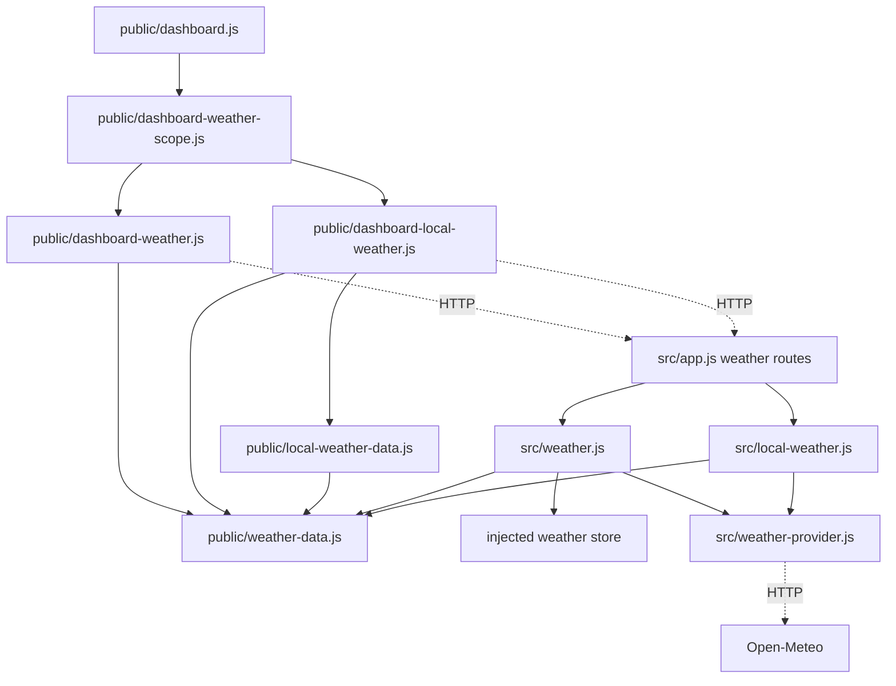

# Brooks-Lint Health Dashboard

- [Assessment](#assessment)
- [Dimension Scores](#dimension-scores)
- [Module Dependency Graph](#module-dependency-graph)
- [Test Suite Map](#test-suite-map)
- [Top Findings](#top-findings)
  - [Suggestion](#suggestion)
- [Recommendation](#recommendation)

## Assessment

**Mode:** Health Dashboard

**Scope:** Plan review of `tasks/62-display-air-quality/2-plan.md` at `4f97d5d`, checked against the weather provider, Global and Local services, shared validation, scope controller, rendering, and relevant tests.

**Composite Score:** 99/100

**Trend:** Stable at 99 compared with the latest Health Dashboard record; that record reviewed a different task and scope.

**Verdict:** Approve with two nonblocking test-plan suggestions. The diagnosis-first approach is appropriate because the failing runtime response and root cause remain unconfirmed.

No `.brooks-lint.yaml` exists; balanced scoring and default risks apply. This score measures the proposed work, not whole-project health or proof that the reported defect is fixed. Review used static inspection; application tests and live provider checks were not run during this review.

## Dimension Scores

- Code Quality: Not scored. There is no implementation diff; plan clarity and change scope were checked without treating prose as production code.
- Architecture: 100/100. Shared provider and normalization boundaries remain intact, browser controllers use application APIs, and no new dependency cycle is proposed.
- Tech Debt: 100/100. The plan avoids speculative fallbacks and keeps the `{ aqi }` contract, retry policy, failure isolation, and existing cache responsibilities.
- Test Quality: 98/100. Two T5 suggestions concern explicit invalid-payload and location-race coverage.

With the code-quality dimension omitted, weights are `0.30 / 0.75` for Architecture, `0.25 / 0.75` for Tech Debt, and `0.20 / 0.75` for Test Quality. Each suggestion deducts one point from Test Quality. The weighted result is `99.4666…`, rounded half-up to `99`.

## Module Dependency Graph

Solid arrows show relevant imports or injected service dependencies; dashed arrows show HTTP boundaries. This is the affected weather subsystem, not the whole project.

## Test Suite Map

Counts describe reviewed files, not test cases; several files intentionally contain more than one test layer.

- Service and controller tests: 2 files, `test/weather.test.js` and `test/local-weather.test.js`, with injected provider fetches and clocks. Global tests use a real temporary SQLite store; Local tests use the real memory service.
- API integration tests: 2 files, `test/weather-api.test.js` and `test/local-weather-api.test.js`, covering real application routes and scope isolation.
- Mixed helper, controller, and HTTP tests: 1 file, `test/dashboard.test.js`, including provider URL construction and snapshot validation.
- Browser tests: 2 files, `e2e/dashboard-home.spec.js` and `e2e/settings-scope.spec.js`. The former uses mocked weather snapshots; scope tests exercise the configured application environment.

The existing service tests already cover Global AQI recovery and stale timestamps (`test/weather.test.js:74-90`). AQI without a forecast already has browser coverage (`e2e/dashboard-home.spec.js:939-947`); retain that case rather than adding an identical test. New service tests should verify provider/cache behavior, while browser tests should verify visible state transitions.

## Top Findings

### Suggestion

**T5 — Coverage Illusion: Invalid AQI rejection lacks an explicit test matrix**

Symptom: `2-plan.md:32` requires rejection of missing, null, nonnumeric, and nonfinite readings, but the verification steps at `2-plan.md:40-43` explicitly name valid AQI, zero, failure, and recovery without naming these malformed payload cases. The reviewed tests do not directly exercise `normalizeAir()` with those inputs.

Source: *The Art of Unit Testing* — Test completeness; *How Google Tests Software* — Change coverage rather than execution coverage.

Consequence: If normalization changes during the fix, provider nulls or numeric strings could be coerced into false successful readings while the planned success and transport-failure tests still pass.

Remedy: If the request/normalizer contract changes, add one focused parameterized normalizer test for missing `current`, missing `us_aqi`, `null`, a numeric string, `NaN`, and infinities, alongside valid zero. Exercise JSON-compatible invalid payloads through the affected service to confirm failure state and last-good preservation. Keep nonfinite JavaScript values at the direct normalizer boundary because JSON cannot represent them.

**T5 — Coverage Illusion: Location identity acceptance lacks an AQI-specific race test**

Symptom: `2-plan.md:54` requires rejecting a previous location's AQI, but the verification steps do not explicitly map that criterion to a test. The Global late-result test at `test/weather.test.js:93-107` blocks a forecast response and asserts forecast values; the Local controller test at `test/local-weather.test.js:47-56` uses the same AQI fixture for both locations and asserts only the selected latitude.

Source: *Working Effectively with Legacy Code* — Characterization tests and seams; *How Google Tests Software* — Change coverage.

Consequence: A location-ownership regression could display the correct city and forecast alongside another city's AQI without failing those existing assertions.

Remedy: Explicitly add an AQI-specific case if service or controller ownership changes: hold location A's air response, switch to location B with a distinct AQI, then resolve A after B. Assert B's reading, update time, and error state remain unchanged. For Global mode, first complete the forecast so the held request is actually the air request. Use the existing deferred-response and fake-clock seams.

## Recommendation

Proceed with the reproduction stage and preserve its evidence gate before choosing a code fix. Make the two test cases explicit when their boundaries change, and reuse the existing AQI-without-forecast test. Architecture and scope need no redesign; the only review deductions concern test specificity. If diagnosis leads to broader changes, a focused `brooks-test` review of the changed tests would be more useful than expanding this plan review into a whole-project audit.
