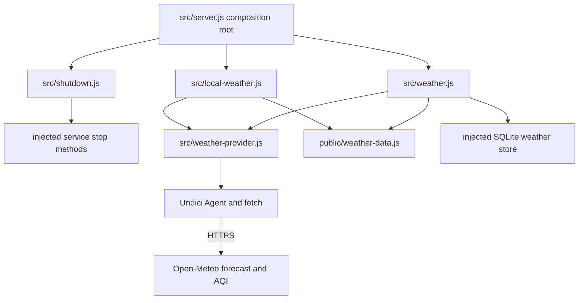

# Brooks-Lint Health Dashboard

- [Assessment](#assessment)
- [Dimension Scores](#dimension-scores)
- [Module Dependency Graph](#module-dependency-graph)
- [Test Suite Map](#test-suite-map)
- [Top Findings](#top-findings)
  - [Warning](#warning)
  - [Suggestion](#suggestion)
- [Verification](#verification)
- [Recommendation](#recommendation)

## Assessment

**Mode:** Health Dashboard

**Scope:** All changes on `62-display-air-quality` relative to base branch `main`: `17c3d3c...5dc615e`, one commit and 15 changed files. Working tree was clean at review start. Reviewed the complete diff, including implementation, tests, documentation, version manifests, and implementation results, plus relevant service startup/shutdown and Undici transport behavior.

**Composite Score:** 99/100

**Trend:** Stable at 99 compared with the previous Health Dashboard record, which assessed this task's plan rather than its implementation.

**Verdict:** One confirmed proxy-compatibility regression should be addressed before merge; the direct-connection AQI fix is otherwise focused and supported by verification.

No `.brooks-lint.yaml` exists; balanced scoring and default risks apply. The score describes this branch's changes, not whole-project health. No implementation fixes were made during review.

## Dimension Scores

- Code Quality: 95/100. One R2 warning: replacing native fetch with an unconditional direct dispatcher drops Node's opt-in environment-proxy behavior.
- Architecture: 100/100. Weather transport policy remains in the provider adapter, services own their pools, and shutdown awaits their disposal. No new cycle, browser/server layering violation, or unrelated module coupling was identified.
- Tech Debt: 100/100. The change uses an existing dependency, avoids global network-default mutation, and retains the established snapshot/cache contract. No separate debt finding was added for the compatibility issue already counted under Code Quality.
- Test Quality: 99/100. One T5 suggestion: automated service tests bypass the new owned-transport shutdown path.

Balanced deductions are five points per warning and one per suggestion. Composite calculation: `95 × 0.25 + 100 × 0.30 + 100 × 0.25 + 99 × 0.20 = 98.55`, rounded half-up to `99`. There are no Critical findings. The numerical score does not override the confirmed compatibility finding.

## Module Dependency Graph

Arrows show relevant imports or injected dependencies; dashed arrows show HTTP boundaries. The graph is limited to the affected subsystem and its lifecycle owner.

## Test Suite Map

Counts are files, not test cases; mixed files intentionally span more than one test layer.

- Transport integration: one new file, `test/weather-provider.test.js`, using actual loopback HTTP, connector-option observation, and body cancellation.
- Services/controllers: two changed files, `test/weather.test.js` and `test/local-weather.test.js`, covering fake-clock refreshes, cache behavior, and distinct-location late responses. Global service tests use real temporary SQLite storage.
- Mixed helper/controller/HTTP coverage: one changed file, `test/dashboard.test.js`, adding finite, absent, null, string, and zero AQI checks.
- Fixture: one changed helper, `test/fixtures/weather.js`, preserving the observed provider response shape without creating a live-network test dependency.
- Browser: one changed spec, `e2e/dashboard-home.spec.js`, adding a single unavailable → zero → stale presentation scenario. Existing AQI-without-forecast coverage is reused.
- Supporting verification includes unchanged weather API tests and `e2e/settings-scope.spec.js`; they protect propagation and source isolation separately from the transport tests.

The added tests express coherent behavior and use existing seams. Exact connector-option assertions are justified by the diagnosed connection-policy defect; the loopback response provides an actual transport result rather than only a mock-call assertion.

## Top Findings

### Warning

**R2 — Change Propagation: Dedicated dispatcher bypasses an explicitly enabled environment proxy**

Symptom: `src/weather-provider.js:5-10` always creates a direct `Agent` and explicitly supplies it to Undici fetch. Previously, the default fetch in both services was Node's native fetch, which honors opt-in proxy routing through `NODE_USE_ENV_PROXY=1` or `--use-env-proxy`. The replacement does not consult that enabled policy or `HTTP_PROXY`, `HTTPS_PROXY`, and `NO_PROXY`.

Source: *Software Engineering at Google* — Backward compatibility and observable behavior; *A Philosophy of Software Design* — Information hiding at adapter boundaries.

Consequence: Installations that previously reached weather providers through an explicitly enabled outbound proxy now attempt direct connections for both forecast and AQI. Where direct access or provider DNS is unavailable, both weather parts fail despite the proxy being usable, expanding a transport-timing fix into a deployment compatibility regression.

Remedy: Preserve Node's opt-in proxy policy when selecting the weather-owned dispatcher. Use the existing Undici package's environment-aware proxy support when that policy is enabled, including `NO_PROXY` handling, while retaining scoped two-second connection settings, TLS validation, request deadlines, and owned shutdown. Keep direct behavior when proxy use is not enabled. Add a child-process loopback proxy regression so environment initialization and bypass behavior are tested without contacting a provider.

Evidence: In Node `v24.22.0`, launched fresh child processes with `--use-env-proxy`, `NODE_USE_ENV_PROXY=1`, and `HTTP_PROXY`/`HTTPS_PROXY` pointing at an owned loopback CONNECT proxy. Both requested `http://weather-review.invalid/air`, which cannot resolve directly. Native fetch returned `200 {"current":{"us_aqi":91}}` through the proxy; `createWeatherTransport().fetch` failed with `ENOTFOUND`. The proxy observed exactly one CONNECT request, from native fetch. This isolates the dispatcher regression without relying on internet connectivity.

### Suggestion

**T5 — Coverage Illusion: Service-owned connection-pool disposal is not asserted automatically**

Symptom: The new ownership branches at `src/weather.js:18-19,128-130` and `src/local-weather.js:6,47-51` are bypassed by the provider-injected service fixtures (`test/weather.test.js:14-18`, `test/local-weather.test.js`, and the Local shutdown fixture in `test/shutdown.test.js:125`). The new transport test invokes `transport.stop()` directly from its cleanup, so it does not establish that either service's `stop()` destroys its owned pool.

Source: *Working Effectively with Legacy Code* — Sensing and separation; *How Google Tests Software* — Change coverage; *The Art of Unit Testing* — Test completeness.

Consequence: Removing or moving a service's new `transport.stop()` call could leave its weather connections open while these focused automated tests still pass. Existing lifecycle tests verify injected work drainage, not the newly acquired resource. The implementation's manual live smoke is useful evidence but does not provide repeatable regression protection.

Remedy: Add a deterministic lifecycle integration case for each default service transport, using a loopback network seam or an owned child process. Establish an actual connection, call the service's `stop()`, and observe connection closure and settled work before store cleanup. Include cancellation while a response is pending and preserve the rule that caller-injected transports are not disposed by the service.

## Verification

- During review, ran `node --test test/weather-provider.test.js test/weather.test.js test/local-weather.test.js test/weather-api.test.js test/local-weather-api.test.js test/dashboard.test.js`: 66 passed, zero failures or skips, approximately 1.15 seconds.
- Ran the isolated proxy probe described above; it reproduced the native-versus-weather routing difference. All probe processes and the loopback proxy were closed; production state was not accessed or changed.
- `git diff --check`: passed.
- The implementation-stage record reports 570 passing Node tests and successful live AQI rendering in both scopes. It also reports 59 passing browser cases and three failures reproduced on the pre-implementation baseline using installed Chromium build 1248 instead of expected build 1243. Those broader runs were not repeated during this review, and their recorded baseline failures are not counted as new branch defects.

## Recommendation

Address proxy-policy preservation first and add the loopback proxy regression before merge. Keep the scoped dual-stack timing fix and existing data contracts. The service-pool lifecycle assertion is a nonblocking follow-up. A focused review of the revised transport and its tests is sufficient; the current findings do not justify a broader architecture rewrite.
