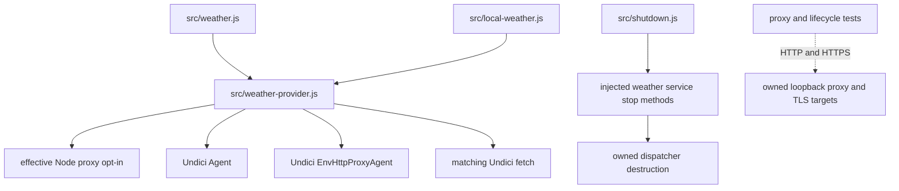

# Brooks-Lint Health Dashboard

- [Assessment](#assessment)
- [Dimension Scores](#dimension-scores)
- [Module Dependency Graph](#module-dependency-graph)
- [Test Suite Map](#test-suite-map)
- [Top Findings](#top-findings)
- [Verification And Limits](#verification-and-limits)
- [Recommendation](#recommendation)

## Assessment

**Mode:** Health Dashboard

**Scope:** Plan review of `tasks/63-weather-proxy-and-shutdown-coverage/2-plan.md` at `b70b324`, checked against the goal, current weather transport and service shutdown boundaries, shutdown coordinator, relevant tests/helpers, and installed Undici implementation.

**Composite Score:** 100/100

**Trend:** 99 → 100 (+1) compared with the previous Health Dashboard record, which reviewed task 62's implementation rather than this plan.

**Verdict:** Approved. The plan addresses both prior findings with a bounded adapter change and tests that exercise actual routing and owned-resource disposal.

No `.brooks-lint.yaml` exists; balanced scoring and default risks apply. This assessment concerns plan readiness. It does not mean the existing proxy regression is fixed or the proposed tests have passed.

## Dimension Scores

- Code Quality: Not scored because this stage has no implementation diff. Plan clarity and change scope were inspected; no speculative production abstraction or unrelated change is required.
- Architecture: 100/100. Proxy policy remains behind `createWeatherTransport()`, matching Agent/fetch versions stay paired, and Global/Local services retain explicit resource ownership. Proposed dependencies introduce no cycle or browser/server boundary change.
- Tech Debt: 100/100. The plan reuses the installed environment-proxy dispatcher and existing lifecycle seams. It avoids a duplicate proxy parser, global dispatcher mutation, production test-only endpoints, and a new dependency.
- Test Quality: 100/100. The plan separates startup policy, routing, TLS, cancellation, service ownership, and store-cleanup assertions. Bounded child processes and loopback fixtures target the changed behavior without live-provider dependencies.

No findings produce deductions. With the code-quality dimension omitted, weights are `0.30 / 0.75` for Architecture, `0.25 / 0.75` for Tech Debt, and `0.20 / 0.75` for Test Quality. All three scored dimensions are 100, so the composite is 100.

## Module Dependency Graph

Solid arrows show proposed imports or existing injected dependencies; dashed arrows show network boundaries. The policy detector and dispatcher selection belong inside the existing adapter, not a new subsystem.

## Test Suite Map

Counts describe files and planned roles, not implemented test counts.

- Transport integration: one existing file to extend, `test/weather-provider.test.js`, with fresh-process opt-in/precedence cases, direct versus proxy routing, `NO_PROXY`, TLS, and connection-policy observations.
- Lifecycle integration: one planned file, `test/weather-transport-lifecycle.test.js`, exercising both services without `fetchImpl`, real idle/pending connections, repeated stop, and caller-owned transport reuse.
- Existing service coverage: two files, `test/weather.test.js` and `test/local-weather.test.js`, retaining hourly refresh, cache/error/timestamp independence, and source identity protection.
- Existing ownership/process coverage: two files, `test/shutdown.test.js` and `test/server-shutdown.test.js`, supporting coordinator ordering and owned-process cleanup.
- Existing API/browser-controller coverage: three files, `test/weather-api.test.js`, `test/local-weather-api.test.js`, and `test/dashboard.test.js`, included in targeted verification.
- Helpers: the plan reuses `test/fixtures/lifecycle.js`, weather response fixtures, and existing temporary-CA patterns. New helpers remain specific to loopback proxy and child-process ownership.
- Browser coverage: no new browser case is required for an adapter-only change. The plan requires affected browser checks if implementation changes a browser-facing contract.

The testing tradeoff is justified: fresh processes are needed to observe Node startup policy, and real sockets are needed to distinguish pool destruction from unreferenced idle resources. These integration tests cover risks that injected fetch fixtures cannot observe.

## Top Findings

No Critical, Warning, or Suggestion findings were identified in the plan.

The prior R2 warning has an explicit implementation path in steps 1 and 2: preserve effective opt-in, delegate environment routing, compare ambiguous semantics with native fetch, and retain the scoped connection policy on proxy connectors. Installed Undici code confirms the plan's distinction between direct `connect` options and proxy `proxyTls`/`requestTls` options (`node_modules/undici/lib/dispatcher/proxy-agent.js:148-151`).

The prior T5 suggestion has an explicit verification path in step 3: exercise default transports, observe idle socket closure before cleanup, cancel pending bodies, preserve injected ownership, and demonstrate that removing service disposal makes a test fail. Current service shutdown methods already await `transport.stop()` (`src/weather.js:128-130`, `src/local-weather.js:47-51`), while the existing Local coordinator test injects fetch (`test/shutdown.test.js:123-129`); the proposed tests close that precise coverage gap.

The plan also avoids two misleading signals: it does not count child exit as proof of idle-pool disposal, and it does not require peer FIN delivery to precede local SQLite cleanup. Its longer-than-assertion keep-alive lifetime and disposal-removal check guard against cleanup or natural expiry hiding a missing stop call.

## Verification And Limits

Review used static inspection of the plan and relevant source/test boundaries. No implementation code, dependency manifest, or task plan was changed. No application tests, proxy probes, browser runs, or live provider requests were executed during this review.

Effective proxy-policy detection remains an implementation validation item, as the plan explicitly states. The `http.globalAgent.options.proxyEnv` observation from Node `v24.22.0` is a candidate surface rather than proof of availability across every supported Node release. Native-reference cases, feature detection, and documented runtime limitations remain necessary before claiming compatibility.

Likewise, delegating to `EnvHttpProxyAgent` does not itself establish parity for every possible `NO_PROXY` expression. The plan's named exact-host, suffix, port, wildcard, and case-precedence tests are the acceptance evidence for its supported routing behavior.

## Recommendation

Proceed with implementation in the planned order: establish native startup-policy behavior, correct the adapter, then verify routing and service-owned disposal through the same isolated fixtures. Preserve the evidence and compatibility checks already written into the plan. No plan revision or architecture redesign is required before starting.
