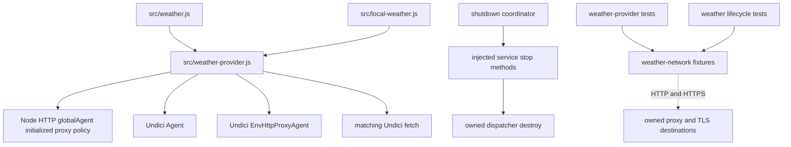

# Brooks-Lint Health Dashboard

- [Assessment](#assessment)
- [Dimension Scores](#dimension-scores)
- [Module Dependency Graph](#module-dependency-graph)
- [Test Suite Map](#test-suite-map)
- [Top Findings](#top-findings)
  - [Warning](#warning)
- [Verification](#verification)
- [Recommendation](#recommendation)

## Assessment

**Mode:** Health Dashboard

**Scope:** All changes on `63-weather-proxy-and-shutdown-coverage` relative to its base branch `62-display-air-quality`: `4baf53f...6649a4a`, one implementation commit and 11 changed files. The parent branch already contains task 63's goal, plan, and plan review. Reviewed the entire implementation diff, including runtime transport selection, both test helpers, routing/lifecycle tests, documentation, version manifests, and implementation results. Working tree was clean at review start.

**Composite Score:** 99/100

**Trend:** 100 → 99 (−1) compared with the latest Health Dashboard record, which reviewed the plan rather than the implementation.

**Verdict:** Address one confirmed `NO_PROXY` compatibility mismatch before merge. Startup opt-in routing and the requested owned-pool shutdown coverage otherwise meet the task's intended boundaries.

No `.brooks-lint.yaml` exists; balanced scoring and default risks apply. The score applies to these branch changes, not whole-project health. No implementation or test fixes were made during review.

## Dimension Scores

- Code Quality: 95/100. One R2 warning: delegating bypass matching to the external Undici version changes native Node wildcard-domain semantics for the domain itself.
- Architecture: 100/100. Effective startup-policy detection and transport selection stay in the provider adapter, matching fetch/dispatcher versions remain paired, and services retain their owned disposal interface. No new cycle, global networking mutation, or browser/server layering change was found.
- Tech Debt: 100/100. The connection policy is defined once and supplied to direct and proxy connector paths. Existing dependencies, response contracts, and lifecycle ownership are preserved; no separate debt deduction duplicates the routing finding.
- Test Quality: 100/100. Fresh-process routing comparisons and real socket assertions are appropriate for startup policy and pool disposal. The missing wildcard-domain regression is part of the functional finding below rather than a second deduction for the same issue.

Balanced scoring deducts five points for the single Warning. Composite calculation: `95 × 0.25 + 100 × 0.30 + 100 × 0.25 + 100 × 0.20 = 98.75`, rounded half-up to `99`. No Critical or Suggestion findings were identified. The score does not override the compatibility finding.

## Module Dependency Graph

Solid arrows show relevant imports or injected ownership; dashed arrows show network boundaries.

## Test Suite Map

- Transport/routing integration: one changed executable test file, `test/weather-provider.test.js`. The review run reported 27 tests including nested scenario groups, covering startup policy, explicit disabling, proxy selection, lowercase precedence, the named bypass cases, TLS validation, and connector settings.
- Service lifecycle integration: one new executable test file, `test/weather-transport-lifecycle.test.js`, with six cases across Global and Local owners: idle pool destruction, pending-body cancellation with store cleanup, and caller-owned injected resource reuse.
- Fixture infrastructure: two new helper modules, `test/fixtures/weather-network.js` and `test/fixtures/weather-network-client.mjs`. Child environments are explicit; DNS/proxy mapping remains within declared loopback destinations. The child stays alive during socket-close assertions, and the fixture observes actual dispatcher-destruction completion before store cleanup.
- Existing service/API/coordinator tests remain available and were included in implementation-stage verification. The implementation report records 130 focused and 603 full-suite passes, with the fixture-discovery qualification stated explicitly.

The larger integration fixture is justified by the need to observe real startup options, TLS tunnels, cancellation, and idle sockets. No production-only test seam or live-provider dependency was introduced. The prior task's untested default-transport disposal path now has meaningful assertions; injected ownership is independently verified by successful reuse after service stop.

## Top Findings

### Warning

**R2 — Change Propagation: Wildcard-domain bypass differs from native Node for the domain itself**

Symptom: `src/weather-provider.js:10-12` selects the external Undici `EnvHttpProxyAgent` for enabled proxy policy without preserving all native bypass semantics. On Node `v24.22.0`, native fetch treats `NO_PROXY=*.api.open-meteo.com` as bypassing `api.open-meteo.com` itself, while Undici `8.11.2` treats the wildcard as subdomains-only and proxies that host. Its implementation explicitly skips exact matches for wildcard entries (`node_modules/undici/lib/dispatcher/env-http-proxy-agent.js:112-120,160-170`). The added bypass matrix at `test/weather-provider.test.js:78-84` covers a bare `*` and a leading-dot suffix, but not a `*.domain` rule at the domain itself.

Source: *Software Engineering at Google* — Backward compatibility and observable behavior; *A Philosophy of Software Design* — Information hiding at external adapter boundaries.

Consequence: An existing Node bypass configuration can send a weather request through a proxy when native fetch would connect directly. In installations where that bypass is needed because the proxy cannot reach or permit the provider, weather can fail even though the former native route works. Preserving proxy opt-in alone therefore does not fully preserve the requested environment routing behavior.

Remedy: Align wildcard-domain bypass with the native reference at the weather adapter boundary, retaining the scoped connection policy and owned dispatcher lifecycle. A narrow normalization or compatible routing decision should preserve native behavior without replacing the entire proxy parser. Add native-versus-weather regression cases for both the domain itself and a subdomain under a `*.domain` entry, including the lowercase `no_proxy` path. Assert both successful data and whether the proxy actually received a request.

Evidence: Reused the branch's isolated loopback fixture with a trusted HTTPS target named `api.open-meteo.com` at the fixture's ephemeral port, `NODE_USE_ENV_PROXY=1`, `HTTPS_PROXY` pointing to the recording loopback proxy, and `NO_PROXY=*.api.open-meteo.com`. Both clients returned fixture data, but native fetch generated zero proxy requests and the weather transport generated one. A control case targeting `sub.weather.invalid` with `NO_PROXY=*.weather.invalid` generated zero proxy requests for both clients. No actual Open-Meteo request or external DNS lookup was needed.

## Verification

- During review, ran `node --test test/weather-provider.test.js test/weather-transport-lifecycle.test.js`: 33 passed, zero failures or skips, approximately 6.9 seconds.
- Ran additional loopback-only native-versus-weather probes for leading-dot, bare-domain, and wildcard-domain rules. The confirmed mismatch is the wildcard-domain rule applied to the domain itself; ordinary subdomain matching agreed in the control case.
- Reviewed the implementation-stage mutation evidence: restoring the former direct dispatcher broke enabled-policy scenarios, and removing owned-pool disposal broke idle lifecycle checks. Those mutations were not repeated during this review and no source changes were needed for the routing probes.
- `git diff --check`: passed. The full Node suite, browser tests, live-provider access, and older Node releases were not rerun during this review.
- All probe clients, temporary certificates, and loopback servers were cleaned up. No production database, browser profile, user `.env`, or global parent-process network configuration was changed.

## Recommendation

Fix the wildcard-domain native-compatibility gap and extend the existing bypass matrix before merge. Keep the current startup-policy detector, scoped connector configuration, and real lifecycle coverage. A focused transport/bypass recheck is sufficient; no service ownership redesign or browser change is indicated.
