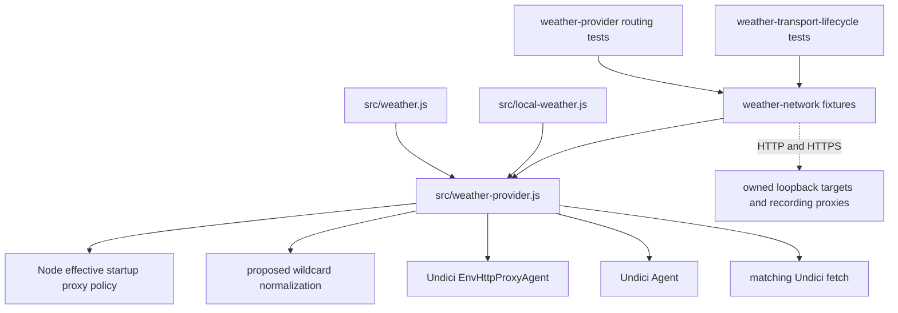

# Brooks-Lint Health Dashboard

- [Brooks-Lint Health Dashboard](#brooks-lint-health-dashboard)
  - [Assessment](#assessment)
  - [Dimension Scores](#dimension-scores)
  - [Module Dependency Graph](#module-dependency-graph)
  - [Test Suite Map](#test-suite-map)
  - [Top Findings](#top-findings)
    - [Warning](#warning)
  - [Verification](#verification)
  - [Recommendation](#recommendation)

## Assessment

**Mode:** Health Dashboard

**Scope:** Plan review of `tasks/64-weather-wildcard-proxy-bypass/2-plan.md` at `641d830`, checked against its goal, the current weather adapter, installed Undici implementation, and existing routing/lifecycle fixtures. This assesses the proposed changes, not whole-project health or a completed implementation. The working tree was clean at review start.

**Composite Score:** 99/100

**Trend:** Stable at 99 compared with the latest Health Dashboard record, which reviewed task 63's implementation rather than this plan.

**Verdict:** Revise the proposed bypass snapshot before implementation; the remaining scope, adapter placement, and routing verification are sound.

No `.brooks-lint.yaml` exists. Default risks and balanced scoring apply. The plan and implementation code were not modified during review.

## Dimension Scores

- Code Quality: 95/100. One R2 warning: supplying a fixed normalized `noProxy` option removes observable environment refresh behavior shared by native fetch and the existing weather transport.
- Architecture: 100/100. Compatibility handling belongs in `src/weather-provider.js`; the proposed public Undici option retains service boundaries, scoped connector configuration, matching fetch/dispatcher versions, and the owned disposal interface. No new dependency cycle or global networking mutation is proposed.
- Tech Debt: 100/100. A bounded normalization helper avoids duplicating the proxy parser or introducing extra pools. The snapshot issue is counted once under Code Quality rather than deducted again as debt.
- Test Quality: 100/100. The planned child-process comparisons, proxy request counts, negative controls, trusted HTTPS targets, and mutation check verify behavior rather than helper internals. Missing refresh characterization is included in the R2 finding rather than scored twice.

Balanced scoring deducts five points for one Warning. Composite calculation: `95 × 0.25 + 100 × 0.30 + 100 × 0.25 + 100 × 0.20 = 98.75`, rounded half-up to `99`. The Code Quality dimension assesses the proposed plan changes; no runtime patch exists yet. No Critical or Suggestion findings were identified.

## Module Dependency Graph

Solid arrows represent imports or ownership; dashed arrows represent network boundaries. Normalization is proposed; the other relationships already exist.

## Test Suite Map

- Existing focused transport coverage: `test/weather-provider.test.js` reports 27 tests including nested scenarios. It covers direct connector settings, stalled-body cancellation, startup opt-in and disabling, protocol-specific proxy selection, lowercase precedence, existing bypass rules, and TLS validation.
- Existing service lifecycle integration: `test/weather-transport-lifecycle.test.js` has six cases covering idle pool disposal, pending-body cancellation before store cleanup, and injected transport reuse across Global and Local owners.
- Planned change coverage: extend the existing bypass matrix for domain and subdomain wildcard rules over HTTP and HTTPS, lowercase selection, empty lowercase overrides, wildcard ports, mixed lists, and unrelated-host controls. No additional unit or browser test files are proposed; real routing needs the existing process/network integration seam.
- Review-only characterization: 20 fresh-client requests across five scenarios and two protocols reproduced the wildcard gap and verified the plan's empty-lowercase and port expectations. A separate four-request probe compared environment edits on reused native and weather transports. These probes were executed from the command line and did not create repository test files.

## Top Findings

### Warning

**R2 — Change Propagation: Fixing wildcard routing also freezes unrelated bypass updates**

**Symptom:** `2-plan.md:29,32,48,53` proposes always supplying a normalized `noProxy` constructor option and accepting transport recreation as the requirement for future bypass edits. The current adapter leaves that option implicit. Undici `8.11.2` rereads `process.env.no_proxy ?? process.env.NO_PROXY` when dispatching, but its `#noProxyChanged` getter returns false whenever the explicit option is present (`node_modules/undici/lib/dispatcher/env-http-proxy-agent.js:178-186`). This changes even ordinary non-wildcard bypass behavior. The plan acknowledges the change, but neither the goal nor the user's request asks to replace runtime refresh with a snapshot.

**Source:** *Software Engineering at Google* — Hyrum's Law and backward compatibility; *Working Effectively with Legacy Code* — characterization tests before changing existing behavior.

**Consequence:** An already-created weather transport would keep using an obsolete route after bypass configuration changes, although both its current implementation and native fetch observe those changes. A narrow wildcard compatibility fix would introduce a second routing incompatibility, potentially sending requests through a proxy after a bypass rule is added or continuing direct access after it is removed. Recording the difference in implementation results does not preserve behavior.

**Remedy:** Revise step 2 to preserve per-dispatch environment refresh at the adapter boundary while normalizing wildcard-domain rules. Specify the public dispatcher routing/composition approach and ownership of every pool it uses before implementation; keep global environment variables and Undici internals untouched. Add a same-transport characterization sequence for both uppercase and lowercase variables: nonmatching rule → matching wildcard rule → nonmatching rule, asserting successful data and proxy request deltas of `1 → 0 → 1` against native fetch. Cover lowercase removal/fallback as part of the same configuration transition. If a snapshot is intentionally desired instead, obtain explicit agreement on that behavior change and define its user-facing contract rather than accepting it only in an implementation report.

**Evidence:** On Node `v24.22.0`, a loopback probe reused one client while changing `NO_PROXY` from `other.invalid` to `weather.invalid`. Native fetch and the current weather transport each returned two successful responses with only one proxy request: the second request bypassed without recreating the transport. The proposed explicit option disables the refresh mechanism responsible for that behavior. No in-project code currently edits these variables, which limits immediate exposure but does not make the compatibility change necessary for the requested fix.

## Verification

- Ran `node --test test/weather-provider.test.js test/weather-transport-lifecycle.test.js`: 33 passed, zero failures or skips, approximately 5.2 seconds. These are baseline results, not validation of the unimplemented normalization.
- Ran loopback-only native/weather probes over HTTP and HTTPS. For `*.weather.invalid`, a matching wildcard port, and a mixed list containing that wildcard, native fetch bypassed the domain itself while current weather fetch used the proxy. Empty lowercase overrides and nonmatching wildcard ports used the proxy for both clients, confirming those planned expectations.
- Ran the reused-client environment-refresh probe described in the finding: four successful responses across native and weather clients, one proxy request per client. Inspected the installed Undici option/refresh logic to establish why the proposed snapshot changes the result.
- Reused existing fixture cleanup for certificates, sockets, proxies, and child clients. Probes made no live-provider requests and did not modify source, tests, dependencies, or the task plan.
- The full Node suite, browser suite, and syntax checks were not rerun for this document-only review. Whitespace validation is performed before committing the review.

## Recommendation

Update the plan to preserve bypass refresh and add reused-client routing characterization before implementing task 64. Keep the existing normalization boundary, native comparisons, negative controls, and real lifecycle checks. One focused compatibility revision is sufficient; the current scope does not indicate an architecture redesign or a separate whole-project audit.
