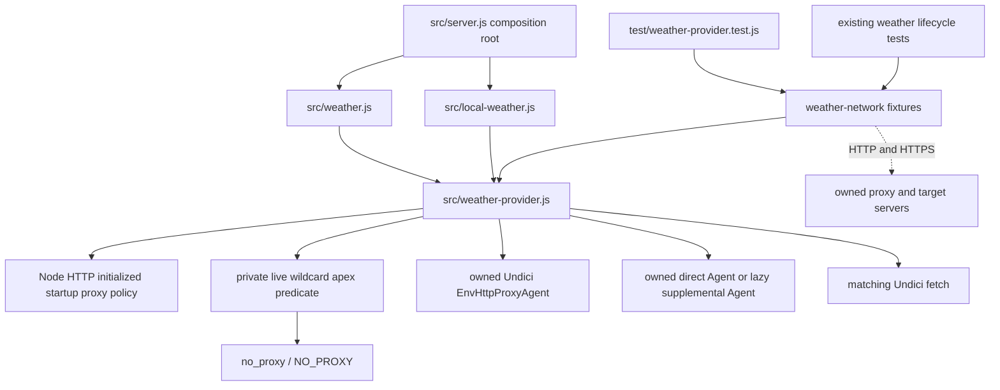

# Brooks-Lint Health Dashboard

- [Brooks-Lint Health Dashboard](#brooks-lint-health-dashboard)
  - [Assessment](#assessment)
  - [Dimension Scores](#dimension-scores)
  - [Module Dependency Graph](#module-dependency-graph)
  - [Test Suite Map](#test-suite-map)
  - [Top Findings](#top-findings)
    - [Warning](#warning)
  - [Verification](#verification)
  - [Recommendation](#recommendation)

## Assessment

**Mode:** Health Dashboard

**Scope:** All changes on `64-weather-wildcard-proxy-bypass` relative to its base branch `63-weather-proxy-and-shutdown-coverage`: `82f4d63...34f6551`, one implementation commit and 10 changed files. Branch creation reflog and merge-base both identify `82f4d63` as the base; the preserved planning branch points there too. Reviewed the entire diff: the provider adapter, routing tests, both network helpers, README, two documentation files, both version manifests, and implementation results. Parent-branch planning artifacts and adjacent service/lifecycle modules were read as context. The working tree was clean at review start.

**Composite Score:** 99/100

**Trend:** Stable at 99 compared with the latest Health Dashboard record, which assessed this task's earlier plan.

**Verdict:** The ordinary wildcard fix, live environment refresh, and owned-pool cleanup work, but trailing-dot wildcard rules introduce a confirmed native-routing incompatibility.

No `.brooks-lint.yaml` exists; default risks and balanced scoring apply. This is a branch-change assessment, not a whole-project audit. Review changes are limited to this report and the required health-history entry.

## Dimension Scores

- Code Quality: 95/100. One R2 warning: supplemental trailing-dot normalization broadens direct routing beyond the native reference.
- Architecture: 100/100. The private compatibility predicate and owned supplemental agent remain behind the existing `fetch`/`stop` interface. Public dispatcher composition leaves ordinary bypass matching with Undici. No new cycle, upward dependency, private-symbol access, production global-state mutation, or service/browser coupling was found.
- Tech Debt: 100/100. One bounded lazy pool and one shared connection policy are proportionate to the confirmed adapter gap. This is a justified compatibility wrapper rather than speculative infrastructure. The routing warning is counted once under Code Quality.
- Test Quality: 100/100. Fresh-process comparisons, reused-client request-level route counts, independent negative controls, and actual peer-socket shutdown assertions verify behavior. No actionable T1 obscurity or T2 brittleness finding was identified. The missing trailing-dot characterization belongs to the routing warning rather than a duplicate test deduction.

Balanced scoring deducts five points for one Warning. Composite calculation: `95 × 0.25 + 100 × 0.30 + 100 × 0.25 + 100 × 0.20 = 98.75`, rounded half-up to `99`. No Critical or Suggestion findings were identified. A high aggregate score does not resolve the routing finding.

## Module Dependency Graph

Solid arrows show relevant imports, composition, or ownership; dashed arrows show network boundaries. The server and services are context, not modified production files.

## Test Suite Map

- Changed executable test scope: one integration file, `test/weather-provider.test.js`, with 12 top-level tests after expanding the abort/stop loop and 50 nested scenario tests, giving 62 runner-reported tests. These cover connector policy, cancellation, startup policy, proxy selection, bypass matching, live edits, TLS, and both owned routes' disposal.
- Adjacent lifecycle scope: six existing integration tests in `test/weather-transport-lifecycle.test.js`, covering idle disposal, pending-work/store ordering, and caller-owned reuse for both Global and Local services. Together the two files report 68 tests.
- Changed fixture infrastructure: two helper modules with declared loopback destinations, explicit child environments, indexed IPC responses, bounded waits, and target/proxy socket sensing. Reused-tunnel assertions count actual requests arriving from proxy upstream sockets rather than counting only CONNECT handshakes.
- Changed standalone unit tests: zero. Changed browser/E2E tests: zero. The real process/network seam is justified by startup-option, routing, TLS, and socket-lifetime risks; the focused suite completes in approximately 14 seconds.
- The implementation report records 638 passing full-suite tests with no skips. That total includes inert fixture discovery and is not a count of routing scenarios. The full suite and browser suite were not rerun during this review.

## Top Findings

### Warning

**R2 — Change Propagation: Trailing-dot wildcard normalization bypasses a proxy that native fetch uses**

**Symptom:** `src/weather-provider.js:9,13-14` accepts an optional terminal dot in a wildcard rule and removes it before comparing the rule's domain with the target hostname. For an ordinary target `weather.invalid`, both `NO_PROXY=*.weather.invalid.` and `NO_PROXY=*.weather.invalid.:<target-port>` therefore select the supplemental direct agent at lines 29-31. On Node `v24.22.0`, native fetch keeps both of these requests proxied. The new matrix at `test/weather-provider.test.js:114-125` does not characterize trailing-dot rules. This is a new divergence: before this branch, Undici's wildcard exact-match exclusion left those domain-itself requests proxied.

**Source:** *Software Engineering at Google* — backward compatibility and observable behavior; *A Philosophy of Software Design* — information hiding at external adapter boundaries; *Working Effectively with Legacy Code* — characterization before changing established behavior.

**Consequence:** A trailing-dot bypass entry now sends a weather request directly where native fetch, and the previous weather transport, would use the configured proxy. The adapter changes the egress route even though it is meant to supplement only the native wildcard-domain-itself behavior. Installations whose connectivity depends on the proxy can lose weather retrieval. Successful fixture data alone cannot expose the difference because both loopback routes return the same response.

**Remedy:** Characterize native handling of trailing-dot wildcard rules and target hostnames over HTTP and HTTPS, including matching ports, before finalizing the normalization boundary. Restrict supplemental matching to cases where native fetch would bypass; delegate the remaining cases to the environment agent. Add native-versus-weather routing assertions for these controls. The plan explicitly requested Undici-consistent trailing-dot normalization, but the measured native behavior differs, so clarify that conflict rather than treating dependency normalization as proof of native compatibility.

**Evidence:** A review-only loopback probe used the existing trusted fixture, explicit proxy opt-in, fresh native/weather children, and identical proxy/bypass settings. For each protocol, `*.weather.invalid` produced native/weather proxy-request deltas `0/0`; `*.weather.invalid.` produced `1/0`; and `*.weather.invalid.:<fixture-port>` produced `1/0`. Every request returned the expected AQI `91`. The HTTPS cases used the fixture CA and retained certificate validation. No external provider or DNS lookup was required.

## Verification

- `node --test test/weather-provider.test.js test/weather-transport-lifecycle.test.js`: 68 passed, zero failures, cancellations, or skips, approximately 14.1 seconds. The proxy runtime guard allowed all relevant cases to execute on Node `v24.22.0` with Undici `8.11.2`.
- `npm run check`: passed. `git diff --check`: passed before writing the report and checked again before commit.
- Review-only comparative routing probe: 16 successful fresh-client requests across two protocols, two client types, and four rule variants. The ordinary wildcard control agreed; trailing-dot rules differed as documented above. A zero-port wildcard also produced native/weather deltas `0/1`; that pre-existing edge mismatch is recorded as a compatibility limit, not scored as a newly introduced regression.
- An initial trailing-dot probe assumed native bypass and failed on native fetch itself. The subsequent comparative probe removed that assumption and measured both routes independently, establishing the finding rather than attributing the exploratory failure to the weather implementation.
- Review-only cleanup failure probe: after a successful real supplemental loopback request, delayed the supplemental agent's destruction completion and rejected environment-agent destruction with a sentinel error. Repeated stop calls shared one promise; that promise remained pending until the supplemental completion was released, then rejected with the original sentinel. Supplemental destruction was initiated once. The final probe preserved both callback and promise forms of Undici's public API; an earlier wrapper failed its own callback handling and was discarded.
- Reviewed the implementation report's route-disabled and frozen-selection mutation evidence. Mutations were not repeated, and no implementation, test, plan, dependency, or version changes were made during review.
- All probes ran in disposable processes with owned loopback servers and cleanup. The cleanup-failure probe changed policy/environment and public-method wrappers only inside its disposable process. No parent-process networking policy, deployment data, browser profile, or user `.env` was changed.

## Recommendation

Resolve the trailing-dot native-routing mismatch before merge and add its characterization controls to the existing matrix. Keep the public composition boundary, per-dispatch environment selection, bounded pool ownership, and real socket assertions. The earlier snapshot/refresh warning is resolved, and ordinary wildcard routing now agrees with native fetch. A focused transport compatibility recheck is appropriate; the evidence does not call for a broader architecture redesign.
