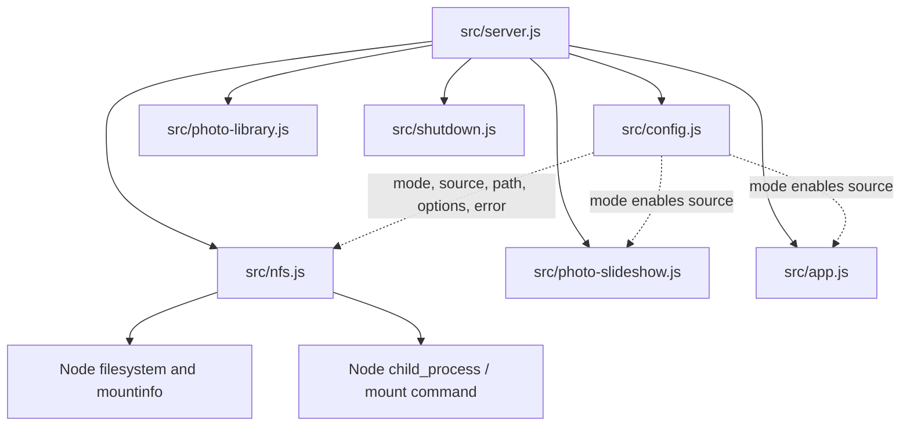

# Brooks-Lint Health Dashboard

- [Brooks-Lint Health Dashboard](#brooks-lint-health-dashboard)
  - [Dimension Assessment](#dimension-assessment)
  - [Module Dependency Graph](#module-dependency-graph)
  - [Test Suite Map](#test-suite-map)
  - [Top Findings](#top-findings)
  - [Recommendation](#recommendation)

**Mode:** Health Dashboard

**Scope:** Plan review of `tasks/65-nfs-mount-mode-on-off/2-plan.md` at `28bac80`, checked against its goal and the affected configuration, preparation, server, deployment, and test boundaries.

**Composite Score:** 100/100

**Trend:** 99 → 100 (+1) from the previous Health Dashboard record. That record reviewed another scope; this is not a measured codebase improvement.

The plan is actionable and ready for implementation. No blocking gaps were found.

## Dimension Assessment

- Code Quality: Not scored. The working tree has no implementation diff; this review assesses the proposed change.
- Architecture: 100/100. Configuration owns accepted values and normalization; `prepareNfs` owns mount selection and verification; the server composes source availability and lifecycle ownership. The plan preserves those boundaries and adds no dependency cycles or abstractions.
- Tech Debt: 100/100. The plan covers both server mode comparisons, preparation branching, subprocess fixtures, current documentation, and migration. Retaining outcome reasons avoids an unrelated status-contract change. The coordinated edits belong to one configuration contract rather than unrelated responsibilities.
- Test Quality: 100/100. Planned checks cover normalization, omitted and legacy values, both enabled preparation paths, no work under `off`, unsafe mounts, command failures, real-server readiness/status, and shutdown. Existing seams support these checks without production-only test hooks or a live NAS.

Scoring uses balanced deductions with zero findings. With the implementation-diff dimension omitted, the composite is `(100 × 0.30 + 100 × 0.25 + 100 × 0.20) / 0.75 = 100`. This score reflects plan readiness, not verified implementation correctness. No `.brooks-lint.yaml` was found.

## Module Dependency Graph

Arrows show relevant runtime dependencies. Dashed arrows show configuration passed into a component by the composition root, not imports.

The graph is scoped to this task. High fan-out in `src/server.js` is intentional composition-root wiring. The plan keeps source-based preparation decisions inside `src/nfs.js` rather than distributing them across slideshow or HTTP modules.

## Test Suite Map

- Unit-focused files: 2, `test/config.test.js` and `test/nfs.test.js`. These protect the configuration matrix, side-effect boundaries, safety options, verification, and preparation-child ownership.
- Integration/mixed files in the targeted command: 4, `test/server-shutdown.test.js`, `test/startup-key.test.js`, `test/home-assistant-tls.test.js`, and `test/release-config.test.js`. These exercise real startup/lifecycle behavior and deployment configuration; release checks also contain static assertions and an optional Compose parser check.
- Browser specification additions: 0. The plan updates the shared `e2e/server-setup.js` environment without adding a new browser scenario. Real-server source-state assertions provide the relevant wiring coverage for this configuration change.
- Planned verification includes the targeted six-file command, `npm run check`, and `npm test`. Optional Compose parser skips are explicitly recorded. No tests were run during this document review.

This is a file-level map of the planned verification scope, not a whole-project test count. More integration files than unit files is justified here by the existing startup fixtures; the behavioral matrix remains concentrated at unit level.

## Top Findings

No Critical, Warning, or Suggestion findings.

The review considered the intentional compatibility break against *Software Engineering at Google* and its backward-compatibility guidance. The plan explicitly documents each legacy-value migration and removal of source-only implicit enablement, so these are recorded decisions rather than unaddressed change-propagation risks.

The test design follows the seam guidance in *Working Effectively with Legacy Code*: mount metadata and command execution remain injectable, while real-server tests check observable readiness and photo-source state. Exact emitted mount arguments and no-command assertions verify meaningful external effects rather than incidental private implementation details.

## Recommendation

Proceed with the plan. Preserve its explicit decisions: omitted mode means `off`; `on` selects preparation through source presence; legacy values are rejected nonfatally; existing-mount migration clears `NFS_SOURCE`. Implement the planned real-server disabled/unavailable assertions alongside the unit matrix, and record actual check results before claiming completion. Further focused review is unnecessary at the planning stage unless implementation introduces new behavior or dependencies.
