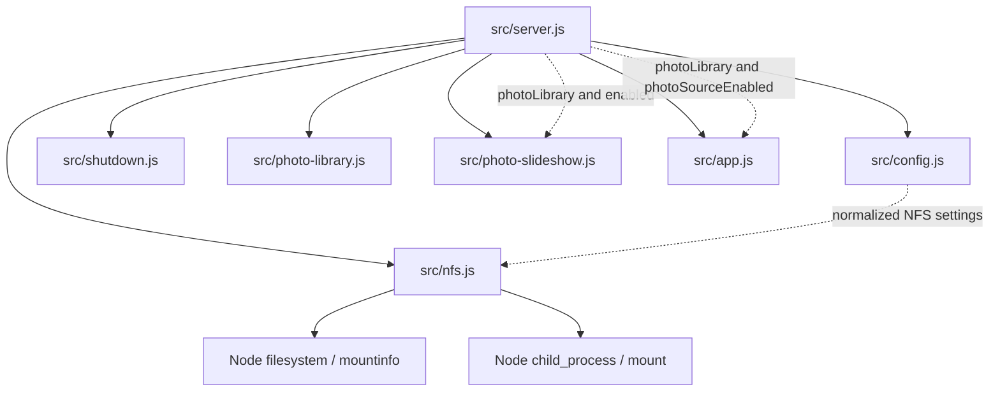

# Brooks-Lint Health Dashboard

- [Brooks-Lint Health Dashboard](#brooks-lint-health-dashboard)
  - [Dimension Assessment](#dimension-assessment)
  - [Module Dependency Graph](#module-dependency-graph)
  - [Test Suite Map](#test-suite-map)
  - [Top Findings](#top-findings)
  - [Verification](#verification)
  - [Recommendation](#recommendation)

**Mode:** Health Dashboard

**Scope:** All changes on `65-nfs-mount-mode-on-off` relative to base branch `main`, merge base `2093676`, through `ae52b2e`: one implementation commit and 19 changed files. The working tree was clean when review started. Configuration, mount preparation, server composition, helper environments, tests, documentation, manifests, and the implementation record were reviewed.

**Composite Score:** 100/100

**Trend:** Stable at 100 compared with the preceding Health Dashboard record, which reviewed this task's plan. The scopes differ; the scores do not measure a longitudinal codebase trend.

The branch implements the reviewed contract consistently. No actionable defects or maintainability findings were identified in the changed scope.

## Dimension Assessment

- Code Quality: 100/100. `src/config.js:13-27` normalizes the two accepted values, defaults to `off`, and records invalid configuration nonfatally. `src/nfs.js:43-51` exits before side effects under `off` and selects existing-mount preparation only when the normalized source is empty. Both server enablement checks use `mode === 'on'` at `src/server.js:74-75`.
- Architecture: 100/100. No imports or dependency directions changed. Configuration validation remains at the boundary; mount details remain in `prepareNfs`; the server owns lifecycle composition and passes source enablement into the slideshow and HTTP layer. Existing child registration remains before awaiting the mount command. Composition-root fan-out is intentional.
- Tech Debt: 100/100. The change removes the three-value configuration selector without adding abstractions or duplicating preparation policy. Source-based branching stays in one place. Current examples and subprocess fixtures migrate together; preserving `disabled`, `existing`, and `mounted` result reasons avoids unnecessary changes to runtime vocabulary. Package and lockfile root versions agree at `0.17.34`.
- Test Quality: 100/100. Added cases express public configuration and API outcomes, isolate startup settings, and retain the existing mount seams. Exact command assertions protect externally meaningful safety arguments. Real-server tests verify source state, settings availability, warnings, and cleanup rather than substituting mocked server wiring.

Balanced scoring starts each dimension at 100 and deducts nothing because there are no findings. Composite: `100 × 0.25 + 100 × 0.30 + 100 × 0.25 + 100 × 0.20 = 100`. No `.brooks-lint.yaml` was found. Scores apply only to the branch changes and their directly affected boundaries.

## Module Dependency Graph

Arrows show relevant runtime dependencies. Dashed arrows show values passed by the composition root, not imports.

No cycle is introduced. `src/photo-slideshow.js:49` retains the no-discovery guard for disabled sources; `src/app.js:365-377` projects the server-provided enabled flag independently of inventory availability. This preserves the intended disabled versus enabled-but-unavailable distinction.

## Test Suite Map

- Unit-focused changed test files: 2, `test/config.test.js` and `test/nfs.test.js`. Configuration cases cover omitted/explicit/normalized modes, source presence, legacy/empty/unknown values, enabled paths, invalid source/options, and immutability. Preparation cases retain existing-mount safety, matching-mount reuse, conflict handling, emitted mount options, verification failures, and child ownership.
- Integration/mixed changed test files: 4, `test/server-shutdown.test.js`, `test/startup-key.test.js`, `test/home-assistant-tls.test.js`, and `test/release-config.test.js`. Four new startup cases cover both normal/development launch paths under `off` and enabled-but-unavailable `on`. Compose parsing checks the new string value, empty source, fixed container path, and read-only bind.
- Changed browser setup files: 1, `e2e/server-setup.js`; changed browser specification files: 0. The setup now explicitly disables NFS with `off`.
- The file-level map is scoped to this branch, not the whole project. Unit tests hold the input matrix; process tests cover composition, environment parsing, and cleanup. The layer split is justified by the risks under change.

## Top Findings

No Critical, Warning, or Suggestion findings.

The compatibility change is intentional and documented in `docs/nfs-backgrounds.md:10-12`: legacy values require migration, source-only implicit enablement is removed, and existing-mount deployments must clear the source. Under *Software Engineering at Google*'s backward-compatibility guidance, these are explicit migration decisions rather than undocumented regressions. Coordinated edits to tests and examples implement one contract and do not constitute unrelated Shotgun Surgery.

The existing injected mount/command seams follow *Working Effectively with Legacy Code*'s Sensing and Separation guidance. The new endpoint assertions add a distinct composition-level check rather than duplicating the unit configuration matrix. Runtime result reasons intentionally remain separate from environment values, preserving conceptual integrity without imposing new domain abstractions.

## Verification

- Reviewed the complete `git diff main...HEAD` and the sole included commit, `ae52b2e`. Confirmed `main` is the branch base at `2093676`.
- `git diff --check main...HEAD`: passed during review.
- Searches found no legacy mode assignments/comparisons in active source, tests, or current documentation. Legacy names remain intentionally in rejection tests and migration prose.
- Verification already executed on this implementation in the preceding stage: targeted six-file command passed 45 tests with no failures/skips; `npm run check` passed; `npm test` passed 645 tests with no failures/skips. Compose parsing passed. These results were observed in this session and match `4-implemented.md`; tests were not repeated because implementation did not change and review uncovered no unresolved concern requiring a new run.
- Live NAS/mount operations, browser tests, and the optional production-install smoke were not performed. No implementation fixes were made during this review.

## Recommendation

Ready to merge. Follow the documented environment migration when deploying: use `off` to disable, or `on` with the intended source/path; clear `NFS_SOURCE` for a host-prepared mount and restart the application. No focused follow-up review is indicated by the scoped findings.
