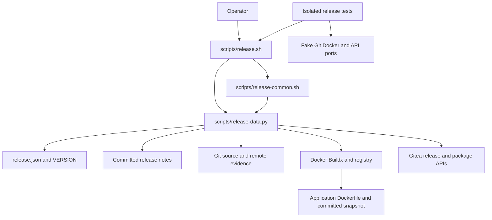

# Brooks-Lint Health Dashboard

- [Brooks-Lint Health Dashboard](#brooks-lint-health-dashboard)
  - [Dashboard](#dashboard)
  - [Module Dependency Graph](#module-dependency-graph)
  - [Test Suite Map](#test-suite-map)
  - [Top Findings](#top-findings)
    - [Warning](#warning)
  - [Recommendation](#recommendation)

**Mode:** Health Dashboard

**Scope:** Plan review of `tasks/66-container-release-template/2-plan.md` at commit `63c9d82`, checked against the goal, current packaging/tests, and template commit `3c73528231ac1cbdd43600a5ca723390db804bac`. This assesses the proposed design, not implemented code or live publication readiness. No `.brooks-lint.yaml` exists; balanced scoring applies.

**Composite Score:** 95/100

**Trend:** 100 → 95 (−5) against the previous Health Dashboard record. Scopes differ; this is not evidence of a project-wide regression.

Revise the plan before implementation: retain its conservative adoption boundary, but enforce blockers and preserve platform-preflight behavior explicitly.

## Dashboard

- Code Quality: not scored; no implementation diff exists. Reviewed the proposed change surface without inventing function-level findings.
- Architecture: 95/100; one warning for a known compatibility refusal occurring after publication writes.
- Tech Debt: 95/100; one warning for exposing an executable publication path while its known safety blockers are documentation-only.
- Test Quality: 95/100; one warning for replacing platform coverage with a behaviorally weaker upstream check.
- Calculation: PR weight is omitted; `(95 × 0.30 + 95 × 0.25 + 95 × 0.20) / 0.75 = 95`. Each warning deducts five points in its owning dimension. Findings are not double-counted.

Positive boundaries: the plan pins upstream provenance, keeps application/runtime concerns separate, avoids a second legacy publication path, tests nondeterministic ports in isolation, preserves old remote history, and explicitly forbids real publication during implementation. Checked version mirrors are justified compatibility metadata, not an independent DRY defect. Bash orchestration plus a standard-library data/I/O helper is a reasonable boundary for this workflow; its size alone is not overengineering.

## Module Dependency Graph

Planned relationships, verified against the pinned template; this is not a dependency audit of the dashboard application.

No planned dependency cycle or application-to-release-tool dependency was identified. The significant architectural concern is when compatibility evidence is checked, not import direction.

## Test Suite Map

- Current `test/release-config.test.js`: six declared cases covering static image/Compose wiring, optional real Compose parsing, legacy helper structure, invocation refusal, and temporary-Git branch/dirty-state refusal. Replace legacy assertions while preserving runtime contracts.
- Current `test/build-platforms.test.js`: 15 expanded cases covering accepted tokens/variants, running-node aggregation, unavailable/stopped/error nodes, inspection failures, and three old entry-point preflight checks. Legacy entry points may be removed; the capability semantics need explicit migration decisions.
- Pinned upstream Python suite: 99 declared methods: five interface cases, 66 fake-port publication cases, and 28 data/boundary cases. These are method counts, not executed-case counts; subtests add scenarios. The suite has no live registry/Gitea or application-browser certification.
- Proposed layering is appropriate: data/helper checks and fake-port integration tests carry release risk; application tests and optional packaging/image smoke checks cover consumer integration. No test execution or runtime timing claim is made by this review.

## Top Findings

### Warning

**F1 — R5 Dependency Disorder: server compatibility is checked after irreversible publication writes.**

Symptom: `2-plan.md:41-43,52,81` preserves upstream sequencing and tests the `28.2.0` link refusal, but specifies no early compatibility gate. In the pinned `scripts/release.sh:117-142`, the tag is pushed, `latest` is promoted, and the release is created before `associate_package`. The helper's `package_association` checks the server version only when the package is explicitly unlinked. Thus the known unsupported server can produce a deterministic failure after the release has already become visible. The plan acknowledges the mismatch, but does not specify how operators avoid this late failure.

Source: *Clean Architecture* — dependency boundaries; *Code Complete* — explicit error-handling discipline.

Consequence: a nominally blocked adoption can still mutate the Git repository, image alias, and release before returning failure. An operator may misread the nonzero exit as no publication, and the intended package-link outcome remains unmet.

Remedy: add a read-only operational readiness step before authorizing any publication. On this server, require evidence of the exact existing package association, or stop before build/login/tag/promotion/release writes when association is missing, conflicting, or unavailable. Keep the final association verification and server guard; early evidence is not permission to weaken either. For a fresh package on an unsupported server, require a separately reviewed compatibility/association decision before enabling publication. Add a fake-port case proving zero publication writes on that blocked path. This can be an explicit operator release gate if the vendored sequence remains unchanged, but document its required evidence and ordering.

**F2 — R4 Accidental Complexity: known publication blockers have no enforceable activation boundary.**

Symptom: `2-plan.md:26,29,60,77,82` replaces the live release entry point and exposes no-argument publication while deferring N1/N2 to separate work. The only stated protection is documentation and avoiding readiness claims. The pinned `scripts/release-common.sh:29-32` accepts either predecessor or prepared digest, and `scripts/release.sh:132-134` invokes that same guard immediately before release creation even after promotion has been confirmed. The plan correctly acknowledges this known N1 issue, but does not prevent invoking the affected path.

Source: *A Philosophy of Software Design* — Strategic vs. Tactical Programming; *Software Engineering at Google* — dependency management and upgrade blockage.

Consequence: replacing the supported command makes the known-defective sequence available to the next operator despite a report saying publication is blocked. A predecessor reappearing after promotion may still permit a release POST before final verification detects the inconsistency. N2 can also change plugin selection after preflight. Documentation alone does not isolate this deferred debt.

Remedy: retain the bounded adoption scope, but specify an enforceable publication-disabled boundary until reviewed fixes or a verified newer pin address the blockers. Keep `--help` and `--validate` usable, and exercise the upstream publication sequence only in isolated fixtures while disabled. Alternatively, explicitly include reviewed N1/N2 fixes and their regressions before enabling the real entry point. Require a regression where `latest` returns to the predecessor after confirmed promotion and no release POST occurs, plus config-local plugin selection coverage. Do not add a casual bypass flag that defeats the readiness gate.

**F3 — T2 Test Brittleness: upstream preflight is not equivalent to the capability checks being removed.**

Symptom: `2-plan.md:44,48,50` permits removal of the old platform helper/tests once equivalent coverage exists, but does not identify concrete mismatches. Current `scripts/check-build-platforms.js:18-24` considers only running nodes and accepts platform variants; `test/build-platforms.test.js:58-73` explicitly covers `linux/arm64/v8`, stopped nodes, and error nodes. The pinned helper's `dispatch` platform branch gathers every `Platforms:` line without node-status filtering and requires exact `linux/amd64`/`linux/arm64` tokens. Its upstream platform test checks exact tokens and substring impostors, not those consumer behaviors.

Source: *xUnit Test Patterns* — Behavior Verification and test brittleness; *Working Effectively with Legacy Code* — Characterization Tests.

Consequence: copying a green upstream suite and deleting consumer cases can accept a stopped/error-node capability or reject a previously supported ARM64 advertisement. Later builds can fail after preflight, or supported operators can be blocked unnecessarily. Replacing tests based only on upstream implementation shape conceals a contract change.

Remedy: add an explicit characterization matrix to the plan before removing the helper: canonical tokens, variant tokens, starred tokens, multiple running nodes, stopped/error nodes, malformed output, and inspection failure. Preserve the current consumer contract through a reviewed adapter/helper change, or document and approve each intentional compatibility break. Test observable preflight outcomes and absence of publication writes, rather than merely asserting copied helper text. Keep builder-advertisement normalization separate from strict published OCI manifest verification.

## Recommendation

Update `2-plan.md` to resolve F1–F3 before implementation. Do not broaden the server allowlist, repair remote state, or publish while addressing them. The highest-leverage change is a clear activation gate: local adoption and validation may finish without making a known-blocked release path operational. Then explicitly port the platform characterization matrix before retiring old tests. No implementation code or plan content was changed by this review; only this review and the health-history record are added.
