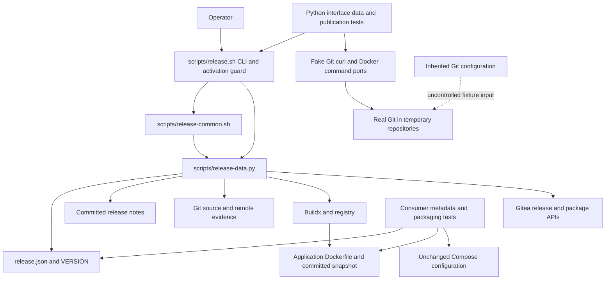

# Brooks-Lint Health Dashboard

- [Brooks-Lint Health Dashboard](#brooks-lint-health-dashboard)
  - [Dashboard](#dashboard)
  - [Module Dependency Graph](#module-dependency-graph)
  - [Test Suite Map](#test-suite-map)
  - [Top Findings](#top-findings)
    - [Warning](#warning)
  - [Verification and accepted boundaries](#verification-and-accepted-boundaries)
  - [Recommendation](#recommendation)

**Mode:** Health Dashboard

**Scope:** All 23 changed files on `66-container-release-template` relative to base `main`, merge base `3e4ee8225e9ab770424e92f7a38745fde2323935` through implementation commit `a2f1bd5`. Includes release scripts/configuration, packaging metadata, documentation, tests, removed legacy helpers, and the implementation record. No `.brooks-lint.yaml` exists; balanced defaults apply. Working tree was clean before review.

**Composite Score:** 99/100

**Trend:** 95 → 99 (+4) from the preceding Health Dashboard record, which reviewed the earlier plan rather than this implementation. Different scopes prevent interpreting this as a project-wide trend.

The branch matches its revised validation-only scope; one reproducible fixture-isolation warning remains. It is not approved for live publication.

## Dashboard

- Code Quality: 100/100; no new actionable R1/R2 finding. The large data/I/O helper is pinned infrastructure behind a small internal boundary; its length alone does not establish cognitive overload. Version/configuration edits belong to one release context rather than unrelated shotgun changes.
- Architecture: 100/100; no dependency cycle, application-to-release dependency, or inappropriate layering identified. Shell orchestration, Python data/I/O, JSON settings, committed source, and external command/API ports have clear responsibilities.
- Tech Debt: 100/100 within this branch's guarded scope; known upstream N1/N2 remain explicitly deferred behind an unconditional activation guard. Do not mistake that containment for resolution. No speculative framework, duplicate release engine, or domain-model distortion identified.
- Test Quality: 95/100; one T1 warning for ambient Git configuration escaping the fixture's isolation boundary.
- Calculation: `100 × 0.25 + 100 × 0.30 + 100 × 0.25 + 95 × 0.20 = 99`. One warning deducts five points only in Test Quality; no duplicate deductions.

## Module Dependency Graph

The external publication edges are reachable only in deliberately modified temporary test copies during this delivery. The real CLI exits for publication attempts before helper sourcing or prerequisites. The uncontrolled fixture input shown above is the finding, not an application-layer dependency defect.

## Test Suite Map

- Python: 108 methods comprising seven interface/boundary methods, 29 helper/data methods, and 72 fake-port publication integration methods; loops/subtests add scenarios beyond those counts. All 99 upstream method names remain, with nine consumer additions.
- Changed Node suite: six cases comprising four static/configuration/shell-boundary checks, one CLI-refusal check, and one optional real Compose-parser integration check. The Compose-parser case executed successfully in this review.
- Removed tests: old platform cases were replaced by running-node/variant/star/multi-node characterization and refusal-order checks against the new helper/workflow. Legacy archive and rebuild-promotion behavior was intentionally retired, not silently dropped from a still-supported interface.
- Changed application/browser E2E tests: zero. `src/`, `public/`, `.dockerignore`, and `docker-compose.yml` are unchanged relative to base. The recorded 630-test application run is implementation evidence, not an independently rerun whole-project review.
- The integration-heavy release suite is justified by cross-process state transitions and mutation ordering. Its recorded 542.714-second runtime is a feedback-cost limitation, but no arbitrary pyramid-ratio deduction is applied. The controlled guard-source transformation is an explicit, fail-closed plan decision; it is not treated as accidental test coupling.

## Top Findings

### Warning

**F1 — T1 Test Obscurity: inherited Git configuration can execute host hooks during supposedly isolated fixture setup.**

Symptom: `test/release-template/test_bash_release.py:219-225` constructs the fixture environment from all of `os.environ` and removes only token/Docker/lock variables. Git-specific controls such as `GIT_CONFIG_COUNT`, its key/value pairs, `GIT_CONFIG_GLOBAL`, `GIT_DIR`, and `GIT_WORK_TREE` are not isolated. `:241-253` then invokes real `/usr/bin/git` for repository creation, commits, and pushes. Fake Git/curl/Docker executables therefore do not fully contain Git's own configuration, hooks, or repository selection. Changing `HOME` alone does not override explicit Git environment controls.

Source: *xUnit Test Patterns* — Mystery Guest and Erratic Test; *The Art of Unit Testing* — Test isolation principle.

Consequence: a developer's shell/CI Git settings can make tests fail unexpectedly, select an unintended repository/index, or run host hooks and their side effects outside the fixture. This weakens the documented guarantee that fixture operations are confined to owned temporary inputs. It does not bypass the checked-in production publication guard, but it affects the tests used as evidence for that guard and later release activation.

Evidence: ran the existing `BashPublicationTests.test_invalid_config_and_local_validation_do_not_read_token` with a temporary, harmless external `pre-commit` hook selected using `GIT_CONFIG_COUNT=1`, `GIT_CONFIG_KEY_0=core.hooksPath`, and `GIT_CONFIG_VALUE_0=<owned temporary directory>`. The test passed, and the hook wrote its sentinel outside the test fixture. Both hook and sentinel were confined to the review-owned temporary directory and cleaned afterward; no network request or live repository mutation was used. This confirms ambient configuration is active during setup rather than merely a theoretical possibility.

Remedy: build the fixture Git environment from a controlled allowlist or comprehensively remove inherited repository/index/object/config/SSH/transport selectors. Disable system/global Git config using explicit fixture settings, point XDG/HOME at owned paths, and disable hooks/signing unless a test explicitly supplies its own. Apply the same policy to setup Git and the real Git subprocesses behind the fake port. Add a regression that injects an external hook and repository/config selectors and proves the hook never executes and all Git writes remain within the owned fixture. Do not weaken production Git authentication behavior to fix a test-only isolation problem.

## Verification and accepted boundaries

- Independently reran 39 Python methods: all seven interface and 29 data methods plus unsupported-server absence, exact/unlinked/conflicting association, and platform-refusal ordering integration checks. All passed in 15.465 seconds.
- Independently reran `node --test test/release-config.test.js`: six passed, zero failures/skips. Also passed `bash -n scripts/release.sh scripts/release-common.sh`, `./scripts/release.sh --validate`, and `git diff --check`.
- The additional controlled ambient-hook reproduction passed its selected test while demonstrating F1. It changed no implementation/test source and used only temporary fixture inputs.
- Reviewed the full implementation record: it reports 108 release tests and 630 application tests passing, production-tree packaging smoke, and a local AMD64 image smoke with shutdown/key-persistence checks. The full nine-minute publication suite, full application suite, and local image build were not repeated during this review; those remain recorded implementation evidence.
- Plan-review F1 is addressed by `scripts/release.sh:64-66` and `scripts/release-data.py:389-399`: read-only readiness precedes login/build/tag/promotion/release writes, reuses strict identities, and preserves final association verification. Plan-review F2 is addressed by `scripts/release.sh:15-20`: real publication, including an empty argument, exits before helpers/tools/state; only help/local validation remain operational. Plan-review F3 is addressed by `scripts/release-data.py:618-635` and the consumer characterization/refusal tests: explicitly running nodes, variants, starred tokens, and multi-node aggregation are handled without relaxing published OCI validation.
- Known N1/N2 defects remain in the pinned underlying engine, as explicitly accepted by the revised plan and documented in README, release operations, testing notes, and the implementation record. The real command is disabled, so they are activation prerequisites rather than newly uncontained publication blockers. This review grants no permission to remove the guard or broaden the stable-`1.25.x` package-link policy.
- Both `linux/amd64` and `linux/arm64` are configured and passed to the fixture-tested Buildx build (`scripts/release.sh:114`). This is not evidence of a real ARM64 build/runtime. Only AMD64 was built and smoke-tested during implementation; ARM64, live Gitea/registry publication, package UI rendering, and Docker plugin-selection correctness remain unverified.
- Private token-file credentials are configuration paths only; no production credential provisioning or publication was performed. Dependency resolutions, runtime image contents, root execution, network, data, certificate, and photo-mount contracts remain unchanged apart from the HTTPS source metadata default and synchronized version mirrors.

## Recommendation

Keep the publication guard intact. Address F1 before relying on the release suite in arbitrary developer/CI environments; a focused test-quality follow-up should harden Git fixture isolation without changing the production release protocol. The guarded adoption has no newly identified critical implementation finding, but live enablement still requires separately reviewed N1/N2 fixes, fresh server/package readiness, and actual multi-platform verification. No fixes were implemented in this review; only this report and health history are committed.
