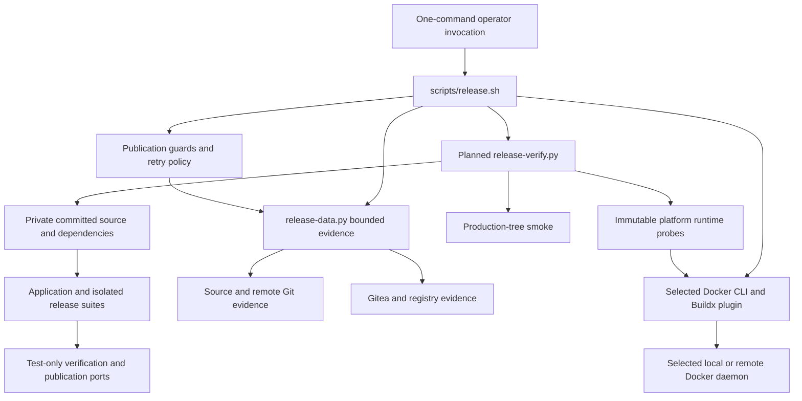

# Brooks-Lint Health Dashboard

- [Brooks-Lint Health Dashboard](#brooks-lint-health-dashboard)
  - [Dashboard](#dashboard)
  - [Module Dependency Graph](#module-dependency-graph)
  - [Test Suite Map](#test-suite-map)
  - [Top Findings](#top-findings)
    - [Warning](#warning)
  - [Accepted decisions and review limits](#accepted-decisions-and-review-limits)
  - [Recommendation](#recommendation)

**Mode:** Health Dashboard

**Scope:** Plan review of `tasks/67-one-command-release-verification/2-plan.md` at `0c0643f`, checked against the current release engine, test fixtures, packaging smoke, goal, and task 66 review. This is a design/readiness assessment, not implementation verification or a whole-project audit. No `.brooks-lint.yaml` exists; balanced defaults apply. The working tree was clean before review.

**Composite Score:** 95/100

**Trend:** 99 → 95 (−4) from the preceding Health Dashboard record. That record reviewed the implemented task 66 branch; different scopes prevent interpreting this as project-wide regression.

Revise three operational boundaries before implementation: temporary-path portability, Docker daemon-side smoke execution, and nested process cancellation.

## Dashboard

- Code Quality: not scored because this is a plan with no implementation diff. Proposed responsibilities and change propagation were examined without inventing line-level code findings.
- Architecture: 95/100; one warning for an unresolved client-versus-daemon network boundary in mandatory image smoke checks.
- Tech Debt: 95/100; one warning for assuming reusable process-group capture also supervises nested session leaders and daemon resources.
- Test Quality: 95/100; one warning for hardcoded test temporary directories remaining outside the planned portability change.
- Calculation: omit PR weight and redistribute proportionally: `(95 × 0.30 + 95 × 0.25 + 95 × 0.20) / 0.75 = 95`. Each warning deducts five points in its owning dimension only.

The plan correctly treats activation as more than deleting a guard: it includes N1/N2 regressions, early package readiness, immutable-image checks, no bypass flags, secret-free local verification, hermetic Git fixtures, and tests preventing recursive verification. Keeping browser downloads outside the mandatory contract is an explicit bounded tradeoff, not an unreported coverage claim.

## Module Dependency Graph

Planned boundaries, not an implemented dependency graph:

No planned cycle or application-to-release-tool dependency was found. The new helper is justified as a verification boundary; a fixed gate runner need not become a general hook/plugin framework. The network and cancellation ownership gaps below matter more than module fan-out.

## Test Suite Map

- Current Python baseline: seven interface/boundary methods, 29 helper/data methods, and 72 fake-port publication methods; 108 total, with additional subtest scenarios. Counts were confirmed by AST inspection, not inferred from coverage percentages.
- Current Node packaging/release suite: six cases covering static image/Compose wiring, optional real Compose parsing, shell/label assumptions, version/configuration mirrors, and disabled/unsupported CLI behavior. Those guard assumptions must change when mandatory verification replaces unconditional refusal.
- Planned additions: hermetic Git-environment regressions, verification-runner pass/fail/timeout integration, simulated nonrecursive gate events, N1 post-promotion faults, actual Buildx executable-selection checks, and immutable AMD64/ARM64 runtime smoke. This split is appropriate: fake ports prove ordering; real runner/plugin/image probes supply different evidence.
- No new tests were executed for this review. The plan is not implemented, so no new test count, duration, platform runtime, or publication success is claimed. Task 66's recorded full-suite/image results remain historical evidence only.

## Top Findings

### Warning

**F1 — T1 Test Obscurity: the mandatory suite still has hidden `/tmp/opencode` prerequisites.**

Symptom: `2-plan.md:49` explicitly makes `scripts/check-production.js` accept an owned temporary parent, but the mandatory Python suite still calls `TemporaryDirectory(dir="/tmp/opencode")` in `test/release-template/test_bash_release.py:30,47,1145`. Only its general publication fixture at `:197` has a fallback. The plan's fixture-isolation work controls environment/configuration but does not explicitly migrate these literal directory choices. Setting `TMPDIR` cannot override an explicit `dir` argument.

Source: *xUnit Test Patterns* — Mystery Guest; *The Art of Unit Testing* — Test isolation principle.

Consequence: on an otherwise supported Linux workstation without this harness-specific directory, the automatically required suite fails before the release checks can complete. Fixing only production smoke leaves an undocumented setup step in the proposed one-command workflow; success on this container would conceal it.

Remedy: extend the plan to route every suite, verification helper, and production smoke temporary directory through a validated run-owned parent or portable temporary-directory helper. Prefer `/tmp/opencode` only when available; do not require a global directory or create it through elevated setup. Add a clean-environment test that exercises the actual suite's directory-selection behavior with that harness path unavailable and confirms all created paths stay under the selected owned parent. Do not solve this by faking suite success in the end-to-end ordering test.

**F2 — R5 Dependency Disorder: mandatory runtime smoke leaves client and Docker-daemon loopback ambiguous.**

Symptom: `2-plan.md:58` preserves remote context/host/TLS selection, while `:64-66` requires both platform containers, loopback ephemeral ports, and HTTP readiness without defining where the HTTP probe runs. Existing connection fixtures explicitly model remote `tcp://` Docker endpoints; a client-side request to `127.0.0.1:<published-port>` reaches the release workstation, not a remote daemon's loopback. Likewise, local temporary filesystem paths are not automatically available as bind sources on a remote daemon. The current local-only image smoke is not a portable template for this new mandatory gate.

Source: *Clean Architecture* — policy/detail boundaries; *The Pragmatic Programmer* — Orthogonality.

Consequence: a supported remote Docker context may build correctly but always fail mandatory readiness, or accidentally probe an unrelated local service. The implementation may then weaken TLS/context handling or silently force local Docker to make tests pass, contradicting the N2 connection-preservation requirement.

Remedy: specify daemon-side smoke semantics in the plan. Prefer a probe executed with `docker exec` using the image's Node runtime to contact the application inside the container's own loopback network, with no published host ports and daemon-owned named volumes rather than client-path bind mounts. Read architecture/dependency/key/HTTP evidence through the selected Docker connection. Alternatively, explicitly restrict the feature to validated local daemons before any staging write, but make that an approved compatibility change. Add a remote-endpoint scenario proving the runner never uses workstation loopback or local bind paths as remote-daemon evidence and never switches contexts implicitly.

**F3 — R4 Accidental Complexity: outer gate deadlines do not define ownership of nested session leaders or daemon resources.**

Symptom: `2-plan.md:45,50` proposes reusing the existing process-group capture behavior and terminating owned child process groups; `:65-66` promises container/volume cleanup on failures and signals. Current `scripts/release-data.py:153-155` creates a new session for every captured command, and `:194-201` kills only that command's group. Running the release suite beneath another such wrapper creates nested session leaders: killing the outer test-runner group does not reach a descendant that started its own session. Abruptly killing a smoke helper also does not execute its `finally` cleanup or stop containers already created in the Docker daemon. No cooperative cancellation/escalation or independent resource-owner mechanism is specified.

Source: *A Philosophy of Software Design* — Information Hiding and Leakage; *Code Complete* — defensive error-handling discipline.

Consequence: timeout/overflow/SIGINT can leave owned commands, occupied ports, containers, or volumes behind even while the outer runner reports a bounded failure and removes temporary state. Stale resources can poison the next release attempt; broad process/container cleanup would violate the promise not to affect unrelated work. This is a missing orchestration contract, not a demand to replace the existing bounded I/O helper for ordinary single-command use.

Remedy: define a release-level cancellation/resource ownership protocol before implementing nested gates. Propagate cooperative cancellation first, allow a bounded cleanup grace period, then escalate only against recorded owned processes/groups; account for descendants that establish new sessions rather than assuming one `killpg` covers them. Keep a parent-owned registry of exact container/volume IDs/names so outer cleanup can remove owned daemon resources even when a helper dies. Preserve diagnostics/state when cleanup cannot be confirmed rather than claiming success or deleting ownership evidence. Add integration cases for a gate spawning a separate-session descendant and for interruption after container/volume creation; verify no surviving owned resources and no signal/removal against unrelated sentinels.

## Accepted decisions and review limits

- The user asked to automate required verification. Including real N1/N2 fixes is justified because the current command is intentionally disabled; merely adding tests while leaving activation impossible would not meet the stated goal. Do not relax those blockers to reduce scope.
- The stable-`1.25.x` new-link guard remains intact, and existing exact association on the observed `28.2.0` family is the only supported path there. A failed prerequisite is not mutation authority. No review finding requests broadening server support or linking a live package.
- One staging push followed by real immutable-image smoke is explicitly allowed by the plan; runtime failure may leave staging evidence. This is not confused with the stronger pre-staging no-publication-write guarantee.
- Long suite execution is intentional, with explicit budgets, no success cache, no skip flag, and separate real-runner tests. The plan already addresses the previous inherited-Git-hook warning and verification recursion; those are not restated as unresolved findings here.
- Browser E2E remains outside the fixed release contract, and actual ARM64 execution is distinguished from advertising support or generating fake manifests. Neither omission is presented as proof of platform/browser readiness.
- N2's proposed plugin identification must be proven by the planned real discovery probes; the locally observed plugin path is not permission to hardcode it. No live Docker/plugin/API experiment or publication was performed in this plan review.

## Recommendation

Update `2-plan.md` for F1–F3 before implementation. First make verification-resource ownership and daemon locality explicit, then add portable temporary-parent behavior and regression coverage for those boundaries. Preserve the one-command contract, source/identity protections, N1/N2 activation criteria, and no-live-publication implementation restriction. The architecture/lifecycle follow-up deserves the most attention because failure cleanup must hold across test subprocesses and Docker resources, not just a successful local run. Only this review and the health-history record are changed; implementation and plan content remain untouched.
