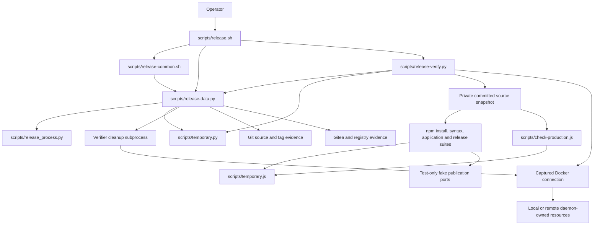

# Brooks-Lint Health Dashboard

- [Brooks-Lint Health Dashboard](#brooks-lint-health-dashboard)
  - [Dashboard](#dashboard)
  - [Module Dependency Graph](#module-dependency-graph)
  - [Test Suite Map](#test-suite-map)
  - [Top Findings](#top-findings)
    - [Warning](#warning)
  - [Verification and review limits](#verification-and-review-limits)
  - [Recommendation](#recommendation)

**Mode:** Health Dashboard

**Scope:** All 33 changed files on `67-one-command-release-verification` relative to `main`, from merge base `63f319a` through implementation commit `c3a6e10`. Architecture and debt scans cover the changed release subsystem and its application/test boundaries, not an unrelated whole-project audit. No `.brooks-lint.yaml` exists; balanced defaults apply. The working tree was clean before review.

**Composite Score:** 97/100

**Trend:** 95 → 97 (+2) against the preceding Health Dashboard entry. That entry reviewed the task plan; the different scopes do not establish a project-wide quality improvement.

Hold merge for cleanup and isolation corrections plus regression coverage. Local verification passes, but three confirmed gaps remain; the score is not a release-readiness certification.

## Dashboard

- Code Quality: 95/100; F1 exposes an error-path dependency that suppresses mandatory independent resource cleanup.
- Architecture: 100/100; no new import cycle or application-to-release-tool dependency found. Cross-process cleanup ownership still needs F1's correction.
- Tech Debt: 95/100; F2 leaves the Node prerequisite outside the otherwise isolated verification environment.
- Test Quality: 95/100; F3 leaves actual mandatory-gate orchestration without a persistent behavioral regression.
- Calculation: `(95 × 0.25) + (100 × 0.30) + (95 × 0.25) + (95 × 0.20) = 96.5`, rounded half-up to 97. Each of the three warnings deducts five points in its owning dimension only. No critical or suggestion findings are counted.

## Module Dependency Graph

Solid arrows describe imports or direct command boundaries; the cleanup edge is subprocess dispatch, not a Python import cycle.

The fixed verification helper, standard-library process owner, and daemon-side probes are justified by present requirements. High fan-out in publication orchestration is not itself a dependency violation. Application code, Dockerfile runtime, dependency resolutions, and Compose storage/network contracts remain unchanged.

## Test Suite Map

- Python release suite: 123 discovered methods, verified by AST counts: seven interface cases, 76 fake-port publication integration cases, 29 helper/data boundary cases, and 11 verifier cases. The helper/data group mixes in-process assertions with bounded subprocess checks; it is not 29 pure unit tests.
- New verifier cases: five helper/unit-contract cases for plugin identity, exact resource cleanup, auth disposal, pending-create evidence, and simulated runtime transitions; six integration cases execute real gates, detached descendants, selected Python/Node fixtures, Git isolation, or signal cancellation. No registry publication or real remote Docker execution occurs in these cases.
- Changed Node tests: nine test files covering development supervision, TLS, photo APIs, release configuration, startup, and shutdown; two shared fixtures also changed. Their primary change is temporary-parent selection. Repository context contains 63 Node test files; the implementation's completed verifier recorded 630 passing application cases.
- Browser E2E: 11 existing `e2e/*.spec.js` files, zero changed browser specifications. Browser checks are intentionally outside the mandatory release contract and were not run for this review.
- The layered fake-port approach is appropriate for publication safety and prevents recursive suites. Its limitation is that it cannot replace behavioral coverage of the real `local()` orchestration identified in F3. The lengthy release suite is an explicit requirement, not an automatic test-pyramid finding.

## Top Findings

### Warning

**F1 — R1 Cognitive Overload: process-cleanup failure skips the independent daemon cleanup attempt.**

Symptom: `scripts/release-data.py:772-783` puts `owner.cleanup(child)` and the parent-side verifier cleanup subprocess in the same `try` block. If process termination cannot be confirmed and `TreeOwner.cleanup()` raises, execution jumps directly to auth disposal and evidence retention; the Docker cleanup subprocess at `:776-777` is never called. The same dispatch branch manages lock ownership, signal forwarding, process teardown, daemon cleanup, auth disposal, and scratch retention, making this exceptional dependency easy to miss. An owned-fixture probe injected that cleanup error after a real worker exited: independent daemon-cleanup calls were zero, the resource manifest remained, and the token was correctly removed.

Source: *Code Complete* — defensive programming and error-handling discipline; *Refactoring* — Long Method with mixed lifecycle responsibilities.

Consequence: the failure path that most needs independent ownership recovery can leave already-created containers running and volumes allocated without even attempting their bounded cleanup. Retaining evidence and returning failure is correct, but it does not satisfy the plan's independent parent cleanup contract. Furthermore, the CLI's generic handling of `RuntimeError` does not preserve the exception's exact surviving process identities in an ownership record.

Remedy: make process teardown, independently bounded daemon-resource reconciliation, credential disposal, and final evidence retention explicit sibling cleanup stages. Preserve process failures while still attempting identity-checked resource cleanup when safe; never convert either failure to success. Persist sanitized PID/start-time survivor evidence alongside exact daemon resource evidence. Add a supervisor-level regression that injects unconfirmed process cleanup and asserts the daemon cleanup attempt, nonzero result, auth disposal, retained identities, and untouched unrelated sentinels.

**F2 — R2 Change Propagation: the Node version probe bypasses verification-environment isolation.**

Symptom: `scripts/release-verify.py:72` constructs the controlled environment, but `:73` calls `DATA.command(["node", "-p", "process.versions.node"])` without it. `scripts/release-data.py:157-161,218-219` consequently uses ambient `os.environ`, stripping a small token-name list rather than the verifier's allowlist. An owned `NODE_OPTIONS=--require=<fixture.cjs>` preload executed during this real prerequisite subprocess and read an ambient fixture application variable, even though neither appears in the controlled environment used by later gates.

Source: *The Pragmatic Programmer* — Orthogonality; *A Philosophy of Software Design* — Information Hiding and Leakage.

Consequence: automatic verification depends on host preload/application settings despite promising isolation. Host startup code can modify prerequisite behavior, access ambient settings, or fail an otherwise valid release before the isolated suites begin. This is a demonstrated environment-boundary violation, not evidence that any live token was read or exposed.

Remedy: execute the Node prerequisite through the same controlled environment and explicit working directory as the other verification children. Keep prerequisite and gate execution on one environment-aware subprocess boundary rather than relying on callers to remember which helper inherits ambient state. Add a real preload-sentinel regression requiring no execution and no ambient application-variable inheritance while preserving approved proxy/CA trust settings.

**F3 — T5 Coverage Illusion: verifier tests can pass when actual local verification is removed.**

Symptom: `test/release-template/test_verification.py:34-44` tests `gate()` directly, but none of the 11 new verifier methods invokes `local()`. Publication fixtures replace the entire `release-verify.py local` action with synthetic success/failure events at `test/release-template/fixtures/bash_release_ports.py:20-30`. An in-memory mutation replacing each verifier module's `local()` with a no-op left all 11 verifier tests passing. Thus the persistent suite does not protect the real sequence at `scripts/release-verify.py:68-93`, including metadata enforcement, snapshot isolation, and mandatory suite/packaging invocation.

Source: *How Google Tests Software* — change coverage versus line coverage; *The Art of Unit Testing* — test completeness; *Working Effectively with Legacy Code* — Sensing and Separation.

Consequence: deleting or accidentally omitting a mandatory gate can leave the release tests green and permit publication without the intended verification. The manually completed full-verifier run establishes current happy-path execution, but it cannot detect a future regression and does not supply the planned small-project pass/fail orchestration cases.

Remedy: add committed integration tests invoking the real `local()` against small owned committed projects with actual controlled passing and failing executable processes. Assert each required gate runs exactly once in order, a failing suite prevents later gates, metadata/source isolation holds, and the caller fails before publication. Keep external publication ports fake and do not introduce production bypass flags. Require removal of a mandatory invocation, including replacement of `local()` with a no-op, to fail these tests.

## Verification and review limits

- Re-ran `python3 -B -m unittest test_verification -v` from `test/release-template`: all 11 cases passed in 2.078 seconds.
- Re-ran `npm run check`, `./scripts/release.sh --validate`, and `git diff main...HEAD --check`: passed. Validation remained local-only.
- Executed three review-owned probes without editing implementation files: injected supervisor cleanup failure, an actual Node preload-sentinel prerequisite, and an in-memory no-op `local()` mutation. They confirmed F1, F2, and F3 respectively. The mutation run still passed all 11 verifier cases in 2.081 seconds. Fixture subprocesses exited; temporary fixture directories were removed. No daemon resources were created for these probes.
- Inspected all changed release helpers, shell policy, fixtures, test migrations, version mirrors, and affected documentation. Reviewed N1's one-way promotion state and N2's pinned executable identity without finding another actionable defect in those changes.
- The implementation record and retained verifier log already establish 630 application cases, 123 Python release cases, and production packaging passing against an isolated committed snapshot. Those complete suites were not rerun during this review; the targeted results above are fresh evidence.
- Current ARM64 execution remains an explicit implementation-record limitation: `exec /usr/local/bin/node: exec format error`. This review did not change or install emulation, weaken runtime requirements, or claim both-platform release readiness. Native/emulated execution support remains an operator prerequisite, not a reason to bypass image smoke.
- No live token was read, production no-argument release command invoked, dependency installed into the checkout, remote source/tag/image/release/link written, or implementation fix applied. Only this review and the health-history entry are changed.

## Recommendation

Correct F1 and F2, then add F3's real orchestration regressions before merging or publishing. Preserve the mandatory fail-closed gates, N1/N2 protections, daemon-side probes, conservative package/server authority, and explicit ARM64 prerequisite. Failure cleanup deserves first attention; a focused lifecycle review is more useful than a broad refactor. Re-run the full isolated verifier after fixes and obtain real ARM64 runtime evidence on the selected daemon before any live release.
