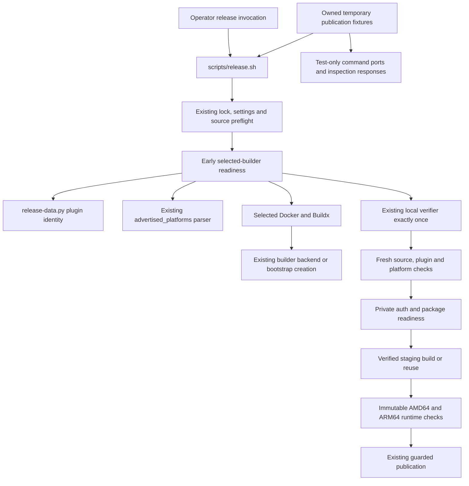

# Brooks-Lint Health Dashboard

- [Brooks-Lint Health Dashboard](#brooks-lint-health-dashboard)
  - [Dashboard](#dashboard)
  - [Module Dependency Graph](#module-dependency-graph)
  - [Test Suite Map](#test-suite-map)
  - [Top Findings](#top-findings)
    - [Warning](#warning)
  - [Accepted decisions and review limits](#accepted-decisions-and-review-limits)
  - [Recommendation](#recommendation)

**Mode:** Health Dashboard

**Scope:** Plan review of `tasks/68-early-arm64-preflight/2-plan.md` at `528c903`, checked against its goal, current release ordering, Buildx identity/platform helpers, publication fixtures, and task 67's recorded review. This is a scoped design assessment, not implementation verification or a whole-project audit. No `.brooks-lint.yaml` exists; balanced defaults apply. The working tree was clean before review.

**Composite Score:** 98/100

**Trend:** 97 → 98 (+1) against the preceding Health Dashboard entry. That entry reviewed the implemented task 67 branch; different scopes prevent interpreting this as a measured project-wide improvement.

The ordering change meets the reported need, but clarify bootstrap authority before implementation: a selected builder can exist without its privileged backend container already existing.

## Dashboard

- Code Quality: not scored because this task has no implementation diff. Proposed error handling and change propagation were assessed without inventing code-level findings.
- Architecture: 95/100; one warning for contradictory authority at the early Docker bootstrap boundary.
- Tech Debt: 100/100; parser reuse, original plugin identity, bounded commands, and a focused helper avoid new duplicated policy or speculative infrastructure.
- Test Quality: 100/100; planned behavioral cases cover early refusal, single verifier execution, late capability/plugin drift, retries, connections, and CLI exclusions. No new T1/T2 issue was identified in the proposed suite changes.
- Calculation: omit the PR weight and redistribute proportionally: `(95 × 0.30 + 100 × 0.25 + 100 × 0.20) / 0.75 = 98`. The single warning deducts five points in Architecture only. No critical or suggestion findings are counted.

## Module Dependency Graph

Proposed control flow, not an implemented dependency graph:

No new application-to-release-tool dependency or import cycle is proposed. The concern is authority over the backend represented above, not ordinary orchestration fan-out or the use of a concrete Docker adapter.

## Test Suite Map

- Current Python baseline, counted through AST inspection: seven CLI/interface integration cases, 76 fake-port publication integration cases, 29 helper/data boundary cases, and 11 verifier/lifecycle cases; 123 total. The helper/data group mixes unit assertions and real subprocess boundaries rather than representing 29 pure unit tests.
- Current Node context: 63 test files, including six release-configuration cases. Existing task 67 results are historical evidence, not tests executed for this plan review.
- Browser E2E context: 11 specification files; no browser test changes are needed for release-ordering behavior.
- Planned additions are at the appropriate layer: parser characterization remains local; real shell orchestration runs against owned Git repositories and fake external executables; per-inspection responses expose early versus late evidence. Testing publication event order is intentional behavior verification, not unnecessary coupling to private function names.
- F1 needs a driver/lifecycle case in that same fixture boundary. It does not require starting a real privileged container or adding another full verifier integration suite. Task 67's separate missing-real-`local()` regression remains explicitly unresolved, not silently counted as covered by this task.

## Top Findings

### Warning

**F1 — R5 Dependency Disorder: early bootstrap crosses an unresolved privileged-resource boundary.**

Symptom: `2-plan.md:26` requires `docker buildx inspect --bootstrap` before local verification, while `:29` forbids privileged containers in the early phase. Lines `:52,77` acknowledge backend startup and image fetching, but do not resolve backend creation. An existing configured `docker-container` builder may have no backend container yet. Docker Buildx's [docker-container driver implementation](https://github.com/docker/buildx/blob/master/driver/docker-container/driver.go), inspected read-only for this review, calls `create()` from `Bootstrap()` when the container is absent; `create()` uses `container.HostConfig{Privileged: true}` and a persistent BuildKit state volume. Preserving an existing builder configuration therefore does not guarantee that no privileged container will be created. This evidence describes a supported upstream driver path, not the installed host's current driver or state.

Source: *Clean Architecture* — policy/detail boundaries; *A Philosophy of Software Design* — Information Hiding and Leakage; *Code Complete* — defensive error-handling discipline.

Consequence: implementation cannot simultaneously promise the unconditional no-privileged-container constraint and bootstrap every supported configured builder. It may create privileged persistent backend resources before tests even when the later platform check fails, or reject legitimate inactive builders contrary to the stated compatibility decision. Existing inspection fixtures only emit text and do not model that lifecycle, so ordinary early-refusal event assertions would not expose this policy mismatch. Backend resources also must not be confused with invocation-owned smoke containers subject to automatic deletion.

Remedy: state one explicit bootstrap policy in the plan. The conservative option is non-bootstrapping early inspection with an actionable instruction to have the administrator prepare an inactive or missing backend. If preserving automatic bootstrap is intended, obtain explicit approval for creation/start of the already-selected builder's backend, including possible privileged container and state-volume creation; distinguish that narrow authority from forbidden QEMU/binfmt installation and builder creation/switching. Document that shared Buildx backend resources are not run-owned smoke resources and must not be broadly cleaned up on failure. Add fixture scenarios for running, stopped, and configured-but-uncreated backends, asserting the chosen behavior, no verifier on early refusal, and no unauthorized privileged bootstrap or unrelated-resource deletion. Do not run a real privileged bootstrap to validate the plan.

## Accepted decisions and review limits

- Checking after cheap source/settings safety requirements but before snapshot installation and suites satisfies the goal's meaning of early. This task is not required to put Docker ahead of argument handling or source agreement checks.
- Reusing `advertised_platforms()` preserves canonical/variant/starred running-node matching without duplicating platform policy. No parser rewrite or additional arbitrary-image probe is justified by the reported error.
- A post-verification recheck is justified because tests are slow. It must compare the original plugin identity rather than recapturing a replacement; the plan explicitly requires that distinction and drift coverage.
- Builder advertisements do not prove actual ARM64 execution. The plan correctly retains immutable-image runtime smoke and states that runtime-only `exec format error` may still occur later. This review does not redefine the goal as early runtime certification.
- Remote Docker selection, TLS, config-local plugins, staging reuse, completed retries, package restrictions, credential timing, and side-effect-free CLI paths are explicitly preserved. No new concern was found in those proposed boundaries beyond F1.
- Task 67's cleanup and Node prerequisite isolation defects, plus its persistent local-orchestration coverage gap, remain recorded inherited issues. Their existence is not attributed to this narrow plan or described as resolved by it.
- Review performed file inspection, AST test counting, and one read-only upstream source fetch. No application/release suite, Docker command, builder bootstrap, live credential access, registry publication, or host setup was executed. No implementation readiness or current AMD64/ARM64 runtime capability is claimed.
- Only this review and the health-history entry are changed. `2-plan.md`, implementation code, archived task records, version mirrors, and `todo.md` are unchanged.

## Recommendation

Resolve F1's bootstrap policy before implementation, then follow the narrow early/late ordering plan. Prefer an early non-bootstrapping refusal if privileged backend creation has not been approved; do not infer that approval from a configured builder name. Once the policy and fixture cases are explicit, the plan is otherwise actionable without expanding into task 67's separate repairs. The infrastructure authority boundary deserves focused attention rather than a broad release-subsystem refactor.
