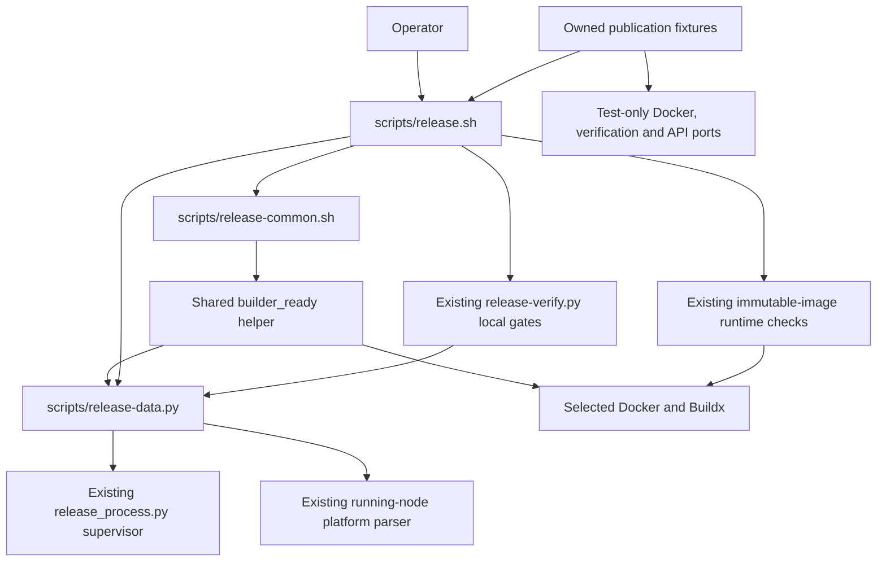

# Brooks-Lint Health Dashboard

- [Brooks-Lint Health Dashboard](#brooks-lint-health-dashboard)
  - [Dashboard](#dashboard)
  - [Module Dependency Graph](#module-dependency-graph)
  - [Test Suite Map](#test-suite-map)
  - [Top Findings](#top-findings)
  - [Verification and review limits](#verification-and-review-limits)
  - [Recommendation](#recommendation)

**Mode:** Health Dashboard

**Scope:** All 14 changed files on `68-early-arm64-preflight` relative to `main`, from merge base `0ca030a` through implementation commit `9119fd0`. Architecture and debt scans cover the changed release subsystem and its immediate dependencies, not a whole-project audit. No `.brooks-lint.yaml` exists; balanced defaults apply. The working tree was clean before review.

**Composite Score:** 100/100

**Trend:** 98 → 100 (+2) against the preceding Health Dashboard entry, which reviewed the original task 68 plan. The plan's bootstrap-authority warning is addressed by the revised non-bootstrapping policy and implementation; different review scopes prevent treating the score as a project-wide improvement.

No new actionable finding or merge blocker was identified in this diff. This scoped result does not clear inherited release defects or certify current ARM64 execution.

## Dashboard

- Code Quality: 100/100; the early check precedes local verification, and the later check validates the original plugin identity rather than recapturing it. The short shared helper explicitly stops on inspection or platform-validation failure.
- Architecture: 100/100; shell publication policy continues to use the existing bounded Python evidence boundary. Both readiness inspections omit bootstrap, and no new dependency cycle or application-to-release-tool dependency is introduced.
- Tech Debt: 100/100; the parser and subprocess limits are reused without duplicate platform policy or a configurable verification framework. Version mirrors change together; dependency resolutions remain unchanged.
- Test Quality: 100/100; owned fixtures cover backend lifecycle, early/late refusal, plugin replacement, exactly-once verifier ordering, fresh/reuse/completed retries, connection selection, and CLI exclusions. Command-order assertions protect externally meaningful safety requirements rather than private helper names.
- Calculation: `(100 × 0.25) + (100 × 0.30) + (100 × 0.25) + (100 × 0.20) = 100`. No critical, warning, or suggestion deductions apply to this branch's changes. Inherited task 67 findings are disclosed below rather than attributed to this diff.

## Module Dependency Graph

Arrows represent shell helper calls, Python imports, or subprocess boundaries, not solely static imports.

`builder_ready()` has two current callers in the same workflow, so sharing its command/validation sequence is justified rather than speculative abstraction. Docker platform advertisements remain distinct from runtime execution evidence. Default/context/host/TLS/builder routing and the existing private-auth plugin transition remain intact.

## Test Suite Map

- Python release suite: 128 methods confirmed by AST counting, comprising seven CLI/interface integration cases, 81 fake-port publication integration cases, 29 helper/data boundary cases, and 11 verifier/lifecycle cases. The helper/data group includes both unit assertions and subprocess checks; it is not 29 pure unit tests.
- This branch adds five publication integration methods for stopped/inactive backend refusal, missing plugin refusal, valid running-node union, late readiness loss, and plugin replacement after verification. Existing methods now assert readiness before and after exactly one verifier invocation. The fake Docker port rejects bootstrap arguments rather than silently returning successful inspection text.
- The 11 existing verifier cases mix helper/unit-contract tests with real gate, process, and fixture integration. Their known absence of real `local()` orchestration regression coverage remains inherited task 67 work, not newly supplied coverage.
- Node context: 63 test files; six release-configuration cases were rerun for this review. No Node test file changed on this branch.
- Browser E2E context: 11 specification files; zero changed browser specifications and no browser run. Browser coverage is outside this release-ordering change.
- The integration-heavy publication suite and its explicit command-event checks are justified by remote-write and prerequisite-ordering risk. Its recorded 1071-second duration is not alone evidence of architectural decay in this narrow diff.

## Top Findings

No new actionable findings after reviewing the implementation, tests, documentation, metadata, and revised plan.

The plan-review bootstrap concern is resolved: `scripts/release-common.sh:15-19` invokes plain `docker buildx inspect`, and `scripts/release.sh:53-63` uses the same check before and after local verification. Stopped/inactive nodes cannot satisfy the unchanged parser through cached platform labels. Fixtures reject `--bootstrap` and check shared-resource preservation; documentation requires separate backend preparation and does not treat shared Buildx resources as run-owned smoke cleanup targets.

The scope is intentionally not expanded to inherited task 67 defects. Its recorded warnings remain unresolved: process-cleanup failure can skip independent daemon cleanup, the Node version prerequisite inherits ambient preload/application settings, and persistent tests lack real `local()` orchestration coverage. None is represented as repaired or made harmless by an early platform check.

## Verification and review limits

- Reviewed the complete `main...HEAD` diff and the surrounding shell execution, bounded subprocess/platform helpers, plugin identity, fixture routing, task plan/review, and implementation record. Confirmed lockfile changes are limited to the two version mirrors, without dependency-resolution changes.
- Fresh Python verification: 14 targeted methods passed in 74.261 seconds, covering all seven interface cases, parser characterization, stopped/inactive backend refusal, late evidence/command failure, plugin mutation, fresh/completed-retry ordering, staging reuse, and relative Docker/TLS/Buildx paths. Fixture invocations use owned temporary repositories, not the live release target, and assert supervisor-owned work removal.
- Fresh Node verification: `node --test test/release-config.test.js` passed all six cases with zero skips, including actual Compose parsing. `npm run check`, separate `bash -n` checks for both shell files, `./scripts/release.sh --validate`, and `git diff main...HEAD --check` passed.
- The implementation record and completed suite logs establish 630 application tests passing in 48.117 seconds and all 128 Python release tests passing in 1071.275 seconds. Those full suites were not rerun during review; the targeted results above are fresh evidence.
- The implementation's non-bootstrapping Docker inspection recorded only AMD64 variants on the current selected builder. No actual ARM64 execution is certified, and readiness advertisements would not provide that certification anyway. Actual both-platform immutable-image checks remain mandatory after staging/reuse and before publication.
- This review ran no live no-argument release, registry login, real builder bootstrap, image build/push/runtime probe, package-link mutation, remote Git write, host setup, or checkout dependency installation. Only this report and the health-history entry are changed; no fixes were applied.

## Recommendation

The branch meets task 68's revised early-readiness scope and has no new review blocker. Preserve the non-bootstrapping policy and later runtime gates when merging. Address the three inherited task 67 warnings separately, and have the Docker host administrator prepare sufficient running ARM64 capacity before attempting a live release. This review is not approval to skip runtime checks, provision privileged support, or publish from the implementation branch.
