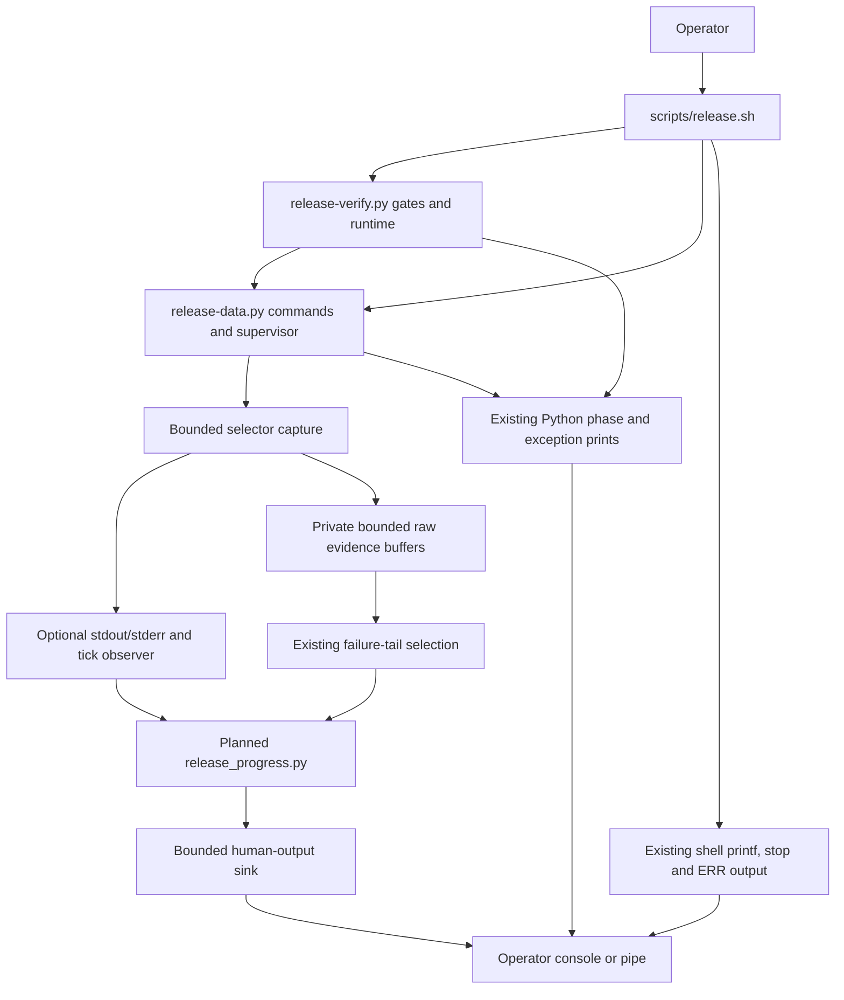

# Brooks-Lint Health Dashboard

- [Brooks-Lint Health Dashboard](#brooks-lint-health-dashboard)
  - [Dashboard](#dashboard)
  - [Module Dependency Graph](#module-dependency-graph)
  - [Test Suite Map](#test-suite-map)
  - [Top Findings](#top-findings)
    - [Warning](#warning)
  - [Accepted decisions and review limits](#accepted-decisions-and-review-limits)
  - [Recommendation](#recommendation)

**Mode:** Health Dashboard

**Scope:** Plan review of `tasks/69-release-progress-logs/2-plan.md` at `3ead3c7`, checked against its goal, current capture/gate/supervisor output paths, publication helpers, and existing tests. This is a design assessment of the proposed logging change, not implementation verification or a whole-project audit. No `.brooks-lint.yaml` exists; balanced defaults apply. The working tree was clean before review.

**Composite Score:** 96/100

**Trend:** 100 → 96 (−4) against the preceding Health Dashboard entry, which reviewed the task 68 implementation. Different scopes prevent interpreting this as a project-wide regression.

Clarify ownership of all human-facing output and stateful sanitized failure context before implementation. The plan otherwise preserves the release safety boundaries and proposes useful behavioral tests.

## Dashboard

- Code Quality: not scored because task 69 has no implementation diff. Existing task 68 changes are context, not this review's PR scope.
- Architecture: 95/100; F1 identifies direct output paths outside the proposed bounded observer/sink boundary.
- Tech Debt: 95/100; F2 identifies split ownership of sensitive-record context across live output, suppression, and failure-tail replay.
- Test Quality: 100/100; handshake-based pre-exit visibility, fake-clock timing, real blocked/closed sinks, exact machine output, and nonrecursive publication fixtures are appropriate. Add the two boundary-specific cases below to make those tests complete for the stated contracts.
- Calculation: omit the PR weight and redistribute proportionally: `(95 × 0.30 + 95 × 0.25 + 100 × 0.20) / 0.75 = 96.333…`, rounded half-up to 96. Each warning deducts five points in its owning dimension only. No critical or suggestion findings are counted.

## Module Dependency Graph

Proposed boundaries with the existing output paths that still need explicit ownership:

The fixed helper and silent-by-default observer are justified current-use boundaries, not speculative infrastructure. Machine-readable stdout must remain separate. F1 concerns the bypass arrows to the console; F2 concerns replaying raw buffers without their original parsing state.

## Test Suite Map

- Current Python baseline, confirmed by AST counting: seven CLI/interface integration methods, 81 fake-port publication integration methods, 29 helper/data boundary methods, and 11 verifier/lifecycle methods; 128 total. The helper/data group mixes unit assertions and real subprocess checks rather than representing 29 pure unit tests.
- Current Node context: 63 test files, including the existing six release-configuration cases. Browser E2E context: 11 specification files. No application or browser behavior change is proposed.
- Planned unit/boundary coverage includes incremental decoding, sanitization, quotas, injected-clock heartbeat behavior, and byte-exact capture results. Planned integration coverage includes real child/parent handshakes, quiet processes, blocked/slow/closed output consumers, cancellation, and fixture publication ordering. Tests must exercise actual gate/wrapper wiring, not only formatting functions.
- Existing `VerificationTests.test_real_gate_runs_pass_fail_timeout_and_overflow` validates gate outcomes but does not establish pre-exit visibility. The new handshake tests are the right additional evidence. Fake publication executables remain appropriate for preventing live writes and recursive suite execution.
- No test suite was executed for this plan review. Counts describe existing source; no future test count, log timeliness, secret protection, or sink cleanup is claimed as implemented.

## Top Findings

### Warning

**F1 — R5 Dependency Disorder: a bounded capture observer does not own every human-output path that can hold the lock.**

Symptom: `2-plan.md:34-40` specifies a bounded observer/sink around selected `capture()` calls, while `:27` preserves existing public output and `:46` adds shell phase transitions without requiring those paths to use that sink. Current `scripts/release-common.sh:6-18` writes directly through shell `echo`/`printf`; `scripts/release-verify.py:48,62-65,256` prints gate/status/exception text directly; and `scripts/release-data.py:783,808` prints cleanup/failure diagnostics directly. The lock supervisor at `scripts/release-data.py:757-770` starts Bash with inherited output descriptors and waits for it. It does not currently mediate console backpressure. The planned blocked-sink test at `2-plan.md:57` does not explicitly exercise these top-level phase, failure, and cleanup paths.

Source: *Clean Architecture* — policy/detail boundaries; *A Philosophy of Software Design* — Information Hiding and Leakage; *Code Complete* — defensive error-handling discipline.

Consequence: a full stderr pipe can still block a phase message or final exception diagnostic even if every live child-log observer is nonblocking. That can prevent a gate from starting its deadline, delay process completion, or retain the checkout lock indefinitely. A closed pipe can also introduce an unintended output error in a shell/Python control path. Thus passing helper-only sink tests would not establish the plan's invocation-level claim that an unread console cannot stall supervision or lock release.

Remedy: specify one bounded human-output ownership boundary for normal release invocations, covering new and retained phase records, summaries, exception handlers, shell traps, and cleanup diagnostics, not just observer callbacks. Choose either coordinated bounded emitters or a supervisor-owned forwarding boundary; preserve helper machine stdout and do not change shared ancestor descriptor flags. State the sink shutdown deadline and fallback behavior when no diagnostic can be delivered. Add top-level owned-repository cases with prefilled/unread and closed console pipes during initial phase output, nonzero gate completion, and cleanup, asserting bounded exit, release-lock reacquisition, correct failure status, and owned-only resource handling. This need not repair task 67's separate daemon-cleanup ordering defect, but it must prevent logging from creating another blocking path.

**F2 — R2 Change Propagation: failure-tail replay has no explicit owner for prior sensitive-record state.**

Symptom: `2-plan.md:36-38` requires complete-record streaming, suppression of multiline private-key/configuration text, and the same sanitation policy for the existing failure tail. Current `scripts/release-verify.py:55` selects the last 8,192 raw bytes from concatenated stdout/stderr, which can start in the middle of a logical record or sensitive block. Applying the same sanitizer to that slice with fresh state does not recover an earlier `BEGIN ... PRIVATE KEY` or configuration-dump marker. The 4 KiB overlong-record discard and 1 MiB display suppression at `2-plan.md:30` also need an explicit rule for retaining sensitive-region state when text is not displayed. The tests at `:55` cover split writes and multiline text, but do not explicitly cover a marker outside the retained raw tail or preceding a suppressed region.

Source: *A Philosophy of Software Design* — Information Hiding and Leakage; *The Pragmatic Programmer* — Orthogonality and DRY; *Code Complete* — defensive error handling.

Consequence: an implementation can correctly hide a sensitive block during live output yet later print its unlabelled body in a failure diagnostic. Similarly, discarding an oversized marker record or stopping sanitation when the display quota is exhausted can cause later records to be misclassified as safe. The same confidentiality decision would depend on which output path handled the bytes, undermining both secrecy and maintainability despite nominally sharing a redaction function.

Remedy: define per-stream sensitive-record state with a single lifecycle from initial bytes through EOF, including suppression and malformed/overlong input handling. Build any retained failure tail from already-sanitized records using that context, not a newly sanitized arbitrary raw suffix; if context is unavailable, omit the raw tail with a fixed message. Keep raw capture byte-exact and private for machine evidence, separate from the bounded sanitized diagnostic buffer. Specify what happens when an oversized marker or incomplete sensitive block makes classification uncertain, and continue tracking suppression state after the display quota is reached. Add regressions where a private-key/config marker falls before the last 8 KiB, a marker-containing line exceeds 4 KiB, and a block spans display suppression, EOF, and a nonzero exit. Neither live output nor final failure reporting may reveal the fixture body.

## Accepted decisions and review limits

- The request is correctly scoped to release-console visibility, not application UI or persistent log storage. A fixed helper is warranted by chunking, secrecy, and backpressure requirements; this review does not recommend an extensible logging framework.
- Local sanitized streaming versus heartbeat-only authenticated operations is a sound distinction. Progress does not need raw registry/login/build responses to show that publication work is ongoing, and command completion must remain distinct from verified remote acceptance.
- The plan explicitly preserves capture byte/time limits, raw command results, helper stdout protocols, process ownership, early non-bootstrapping ARM64 refusal, and mandatory immutable-image runtime checks. Those are useful constraints rather than new bypasses.
- A silent default observer, independent display budget, dropped display records under pressure, and no universal arbitrary-secret-sanitization claim are appropriate tradeoffs. The findings concern missing end-to-end ownership details, not a request to increase budgets or block on log delivery.
- Keep heartbeat scheduling independent of output availability throughout an opted-in command's lifetime, including a child that closes its output pipes before exiting. Current `capture()` switches from its selector loop to `process.wait()` at `scripts/release-data.py:197-198`; implementation and quiet-process tests should account for that existing boundary rather than assuming all quiet children keep their pipes open.
- Task 67's cleanup/isolation/real-local-orchestration warnings remain inherited separate work. This plan must not claim to resolve them, and the review does not require merging or archiving task 68.
- Review performed file inspection and AST test counting only. No release command, Docker/bootstrap operation, credential read, dependency installation, runtime probe, or publication was executed. Only this review and health-history entry are changed; `2-plan.md` and implementation code remain untouched.

## Recommendation

Update the plan for F1 and F2 before implementation. First define the invocation-wide bounded output boundary, then give stateful sanitized diagnostics one owner across live display, suppression, and failure reporting. Retain the existing scope, heartbeat-only authenticated visibility, and handshake-based tests. These output-boundary details deserve a focused lifecycle/confidentiality review; no broader publisher rewrite or relaxation of release safety is needed.
