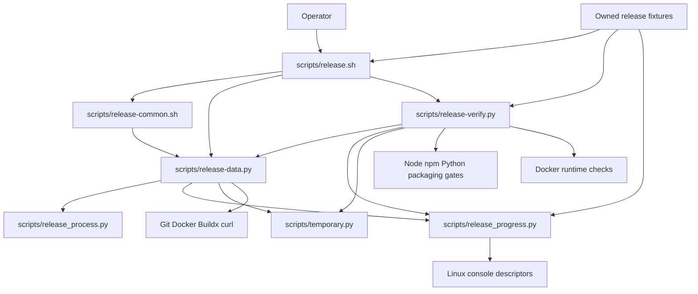

# Brooks-Lint Health Dashboard

- [Brooks-Lint Health Dashboard](#brooks-lint-health-dashboard)
  - [Dashboard](#dashboard)
  - [Module Dependency Graph](#module-dependency-graph)
  - [Test Suite Map](#test-suite-map)
  - [Top Findings](#top-findings)
    - [Warning](#warning)
  - [Verification and review limits](#verification-and-review-limits)
  - [Recommendation](#recommendation)

**Mode:** Health Dashboard

**Scope:** All 17 changed files on `69-release-progress-logs` against its parent branch `68-early-arm64-preflight`, merge base `be171aba2957ba96dca6a4630c4cad939e4990a3`, through implementation commit `8a75d6b`. Architecture and debt scans cover the changed release subsystem and immediate dependencies, not the entire application. The task builds on task 68 rather than `main`; its planning commits are already in the base. No `.brooks-lint.yaml` exists; balanced defaults apply. The working tree was clean before review.

**Composite Score:** 98/100

**Trend:** 96 → 98 (+2) against the preceding Health Dashboard entry, a task 69 plan review. Different scopes mean this is not evidence of whole-project improvement.

Live progress and confidentiality boundaries are substantially implemented, but two reproduced output-lifecycle defects remain.

## Dashboard

| Dimension | Score | Top Finding |
|-----------|-------|-------------|
| Code Quality | 95/100 | Reopened regular-file sinks lose shared caller offsets |
| Architecture | 100/100 | No new structural finding in this scope |
| Tech Debt | 95/100 | Suppressed records reset the visible-progress heartbeat clock |
| Test Quality | 100/100 | No separate test-obscurity or brittleness finding |

Two warnings, zero critical findings, zero suggestions. Each warning is charged once, to its owning dimension; missing regression cases are included in the remedies, not counted again. Calculation: `(95 × 0.25) + (100 × 0.30) + (95 × 0.25) + (100 × 0.20) = 97.5`, rounded half-up to 98. Scores summarize this bounded scan, not production readiness.

## Module Dependency Graph

Arrows show imports, helper calls, or subprocess boundaries; external commands are summarized rather than expanded into every invocation.

The new output module depends only on the standard library and does not import publication policy. Capture still owns raw byte limits, deadlines, exit handling, and process cleanup; progress observes stdout/stderr only. The supervisor owns console drainage across the worker and cleanup lifecycle. No new import cycle or application dependency on release tooling was identified. Shell orchestration and data/verification helpers remain distinct despite their subprocess collaboration.

## Test Suite Map

- Python release suite: 148 test methods by AST count: 117 in `test_bash_release.py`, 20 in the new `test_progress.py`, and 11 in `test_verification.py`. The first group retains seven interface, 81 publication, and 29 helper/data cases from the base; helper/data cases mix unit assertions and subprocess integration.
- New progress suite: 15 sink/sanitizer/capture/gate cases and five publication-console integration cases. These mix unit contracts with real child processes, injected clocks, owned pipes/sockets, signal cleanup, and fake remote ports; they are not all unit tests. Handshakes assert pre-exit delivery rather than relying solely on sleep timing. Publication fixtures exercise release orchestration with fake external ports, not live remote E2E publication.
- Node context: 63 test files, with 630 application tests passing in the implementation verifier. No Node test file changed. Browser context: 11 `e2e/*.spec.js` files, none changed or run for this review.
- No new T1/T2 finding: fixture reuse and command-event assertions serve real confidentiality, ownership, and publication-order contracts. The roughly 19-minute full Python run is disclosed, but duration alone does not establish new decay. The two uncovered output cases below require regression coverage; they do not justify a second deduction for the same defects.

## Top Findings

### Warning

**1. R2 — Change Propagation: console isolation breaks caller file-offset semantics**

- **Location:** `scripts/release_progress.py:32-34`, used by `ConsoleBoundary` and standalone progress sinks.
- **Symptom:** Every non-socket console descriptor is reopened through `/proc/self/fd` with `O_APPEND`. For a regular file this creates a separate open-file description and offset. A reproduced child running the actual `ConsoleBoundary()` wrote `release-output-line\n`, but its caller's original non-append stdout offset remained zero. The caller then wrote `after\n`; the file became `after\ne-output-line\n` instead of retaining both records. This can occur when a surrounding shell group or parent redirects the release and subsequent commands into one file.
- **Source:** *A Philosophy of Software Design* — complexity caused by nonobvious dependencies; *Code Complete* — defensive treatment of interface assumptions. Isolating status flags is reasonable for pipes, but the blanket descriptor policy introduces a hidden dependency on how the caller opened its log file.
- **Consequence:** Later caller output can overwrite already-delivered release logs, destroying useful diagnostic evidence even with a healthy reader. Separate stdout/stderr file descriptions can also produce surprising combined-log behavior. Console output is not publication authority, so this is a warning rather than a claim of remote-state corruption.
- **Remedy:** Distinguish regular files from pipes/sockets and preserve shared regular-file offset semantics without changing ancestor flags. Retain bounded console delivery and no blocking fallback. Add real shell/parent continuation regressions plus combined stdout/stderr redirection to the same owned file, alongside the existing independent-flag tests.

**2. R2 — Change Propagation: discarded child activity suppresses visible heartbeats**

- **Location:** `scripts/release_progress.py:272-285` and `scripts/release_progress.py:295-298`.
- **Symptom:** `Progress.record()` updates `self.last` even when the 1 MiB display quota suppresses the record or `sink.emit()` rejects it. `tick()` uses that same timestamp for `still running`. An injected-clock probe set `displayed = DISPLAY_LIMIT`, fed one suppressed line per second, and called `tick()` for 31 seconds: it produced one suppression notice and zero heartbeats. Continued discarded output can therefore keep the console silent indefinitely after that notice.
- **Source:** *Refactoring* — Split Variable; *A Philosophy of Software Design* — separate concepts to avoid hidden coupling. Raw/sanitizer activity and visible-progress timing are distinct state, but currently share one timestamp.
- **Consequence:** A noisy long-running gate becomes apparently quiet once display capacity is exhausted; transient delivery pressure can cause the same effect. The user loses the ongoing activity signal this task promises, even while capture and verification continue correctly. Changing display policy unexpectedly changes liveness reporting.
- **Remedy:** Separate raw/sanitizer activity from visible-output/heartbeat timing. Keep sanitizing through suppression, but do not let discarded records postpone heartbeat attempts indefinitely. Test quota exhaustion and temporary delivery rejection with an injected clock, continued safe redaction, and heartbeat cessation after exit.

## Verification and review limits

- Inspected the complete 17-file branch diff, surrounding capture/supervisor/gate code, new tests and fake ports, accepted plan/review, documentation, version mirrors, and implementation record. Version-only lockfile changes do not alter dependency resolution.
- Fresh review run: `python3 -B -m unittest test_progress -v` passed all 20 cases in 48.067 seconds. These passing cases do not cover shared regular-file offsets or heartbeat behavior after display exhaustion.
- Fresh static checks passed: `npm run check`, separate `bash -n` checks for both release shell files, `./scripts/release.sh --validate`, and `git diff 68-early-arm64-preflight...HEAD --check`.
- Both findings were reproduced with read-only-code probes: an owned temporary redirected file and actual child console boundary for finding 1; an injected clock and memory sink for finding 2. The temporary fixture files were cleaned. Neither probe used credentials or live publication.
- Implementation evidence, not a fresh full-suite rerun: the real isolated committed-snapshot verifier passed 630 application tests with zero failures/skips in 61.535 seconds, all 148 Python release tests in 1126.143 seconds, and production packaging. Evidence: `tasks/69-release-progress-logs/4-implemented.md` and `/tmp/opencode/task69-automatic-verification-cosy_x63/verification.log`. Full suites were not repeated during review.
- Silent default capture, heartbeat-only authenticated commands, bounded output loss under pressure, conservative stream suppression through EOF, and non-bootstrapping ARM64 checks are deliberate safety tradeoffs, not separate defects. No new disclosure was reproduced; this does not guarantee detection of arbitrary encoded secrets.
- Existing task 67 warnings remain separate: process-cleanup failure can skip daemon cleanup, the Node prerequisite probe inherits ambient preload/application settings, and persistent tests lack real `local()` orchestration regression coverage. The implementation verifier run does not repair those defects.
- No live release, image build/push/runtime check, remote Git write, package mutation, host installation, privileged bootstrap, or dependency installation into this checkout was performed. Actual ARM64 support remains an operator prerequisite. Only this report and health history are changed; no fixes are applied.

## Recommendation

Fix regular-file offset preservation first, then decouple visible heartbeat timing from suppressed child activity before merging this progress feature. Code Quality and Tech Debt tie as the lowest-scoring dimensions; a focused code-quality follow-up should verify both output-state contracts and their new regression cases. Preserve the authenticated-output boundary, bounded delivery, and mandatory release/runtime gates. The high scoped score does not waive these reproduced warnings, inherited task 67 work, or the separate ARM64 prerequisite.
