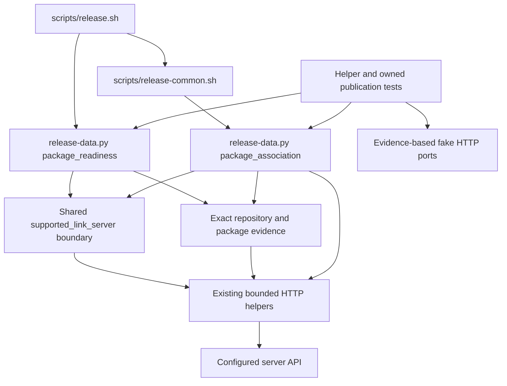

# Brooks-Lint Health Dashboard

- [Brooks-Lint Health Dashboard](#brooks-lint-health-dashboard)
  - [Dashboard](#dashboard)
  - [Module Dependency Graph](#module-dependency-graph)
  - [Test Suite Map](#test-suite-map)
  - [Top Findings](#top-findings)
  - [Verification and review limits](#verification-and-review-limits)
  - [Recommendation](#recommendation)

**Mode:** Health Dashboard

**Scope:** Plan review of `tasks/70-server-package-link-compatibility/2-plan.md` at `6ead8cf`, checked against its goal and the current package association helpers, publication fixtures, and contract tests. All four dimensions assess the proposed change, not a whole-project audit or an implemented compatibility feature. No `.brooks-lint.yaml` exists; balanced defaults apply. The working tree was clean before review.

**Composite Score:** 100/100

**Trend:** 98 → 100 (+2) against the preceding Health Dashboard entry, the task 69 branch review. Different scopes mean this is not evidence that previous defects were fixed.

No new actionable plan defect was identified. Proceed with the evidence-discovery step, but do not treat this review as verification that the deployed `28.2.0` server safely supports link writes.

## Dashboard

- Code Quality: 100/100. The plan localizes compatibility decisions in the existing shared boundary and preserves the distinct readiness, final association, and readback responsibilities. It explicitly avoids turning failed reads, 404s, or null associations into write permission.
- Architecture: 100/100. Server-specific discovery and response details stay inside bounded Python HTTP helpers rather than leaking product/version rules into shell publication policy. No new plugin framework, configuration bypass, or dependency cycle is proposed.
- Tech Debt: 100/100. Scope is limited to evidenced server support, with exact source references, a refusal path when evidence is inadequate, and accurate diagnostics. Unknown future versions are not automatically authorized. Existing release defects are disclosed as separate work rather than silently folded into compatibility changes.
- Test Quality: 100/100. Proposed helper and owned publication tests cover distinct risks: discovery parsing, authorization/refusal, hidden links, final identity refresh, and uncertain-write reconciliation. Source evidence is explicitly separated from fixture assertions, and the expensive full suite need not run twice.
- Calculation: `(100 × 0.25) + (100 × 0.30) + (100 × 0.25) + (100 × 0.20) = 100`. Zero critical findings, warnings, or suggestions. The plan is the reviewed change, so the Code Quality dimension is retained; this does not assign a code-quality certification to unimplemented code.

## Module Dependency Graph

Arrows represent current helper calls and subprocess boundaries, with the proposed compatibility decision shown inside the existing data helper. Documentation/source evidence informs implementation; it is not a runtime dependency on an upstream source host.

Readiness and final association share server policy but retain separate authorization requirements. A missing package can pass supported-server readiness without authorizing the later POST. Existing exact links bypass link-capability discovery. This separation matches the current code and avoids making a read-only preflight into cached mutation authority.

## Test Suite Map

- Existing Python baseline: 148 test methods confirmed by AST counting, comprising 117 in `test_bash_release.py`, 20 in `test_progress.py`, and 11 in `test_verification.py`. The 117 cases include seven interface, 81 publication, and 29 helper/data methods; these are not all pure unit tests.
- Planned unit/helper coverage: strict product/version evidence, malformed responses, unsupported identities, exact package/repository matching, explicit refusal versus uncertain transport outcomes, and one-POST reconciliation. The existing `api_document`/`http` seams permit isolated tests without adding test-only production interfaces.
- Planned integration coverage: owned repositories and fake external ports for fresh publication, completed retries, early unsupported-server refusal, hidden/visible foreign links, unchanged unrelated packages, and no false success. Command-event assertions test publication safety, not incidental private helper names.
- Server-side contract evidence is a separate obligation. Current fake ports return null for hidden links and refuse an already-linked package with HTTP 400; changing their version response would not prove that a real `28.2.0` implementation behaves that way. The plan explicitly requires exact-release source tracing and, where needed, isolated executable confirmation.
- Node context: 63 test files. Browser context: 11 `e2e/*.spec.js` specifications, outside this package-link task. No test counts for the proposed additions are claimed before implementation; there are no live publication E2E tests authorized here.

## Top Findings

No new actionable plan findings after applying the four scoped scans. The following are important existing controls or implementation gates, not additional scored defects:

- Plan lines 22–25 and 70–72 require independent product/release evidence and reject version-shape or branding guesses. Runtime evidence must match the actual API rather than a fabricated product field. Unknown or customized identities remain unverified.
- Plan lines 24, 32, and 72 address the central safety issue in `scripts/release-data.py:424-427,458-460`: a hidden existing association may look unlinked to the caller. A client GET is insufficient; the server-side write must preserve the no-reassignment invariant under the documented writer-exclusion requirement. If this cannot be established, support stays disabled.
- Plan lines 31–33 retain the existing early readiness and final mutation distinction, refreshed exact identities, one scoped POST, and readback. Explicit HTTP refusals do not enter transport-uncertainty reconciliation. Already-correct links remain read-only on otherwise unsupported servers.
- Plan lines 38–43 prevent circular validation through fixtures that merely hard-code the desired server behavior. Existing failure tests provide useful characterization, while the proposed identity/discovery coverage protects the new boundary.
- Plan lines 49 and 61 allow a documented blocked investigation, not a claim that the requested compatibility has shipped. If the evidence step blocks, stop before changing compatibility policy or publishing success/version claims; resolve the evidence or seek the separately approved design described in the plan.

## Verification and review limits

- Read the complete goal and plan, `scripts/release-data.py:389-473`, fake server route handling in `test/release-template/fixtures/bash_release_ports.py:230-271`, and association helper/regression tests around `test_bash_release.py:1212-1281`. Compared these with the earlier inspected readiness, fresh-publication, hidden-link, retry, and failure scenarios.
- Confirmed current behavior accepts stable `1.25.x` version strings for link capability and that the fixture's non-reassignment behavior is modeled independently of its configured version. Neither observation establishes real-server compatibility.
- Counted existing test methods and test files without executing suites. No application, release, browser, server, or production-packaging tests were run for this documentation-only review. Existing implementation test results are not presented as new verification.
- Did not contact the live server, inspect credentials, install dependencies, run live publication, mutate package associations, bootstrap infrastructure, or verify upstream source semantics. The operator-provided `{"version":"28.2.0"}` remains evidence of the reported version only, not product identity or safe link behavior.
- Task 69's regular-file offset and suppressed-heartbeat warnings and task 67's inherited cleanup, environment-isolation, and orchestration-test findings remain separate. This score does not waive them, ARM64 prerequisites, or release authorization requirements.
- This review changes only `3-plan-review.md` and the health-history entry. The plan and implementation code remain unchanged.

## Recommendation

Proceed with read-only identity and exact-release source investigation first. Enable the smallest supported compatibility path only after server-side non-reassignment and actual discovery evidence are established; otherwise report the concrete blocker and retain refusal. No dimension currently warrants a separate full audit based on this scoped review. Reassess implementation code, source evidence, and new regression results before calling the compatibility fix complete or attempting an authorized release.
