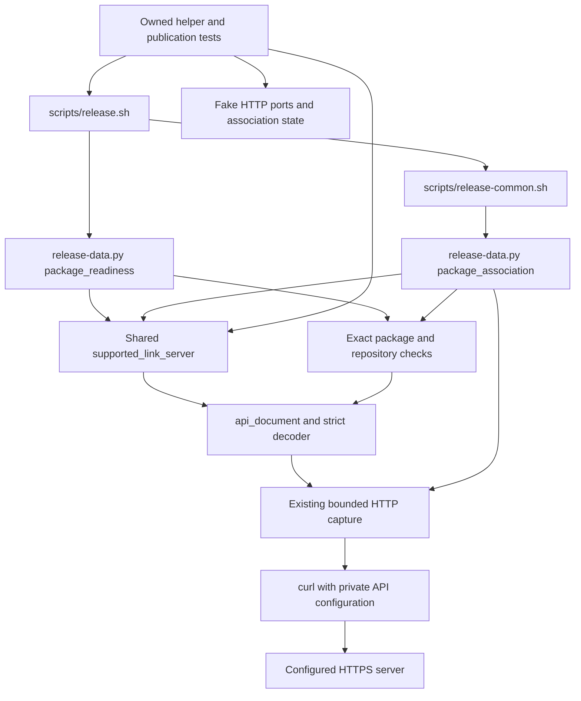

# Brooks-Lint Health Dashboard

- [Brooks-Lint Health Dashboard](#brooks-lint-health-dashboard)
  - [Dashboard](#dashboard)
  - [Module Dependency Graph](#module-dependency-graph)
  - [Test Suite Map](#test-suite-map)
  - [Top Findings](#top-findings)
  - [Verification and review limits](#verification-and-review-limits)
  - [Recommendation](#recommendation)

**Mode:** Health Dashboard

**Scope:** All 12 changed files on `70-server-package-link-compatibility` relative to `main`, merge base `3cdb4c8e38c9faa57fe7b321abe83a014d33aef1`, through implementation commit `f85c0c1`. Architecture and debt scans cover the changed release package-association boundary and immediate dependencies, not the entire application. The task's planning commits are already on `main`. No `.brooks-lint.yaml` exists; balanced defaults apply. The working tree was clean before review.

**Composite Score:** 100/100

**Trend:** Stable at 100 against the preceding Health Dashboard entry, the task 70 plan review. Scope differs; this does not imply that inherited defects were repaired.

No new actionable finding or merge blocker was identified in this diff. Compatibility remains conditional on the documented trusted-server contract and exclusion of all competing writers.

## Dashboard

- Code Quality: 100/100. `supported_link_server()` preserves the stable `1.25.x` path and adds a strict exact-version/Gitea-schema check for `28.2.0`. Parsing failures and mismatched metadata refuse rather than authorizing writes. Exact package/repository checks and final association logic remain unchanged.
- Architecture: 100/100. Both readiness and final association reuse one compatibility boundary and the existing bounded HTTPS helpers. Product-specific metadata does not leak into shell policy, and no new import, cycle, configurable bypass, or discovery framework is introduced.
- Tech Debt: 100/100. The narrow compatibility branch hides the new response details without duplicating publication/reconciliation rules. Immutable source evidence and operational limits are recorded. Exact-release restriction is deliberate conservatism, not unsupported speculative generality.
- Test Quality: 100/100. Added cases cover metadata refusal, one-POST reconciliation, fresh/retry behavior, and foreign-association preservation through existing seams and owned fixtures. Command/event assertions express real safety contracts rather than arbitrary helper implementation details. No new T1/T2 finding was established.
- Calculation: `(100 × 0.25) + (100 × 0.30) + (100 × 0.25) + (100 × 0.20) = 100`. Zero critical findings, warnings, or suggestions. This is a scoped review score, not whole-project health or live-release certification.

## Module Dependency Graph

Arrows represent helper calls and external command boundaries, not just static imports. The upstream source links support review evidence; runtime does not depend on fetching upstream code.

Readiness remains read-only and precedes staging/publication writes. Final association separately verifies capability and refreshes package/target identities before a scoped POST. An exact existing link bypasses capability discovery entirely; unsupported servers can therefore still satisfy read-only completed-publication verification. No readiness cache becomes mutation authority.

## Test Suite Map

- Python release suite: 154 methods confirmed by AST counting: 123 in `test_bash_release.py`, 20 in `test_progress.py`, and 11 in `test_verification.py`. The 123 comprise seven interface, 83 publication, and 33 helper/data methods. Helper/data and verifier groups mix unit assertions with real subprocess integration; they are not exclusively unit tests.
- Branch additions: four helper methods and two owned publication methods, plus revised absent/unlinked/conflicting readiness scenarios. Helper cases exercise malformed and mismatched discovery, unknown/prerelease/custom versions, explicit HTTP refusal, exact readback, and uncertain transport outcomes. Publication cases assert discovery before build, read-only correct-link retries, lost-response reconciliation, and hidden foreign/unrelated association preservation.
- The fake server's metadata uses the observed Gitea response shape. Its stored-positive-link refusal is backed by the inspected upstream service, rather than asserted as proof merely because the fixture reports `28.2.0`. The fixture tests the client contract, not the deployed binary or a real server mutation.
- Node context: 63 test files; six release-configuration cases were freshly rerun. The implementation's isolated verifier ran 630 application tests. Browser context: 11 `e2e/*.spec.js` specifications, none changed or run during review. No live remote publication E2E coverage is claimed.
- Full-suite budget remains tight: 1183.237 seconds against `scripts/release-verify.py:89`'s 1200-second gate, leaving about 16.8 seconds. Integration-heavy safety testing is justified and no deadline failure was reproduced, so duration alone is not scored as a new defect. Further suite growth or modest host slowdown can exhaust this margin; this limit should not be mistaken for comfortable release-time headroom.

## Top Findings

No new actionable findings after inspecting the implementation, tests, documentation, version metadata, and accepted plan.

- `scripts/release-data.py:431-445` only accepts exact `28.2.0` with matching `info.title = "Gitea API"` and schema version; future patches, suffixes, unknown products, and malformed discovery remain refused. Existing `1.25.x` support is preserved rather than retroactively redesigned in this task.
- `scripts/release-data.py:448-483` retains early read-only readiness, exact correct-link short-circuiting, explicit final unlinked evidence, fresh target/package reads, one POST, and exact readback. Explicit HTTP failures do not become transport-loss reconciliation, and the diff introduces no unlink, reassignment, or repair authority.
- Rechecked the immutable upstream [Gitea 28.2.0 association service](https://github.com/go-gitea/gitea/blob/829b49c1ae96015e345f9d2a0eb1ea7acd5f31e1/services/packages/package_update.go): `LinkToRepository()` rejects stored positive `RepoID` before calling the model update and requires matching owners and packages-write permission. Rechecked the [converter](https://github.com/go-gitea/gitea/blob/829b49c1ae96015e345f9d2a0eb1ea7acd5f31e1/services/convert/package.go): inaccessible associations can be null. This supports the hidden-link refusal contract under writer exclusion; null by itself is never proof of safety.
- Documentation explicitly states that the model update is not compare-and-set and metadata is not cryptographic build attestation. Those trust/exclusion requirements are deliberate existing boundaries, not defects claimed fixed by this compatibility patch. Copying metadata into a behavior-changing fork does not establish support.
- Task 69's regular-file offset and suppressed-heartbeat warnings, and task 67's cleanup sequencing, ambient Node prerequisite environment, and persistent real-`local()` orchestration-test gaps remain inherited separate work. None is cleared by this review or its scoped score.

## Verification and review limits

- Reviewed the complete `main...HEAD` diff, surrounding HTTP/decoder/readiness/association boundaries, fake discovery/link routes, helper and publication scenarios, plan, and implementation evidence. Confirmed version mirrors and notes are synchronized and dependency resolutions are unchanged.
- Fresh Python verification: all 33 `BashDataTests` methods plus four targeted publication methods passed, 37 methods total in 54.355 seconds. Publication targets cover failed discovery, fresh accepted/lost link response plus hidden-link retry refusal, unlinked/correct/conflicting readiness, and unsupported-version refusal before writes. These use owned repositories and fake external ports, not real publication destinations.
- Fresh Node verification: all six `test/release-config.test.js` cases passed with zero skips. `npm run check`, separate shell syntax checks, `./scripts/release.sh --validate`, and `git diff main...HEAD --check` passed.
- Confirmed all 11 implementation/test/docs/metadata files outside `4-implemented.md` are byte-identical to the successful owned verifier snapshot at `/tmp/opencode/task70-automatic-verification-xvkuur5b/project`. Its log records 630 application tests with zero failures/skips in 48.240 seconds, all 154 release tests in 1183.237 seconds, production packaging, and final local verification success. These full suites were not rerun during review; the 37-method and six-case results above are fresh.
- Fetched the two immutable upstream source files linked above read-only during review. Live server discovery observations and the actual GET-only compatibility probe are implementation evidence recorded in `4-implemented.md`, not a fresh live-server review probe. No deployed-binary identity attestation or independent real-server mutation test was performed.
- This review performed no live no-argument release, credential read, registry login, image build/push/runtime probe, remote Git write, package mutation, dependency installation, downgrade, or privileged setup. ARM64 readiness and authorization for a later release remain separate prerequisites.
- Only this report and the health-history entry change in this stage. No implementation, plan, or test fixes are applied.

## Recommendation

The branch meets task 70's narrow compatibility scope and has no new review blocker. Preserve the exact-release metadata check, stored-association refusal contract, writer exclusion, and final exact readback when merging. Track the tight test budget and inherited release findings separately without bypassing mandatory checks. No lower-scoring dimension requires a separate focused audit based on this result; the score does not authorize live publication or certify actual ARM64 execution.
