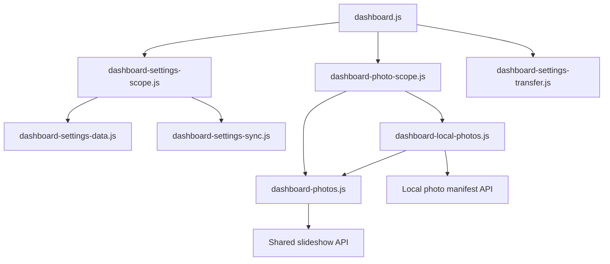

# Brooks-Lint Health Dashboard

- [Brooks-Lint Health Dashboard](#brooks-lint-health-dashboard)
  - [Scores and scope](#scores-and-scope)
  - [Module Dependency Graph](#module-dependency-graph)
  - [Test Suite Map](#test-suite-map)
  - [Top Findings](#top-findings)
    - [Warning](#warning)
    - [Suggestion](#suggestion)
  - [Recommendation](#recommendation)

**Mode:** Health Dashboard

**Scope:** Plan review of `tasks/71-shared-local-global-image/2-plan.md` at `4ccfddc`, checked against the affected settings, photo controllers, transfer UI, and browser fixtures. No implementation changes or test execution.

**Composite Score:** 96/100

The design preserves Local ownership and reuses existing playback machinery, but source-switch continuity and recovery-test coverage need explicit decisions before implementation.

## Scores and scope

- Code Quality: not scored because there is no implementation diff. The planned atomic Local save and unchanged Global preference contract are sound.
- Architecture: 95/100, one warning about foreground-image ownership during source replacement.
- Tech Debt: 99/100, one suggestion about an existing import message becoming misleading.
- Test Quality: 95/100, one warning about loss of independent Local recovery coverage after changing the default.
- Scoring uses balanced deductions: five points per warning and one per suggestion. With the PR dimension absent, weights are `0.30 / 0.75`, `0.25 / 0.75`, and `0.20 / 0.75`; the weighted result is 96.33, rounded to 96.
- These scores assess plan readiness, not measured implementation health. No project `.brooks-lint.yaml` exists. The previous Health Dashboard score was 100 for an unrelated branch review; no comparable plan trend is claimed.

## Module Dependency Graph

The router is the correct boundary for effective playback-source choice. Keeping the option outside shared preferences avoids server-schema propagation. No new cycle or inverted dependency is proposed; the UI composition root's fan-out is justified.

## Test Suite Map

- Existing Node suite: 63 `*.test.js` files, mixing unit and API/integration tests; not separately classified for this scoped review.
- Existing browser suite: 11 `*.spec.js` files.
- Planned additions: a scoped-photo controller test file, settings-coordinator cases, and browser integration cases.
- Existing fake clocks, deferred operations, and real local HTTP/image fixtures provide useful seams. Tests should assert visible selections, retained settings, canceled stale effects, and prohibited writes rather than controller-construction call order.

## Top Findings

### Warning

**Architecture — R2: Source replacement conflicts with last-good-frame retention.**

Symptom: Plan lines 40–42 require disposing the old owner while reusing last-good-frame behavior, and acceptance line 66 preserves that behavior. However, `public/dashboard-photos.js:131` calls `clear()` during disposal; `public/dashboard-local-photos.js:78` delegates disposal to that follower. The router currently disposes the old owner before constructing the new one (`public/dashboard-photo-scope.js:8`).

Source: A Philosophy of Software Design — Information Hiding and Leakage; The Pragmatic Programmer — Orthogonality.

Consequence: Toggling the option clears a successfully displayed image before replacement metadata or decoding succeeds. An unavailable replacement leaves a solid background, contradicting an interpretation that last-good retention applies across toggles. Avoiding this without an ownership decision can also leak foreground image resources or let late cleanup clear a replacement.

Remedy: Define continuity explicitly. Either scope last-good retention to an unchanged playback source and document/test clearing on toggles, or plan a bounded handoff that cancels old work while the presentation layer retains the old foreground resource until successful replacement or authoritative disabled/empty state. If choosing handoff, name the affected controller/view interfaces and test failed replacement reads, failed decodes, repeated toggles, late disposal, and final resource release.

**Test Quality — T5: Default-on silently collapses distinct recovery paths.**

Symptom: Plan line 49 places independent-playback test updates under `e2e/settings-scope.spec.js`, but `e2e/photo-display-recovery.spec.js:18–40` also assumes default Local rotation and edits Order/Interval without opting out. More importantly, its parameterized recovery tests at lines 44–64 distinguish only settings mode. After default-on, both Local and Global cases exercise `createPhotoController`, leaving `createLocalPhotoController` recovery untested by those cases.

Source: How Google Tests Software — change coverage rather than line coverage; Working Effectively with Legacy Code — Characterization Tests.

Consequence: The existing independent-rotation browser test fails on disabled controls, while the recovery cases can pass after silently losing coverage of the independent player. A green suite would no longer demonstrate the preserved independent Local behavior.

Remedy: Explicitly update `e2e/photo-display-recovery.spec.js`: opt out before independent rotation/control edits, and parameterize recovery by three effective states—Global, Local following Global, and Local independent. Assert the expected playback endpoint or absence of the other source's requests alongside visible recovery. Use the existing fake browser/server clocks independently so the selection cannot advance accidentally from wall-clock timing.

### Suggestion

**Tech Debt — R6: Global import success text implies Local viewers cannot change.**

Symptom: Plan line 18 excludes Global import/export changes, while `public/dashboard-settings-transfer.js:41` reports “Global settings imported. Local browsers and mode choices were not changed.” With Local following enabled by default, importing Global order/interval settings can change the shared sequence those Local browsers display.

Source: Domain-Driven Design — Ubiquitous Language; Software Engineering at Google — observable behavior and compatibility.

Consequence: The message conflates unchanged Local saved preferences with unchanged Local playback, making the new default harder to understand and troubleshoot.

Remedy: Keep transfer payloads and write behavior unchanged, but allow a narrow success-message/documentation update stating that Local preferences and mode choices remain unchanged while Local followers track the shared slideshow. Add a browser assertion that import preserves the Local option and preferences while following remains active.

## Recommendation

Update the plan to resolve the source-switch continuity contract first, then explicitly preserve all three browser recovery paths. Include the small import-message clarification without widening transfer schema scope. Keep default-on for fresh and old records, explicit false preservation, atomic Local saves, and the existing server-selection API; these choices match the latest request. No implementation code or goal/plan documents were modified in this review.
