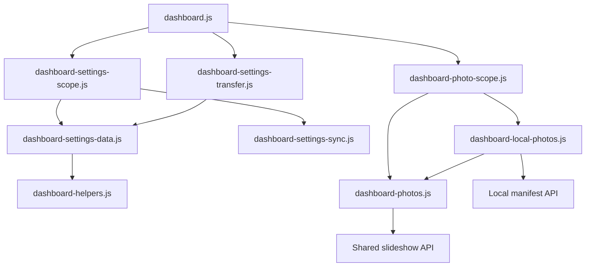

# Brooks-Lint Health Dashboard

- [Brooks-Lint Health Dashboard](#brooks-lint-health-dashboard)
  - [Scores](#scores)
  - [Module Dependency Graph](#module-dependency-graph)
  - [Test Suite Map](#test-suite-map)
  - [Verification](#verification)
  - [Top Findings](#top-findings)
  - [Recommendation](#recommendation)

**Mode:** Health Dashboard

**Scope:** All 25 changed files on `71-shared-local-global-image` at `e09b7a4`, relative to base branch `main` and merge base `340d4fd21dcf8c1904d8f77cab0340b6fd7a8b77`. Includes application changes, tests, documentation, release metadata, and the implementation record. No `.brooks-lint.yaml` exists; balanced defaults apply.

**Composite Score:** 100/100

**Trend:** 96 → 100 (+4) relative to the last Health Dashboard record, which reviewed the plan rather than implemented code; the scopes are not directly comparable.

No new actionable branch findings were identified. The implementation follows the revised plan, including default-on behavior, preserved explicit opt-out, and intentional clearing during source changes.

## Scores

- Code Quality: 100/100. The checkbox is handled separately from shared preferences, and saves retain existing source/revision validation. No unrelated server contract changes or new change-propagation risks were identified.
- Architecture: 100/100. Playback-source choice stays in the existing router, and Local followers reuse the established server follower. Static relative-import traversal found no cycles among `public/*.js`; the dashboard composition root's existing fan-out is intentional.
- Tech Debt: 100/100. Local storage owns the option; Global validation, transfer payloads, and sequencing remain unchanged. Fresh/legacy defaults and strict old-record compatibility are explicitly implemented and documented. Coordinated edits remain within the affected settings/photo boundaries.
- Test Quality: 100/100. Tests exercise observable settings, selected images, forbidden writes, retries, visibility, stale work, and resource release. Fake clocks isolate time-dependent behavior, while real HTTP/image browser fixtures cover integration. No branch-specific T1/T2 findings were confirmed.
- Composite calculation: `100 × 0.25 + 100 × 0.30 + 100 × 0.25 + 100 × 0.20 = 100`. Zero critical, warning, or suggestion deductions. Scores apply to this branch delta, not the entire project's backlog.

## Module Dependency Graph

The router's identity combines settings epoch and effective playback source, so toggling within one Local epoch retires the old player. Presentation-only changes retain the owner. Existing disposal cancels asynchronous work, releases speculative resources, and clears view-owned foreground resources before replacement. There is no new server dependency or independent Local rotation while following.

## Test Suite Map

- Repository: 64 Node test files and 11 browser spec files. A static server/store-marker classification identifies 25 integration-containing Node files and 39 other, primarily unit-oriented files; mixed files are not a precise per-case unit/integration census.
- Branch: seven scoped-photo cases and four settings-scope cases added; existing form, independent-player, recovery, scope, and transfer cases updated. Browser recovery distinguishes Global, Local following, and independent Local playback.
- Coverage includes old records without read-time mutation, invalid booleans, atomic saves, stale tokens, failed storage, scope round trips, cross-tab drafts, independent profiles, hidden/resume, retired reads/decodes, speculative/foreground release, and replacement failures.

## Verification

- Review rerun of `npm run check`: passed on retry. The first attempt, concurrent with both suites, received `SIGSEGV` from a Node syntax-check child for unchanged `public/dashboard-bookmark-list.js`; no syntax diagnostic was reported.
- Review rerun of `npm run test:browser -- e2e/settings-scope.spec.js e2e/photo-display-recovery.spec.js e2e/global-settings-transfer.spec.js`: all 13 cases passed. Log: `/tmp/opencode/home-web-71-review-browser.log`.
- Review parallel `npm test` run: 640 passed, one failed in unchanged `test/home-assistant-tls.test.js` after a development child emitted `free(): invalid next size (fast)`. No implementation changes were made in response.
- Review rerun of `npm test -- --test-concurrency=1`: all 641 cases passed, zero failures or skips. Log: `/tmp/opencode/home-web-71-review-node-serial.log`. The native crashes did not reproduce in the serial run; their root cause was not diagnosed in this review.
- Previously completed verification on this branch: 641 Node cases passed, all 24 task-focused browser cases passed, and the full browser suite reported 162 passed/14 failed. The same 14 failures reproduced at pre-implementation commit `340d4fd`: eight stale-conflict message expectations, one saving-message expectation, one keyboard-focus assertion, two fullscreen document-activity errors, and two cross-browser cases blocked by missing Firefox. These are recorded limitations, not new branch findings.
- Version `0.17.40` is consistent across `VERSION`, npm metadata, README, release notes, and `scripts/release.json`. No deployment, publication, or remote mutation was performed for this review.

## Top Findings

None within the branch delta. No implementation fixes were applied.

Accepted decisions are not findings: default-on also applies to old records without an explicit choice; source changes may temporarily show a solid background; shared selection is not frame-perfect synchronization; and older cached clients require reload before editing the extended Local record. These match the reviewed plan and documentation.

## Recommendation

The branch is acceptable within the requested task scope, subject to the recorded verification limitations. Do not describe the full project browser suite as green: its baseline failures remain, and Firefox must be installed separately for cross-browser checks. Track those existing issues independently rather than broadening this feature. No dimension requires a focused follow-up review based on this delta.
