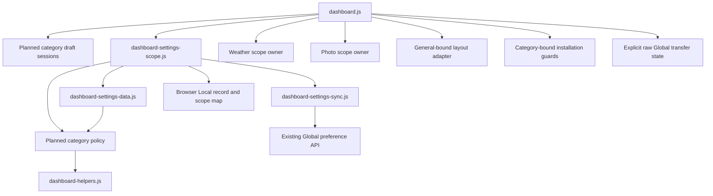

# Brooks-Lint Health Dashboard

- [Brooks-Lint Health Dashboard](#brooks-lint-health-dashboard)
  - [Scores](#scores)
  - [Module Dependency Graph](#module-dependency-graph)
  - [Test Suite Map](#test-suite-map)
  - [Top Findings](#top-findings)
    - [Warning](#warning)
    - [Suggestion](#suggestion)
  - [Recommendation](#recommendation)

**Mode:** Health Dashboard

**Scope:** Plan review of `tasks/72-per-category-settings-scope/2-plan.md` at `bdb9eb6`, checked against the current settings coordinator/sync, integration mutation guards, weather owners, layout session, transfer controls, and related tests. No implementation changes or runtime suite execution. No `.brooks-lint.yaml` exists; balanced defaults apply.

**Composite Score:** 98/100

**Trend:** 100 → 98 (−2) from the previous Health Dashboard, which reviewed task 71's branch rather than this plan; scopes are not directly comparable.

The plan has clear ownership and avoids mixed-store writes, but persisted scope validation at mutation dispatch needs an explicit contract before implementation.

## Scores

- Code Quality: not scored because no implementation diff exists for this task. The planned policy module and category-draft helper give the broad UI change explicit boundaries.
- Architecture: 95/100, one warning about persisted scope ownership at write admission.
- Tech Debt: 99/100, one suggestion about recovery from a corrupt new scope record.
- Test Quality: 100/100. Planned policy/coordinator unit tests and browser integration cases cover distinct risks, including preserved drafts, service isolation, raw Global transfer state, and unchanged image ownership. Add the targeted cases described below rather than duplicating the entire mixed-mode matrix at every layer.
- Calculation: PR weight is omitted and remaining weights are divided by `0.75`: `95 × (0.30 / 0.75) + 99 × (0.25 / 0.75) + 100 × (0.20 / 0.75) = 97.67`, rounded to 98. Scores reflect plan readiness, not measured implementation quality.

## Module Dependency Graph

No new server category schema or dependency cycle is required by the design. Keep the policy module dependent only on leaf preference/data helpers, not on the coordinator or DOM. The existing dashboard composition root may legitimately wire these concrete owners; its fan-out alone is not a layering finding.

## Test Suite Map

- Existing suite: 64 Node test files and 11 browser spec files. Static server/store markers identify 25 integration-containing Node files and 39 other, primarily unit-oriented files; mixed files are not a precise per-case classification.
- Proposed additions: ownership/projection/schema unit tests, coordinator and draft-session cases, service/layout/transfer boundary tests, and mixed-mode browser scenarios using existing real HTTP fixtures and fake clocks.
- A read-only ownership check against `PREFERENCE_KEYS` confirmed that the plan assigns all 48 current preference keys exactly once, with no missing or duplicate assignments. Weather location and `followGlobalPhotos` are correctly described separately from that preference map.
- Full runtime suites were not run for this documentation-only review. The plan correctly distinguishes task 71's recorded baseline browser failures from new regressions and favors sequential verification after observed native Node instability.

## Top Findings

### Warning

**Architecture — R2: Mutations need persisted category-scope validation, not only in-memory epochs.**

Symptom: Plan lines 41 and 47 require rereading the scope map when changing scope and using per-category in-memory epochs for save tokens. Lines 54–59 specify category/store saves, and line 78 requires handler guards, but none explicitly require rereading the persisted category choice before admitting a preference, weather-location, installation, or import mutation. The current Local writer already checks the persisted legacy scope key before writing (`public/dashboard-settings-scope.js:48–50`); this guard must be replaced, not lost or left reading the obsolete key. Global saves and integration guards currently rely on in-memory state.

Source: The Pragmatic Programmer — Orthogonality; A Philosophy of Software Design — Information Hiding and Leakage.

Consequence: A second tab can commit Weather Global → Local while the first tab has not processed its storage event. The first tab's cached Global mode, epoch, and server revision still validate, allowing its stale Weather draft to dispatch a Global write even though the browser's saved category choice is already Local. The same gap can affect connection/device actions and General-gated imports. Handling a late response cannot undo a server write already admitted.

Remedy: Add one coordinator-owned admission check that synchronously rereads and validates the stored scope map, reconciles observed changes, and verifies the target category's current source/token immediately before dispatch. Invoke it for Local and Global category saves, location writes, installation mutations, and import; replace the old whole-mode storage guard. An unrelated category's map change must not reject a still-valid target-category draft merely because the map's total revision changed. If the map cannot be read/validated, reject the mutation with the draft preserved rather than using a preview mode as write authority. State the unavoidable limit: browser storage and server requests cannot provide a cross-tab atomic lock, and changes after admission do not roll back writes. Add tests that update shared storage without delivering the storage event, then attempt each target-category mutation; include an unrelated-category update that remains admissible.

### Suggestion

**Tech Debt — R1: Corrupt-map recovery is not actionable yet.**

Symptom: Plan line 41 retains the last confirmed map, or uses Local preview at startup, when the new map is corrupt. It also requires scope changes to reread that map and reject conflicts. The plan does not define how a user replaces an invalid record when normal rereading cannot produce a valid revision, even though the error is described as actionable.

Source: Code Complete — defensive programming and explicit error paths; Software Engineering at Google — maintainable migration and compatibility behavior.

Consequence: Implementation can either trap users in a preview with no working scope selector or silently overwrite the invalid map without a clear recovery decision. Clearing all site data to escape would unnecessarily discard valid Local preferences, weather location, and the Images follow choice.

Remedy: Define an explicit recovery path for the scope-map record only: either a confirmed UI reset/replacement using the last confirmed map or documented key-specific recovery followed by reload. Do not reset raw Local preferences, legacy keys, credentials, or server records. Add a unit/browser case proving corrupt-map startup, preserved drafts/data, no writes before explicit recovery, and successful category selection afterward.

## Recommendation

Update the plan's mutation-admission contract before implementation and specify corrupt-map recovery. Keep the category ownership map, raw-record composition, category-only patches, conservative store-wide revision conflicts, General-owned layout, service-specific mutation guards, and existing Local Images follow option. These choices address the actual single-mode coupling without introducing speculative server abstractions. Only this review and its history entry were added; the plan and implementation remain unchanged.
