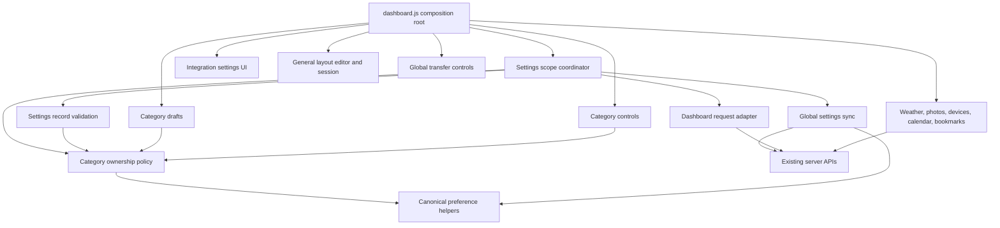

# Brooks-Lint Health Dashboard

- [Brooks-Lint Health Dashboard](#brooks-lint-health-dashboard)
  - [Scores](#scores)
  - [Module Dependency Graph](#module-dependency-graph)
  - [Top Findings](#top-findings)
    - [Warning](#warning)
  - [Test Suite Map and Verification](#test-suite-map-and-verification)
  - [Recommendation](#recommendation)

**Mode:** Health Dashboard

**Scope:** All 47 changed paths on `72-per-category-settings-scope` relative to `main`, using merge base `cc059884b20f4422dd97329818aa3cd0d9acb4ea` through implementation commit `cb29386`. Supporting unchanged controllers and task requirements were read where needed. The working tree was clean before review. This is a branch-scoped assessment, not a whole-project audit.

**Composite Score:** 98/100

**Trend:** 98 → 98, stable against the latest Health Dashboard record, which reviewed this task's plan rather than implementation. These scopes are not directly comparable.

The raw-store separation and persisted-scope admission are sound in the reviewed paths, but integration draft lifecycle gaps should be corrected before merging.

## Scores

- Code Quality: 90/100. Two warnings: an undiscardable new-device draft and Calendar connection success discarding unrelated category drafts.
- Architecture: 100/100. No browser-module import cycles or new layering inversions found. The dashboard's high fan-out is appropriate for its composition-root role.
- Tech Debt: 100/100. No additional independent R1–R6 findings in the changed scope; the two lifecycle issues are counted only under Code Quality.
- Test Quality: 100/100. No actionable T1/T2 findings in the reviewed changed tests. Behavioral scope/admission tests use useful storage, transport, and timer seams; unrelated assertions were not treated as smells merely because a test contains multiple checks.
- Balanced deductions: each warning subtracts 5 points from its assigned dimension. Composite: `round(90 × 0.25 + 100 × 0.30 + 100 × 0.25 + 100 × 0.20) = 98`. Scores do not certify missing browser coverage.

## Module Dependency Graph

The policy and validation modules do not import UI controllers. Server APIs and transfer schemas remain unchanged. A relative-import scan of all browser JavaScript modules found no cycles. The graph summarizes dependencies relevant to this branch rather than every leaf module.

## Top Findings

### Warning

**W1 — R2 Change Propagation: A new Wake-on-LAN draft cannot be discarded through the available controls.**

Symptom: `public/dashboard.js:301-303` rejects a scope change when `integrationSettings.isDirty('wol')` is true. `public/dashboard-integration-settings.js:102` sets that flag on every form input, but its only discard path is the Cancel edit handler at line 108. `public/index.html:178` hides that button for Add device, and `changeEditor(null)` keeps it hidden. Closing/reopening the dialog does not reset `wolDirty` (`public/dashboard-integration-settings.js:112-113`), and category reload only calls `fillCategory` (`public/dashboard.js:357-361`). A minimal Node/EventTarget reproduction confirmed that a dirty Add device draft remains dirty after close/reopen.

Source: *The Pragmatic Programmer* — Orthogonality; *Refactoring* — Inappropriate Intimacy. Scope eligibility now depends on another controller's editor lifecycle without a complete discard contract.

Consequence: After typing even an incomplete device name, users cannot switch Wake-on-LAN back to Local or enable Global import through ordinary save/reload/close actions without actually creating a device, entering another existing device's editor, or reloading the page. This contradicts the instruction to save or discard drafts before changing scope; it is not a reason to bypass the dirty guard.

Remedy: Provide an explicit discard/reset action for Add device as well as Edit, clearing fields and `wolDirty` without sending a mutation. Keep pending-action protection. Add coverage for a dirty new-device draft, discard, subsequent scope change, and import eligibility; preserve unrelated category drafts throughout. Calendar and Bookmarks should also expose clear connection-draft discard actions rather than relying on closing the whole dialog.

**W2 — R2 Change Propagation: Successful Calendar connection closes Settings and drops other category drafts.**

Symptom: The successful connection branch still calls `dialog.close()` in `public/dashboard.js:440`. The dialog close handler at line 395 clears all category draft records, and reopening runs `fillForm()` at line 385, replacing unsaved controls and picker values from confirmed settings. Example: edit Time without saving, switch to Calendar, connect successfully, then reopen Time. The Time edit is gone despite the category-draft isolation contract in `2-plan.md:71-75,118` and `docs/settings-scope.md:32`. This retained whole-dialog behavior is incompatible with the new independent-category workflow.

Source: *The Pragmatic Programmer* — Orthogonality; *The Mythical Man-Month* — Conceptual Integrity.

Consequence: An explicit server connection action silently discards unrelated Time, Images, bookmark-selection, or device-selection drafts. Users cannot safely compose edits across tabs when Calendar connection success terminates every category session.

Remedy: Keep Settings open on Calendar success and update only the Calendar connection form/status. If automatic closure is retained, require explicit consent before discarding any other draft. Add a successful-connection regression that retains an unrelated dirty preference and picker draft. This finding is based on direct handler tracing; browser reproduction was blocked by the missing executable described below.

## Test Suite Map and Verification

- Node unit/integration portfolio: 65 `test/*.test.js` files, including pure policy/session tests, fake-backed controller tests, SQLite/API tests, filesystem/network tests, and process lifecycle tests. The runner has no explicit unit/integration partition, so a precise split is not claimed. There are 520 static test declarations; parameterization, subtests, and discovered fixture modules change runtime counts.
- Browser/E2E portfolio: 11 `e2e/*.spec.js` files with 159 static declarations; parameterization produces additional runtime cases. Changed scenarios cover mixed sources, migration, storage events, corruption recovery, layout isolation, installation guards, transfers, and photo ownership. No inverted-pyramid finding is justified from file counts alone.
- `npm run check`: passed in this review.
- `npm test -- --test-concurrency=1`: passed, 654 tests, 0 failures/cancellations/skips, approximately 48 seconds. Verification ran sequentially, as requested by the task plan.
- `git diff --check main...HEAD`: passed.
- Minimal integration-UI lifecycle reproduction: confirmed `isDirty('wol')` remains true after opening an Add device draft, input, close, and reopen. No implementation or test file was changed for this probe.
- Browser probe: blocked before page execution because `/home/container/.cache/ms-playwright/chromium_headless_shell-1243/chrome-headless-shell-linux64/chrome-headless-shell` is absent. Install the matching Chromium browser with `npx playwright install chromium` before rerunning browser verification. No packages were installed, and no current browser pass is claimed.
- `4-implemented.md` records an earlier full-browser result of 178 passes and two missing-Firefox launch failures. That historical result was not reproduced in this review environment; current Chromium is missing too. The historical Firefox prerequisite remains `npx playwright install firefox`.

## Recommendation

Address W1 and W2 before merging, then rerun focused category-scope/integration browser scenarios and the complete browser suite with the required browser binaries available. Keep the existing raw-store projection, strict ownership policy, and dispatch-boundary admission design. No implementation fixes, version changes, pushes, or merges were performed during this review.
