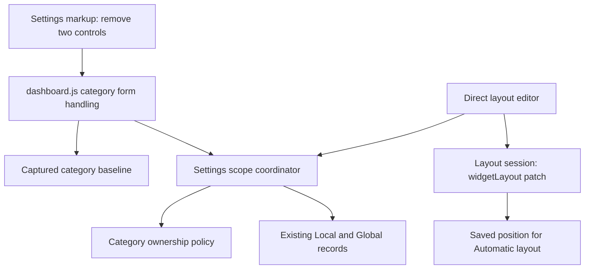

# Brooks-Lint Health Dashboard

- [Brooks-Lint Health Dashboard](#brooks-lint-health-dashboard)
  - [Scores](#scores)
  - [Module Dependency Graph](#module-dependency-graph)
  - [Findings](#findings)
  - [Test Strategy](#test-strategy)
  - [Recommendation](#recommendation)

**Mode:** Health Dashboard

**Scope:** Plan review of `tasks/73-remove-information-layout/2-plan.md` at `da1dfda`, checked against `1-goal.md` and the current markup, serializer, coordinator, layout session, and test expectations. This evaluates the proposed change, not an implementation or the whole codebase. No `.brooks-lint.yaml` was found; balanced defaults apply.

**Composite Score:** 100/100

**Trend:** 98 → 100 (+2) against the latest Health Dashboard record. That record covers task 72's implementation, so this is historical context rather than a comparable improvement measurement.

The plan matches the requested UI removal and explicitly protects stored settings, layout behavior, and regression coverage. No actionable plan findings were identified.

## Scores

- Code Quality: 100/100. The proposed deletion is precise, and the plan limits JavaScript changes to demonstrated dependencies rather than speculative refactoring.
- Architecture: 100/100. UI removal does not change policy ownership, persistence schemas, APIs, or the General-bound layout save path.
- Tech Debt: 100/100. Retaining `position` and `scale` is intentional backward compatibility, not unused speculative functionality: rendering and Automatic layout initialization still consume saved values.
- Test Quality: 100/100. The plan preserves scenario intent while replacing removed input selectors, and adds explicit omitted-input/raw-store preservation coverage.
- Each dimension has zero scored findings. Weighted composite: `100 × 0.25 + 100 × 0.30 + 100 × 0.25 + 100 × 0.20 = 100`. Code Quality is assessed prospectively against the planned changes; this is not implementation approval.

## Module Dependency Graph

The markup-to-form arrow represents DOM consumption rather than a JavaScript import. `public/dashboard.js:106-114` starts from a captured baseline and overlays only existing category controls. `public/dashboard-settings-scope.js:136-142` merges the category patch into its raw backing store. `public/dashboard-layout-session.js:13,19` still uses saved position and emits only `widgetLayout`. The plan correctly retains all three contracts without adding dependency paths.

## Findings

No Critical, Warning, or Suggestion findings. The abbreviated R1–R6 and test-risk checks found no concrete plan defect requiring remediation. The relevant tradeoff is explicit: General retains its existing Save/Reload footer despite losing its ordinary preference inputs, avoiding an unrelated interaction redesign. The two task 72 lifecycle warnings remain out of scope and must not be interpreted as resolved by this score.

## Test Strategy

- Existing portfolio: 65 Node test files covering units/controllers and integration boundaries, plus 11 browser spec files. Unit and integration tests are not formally partitioned; no exact split or new runtime result is claimed.
- The plan identifies both immediate markup assertions in `test/dashboard.test.js` and seven browser specs that interact with the removed controls. Updating category selection, saved keys, and status expectations avoids a superficial selector substitution that would test the wrong store or panel.
- Nondefault Local/Global values, no-change General saves, ordinary category saves, mixed projections, and direct layout patches receive explicit preservation coverage. This addresses the main risk: absent inputs becoming defaults or overwriting another store's values.
- Dirty-draft, validation, conflict, transfer gating, synchronization, and integration-isolation scenarios are retained using available Time/Weather fields. Existing presentation tests can seed legacy values without restoring the removed UI.
- Sequential syntax/Node/browser verification, honest prerequisite reporting, and no package installation are specified. Missing Chromium/Firefox must be checked in the implementation environment; earlier reports do not establish current availability.
- No tests were run for this documentation-only review, and no implementation behavior was changed. The proposed acceptance checks must be executed during implementation.

## Recommendation

Proceed with the plan as written. Keep the implementation focused on removing the fieldset, correcting guidance, and migrating tests without changing saved preference semantics. No change to `2-plan.md` is required by this review.
