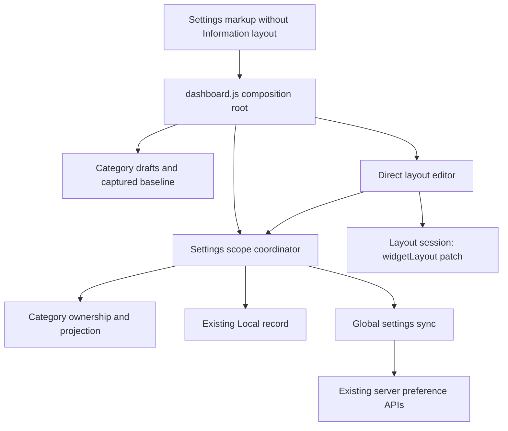

# Brooks-Lint Health Dashboard

- [Brooks-Lint Health Dashboard](#brooks-lint-health-dashboard)
  - [Scores](#scores)
  - [Module Dependency Graph](#module-dependency-graph)
  - [Findings](#findings)
  - [Test Suite Map and Verification](#test-suite-map-and-verification)
  - [Recommendation](#recommendation)

**Mode:** Health Dashboard

**Scope:** All 21 changed paths on `73-remove-information-layout` against `main`, from merge base `14b6b5bd8e807688469a53defc58e6a9a8a3e8ad` through `e442ca6`. Reviewed supporting unchanged form, scope, and layout contracts where necessary. The working tree was clean before review. No `.brooks-lint.yaml` was found; balanced defaults apply.

**Composite Score:** 100/100

**Trend:** Stable at 100 against the latest Health Dashboard record, which reviewed this task's plan. Plan and implementation scores are not directly comparable evidence.

The implementation removes the requested controls without changing preference storage or runtime semantics. No actionable findings were identified; browser runtime verification remains blocked by missing executables.

## Scores

- Code Quality: 100/100. The only production behavior-facing change is the fieldset deletion and replacement guidance in `public/index.html`; no JavaScript or API changes were introduced.
- Architecture: 100/100. General retains ownership of legacy values and both layout profiles. Existing modules and dependency direction remain unchanged; the browser-module import scan found no cycles.
- Tech Debt: 100/100. Retained `position` and `scale` fields are deliberate compatibility, still consumed by presentation and Automatic layout initialization. Removing them from schemas would exceed the requested UI change.
- Test Quality: 100/100. Migrated tests select the correct replacement category and retain behavioral assertions. The new unit and browser scenarios cover different boundaries rather than duplicating the same wiring checks.
- Zero scored findings in each dimension. Composite: `100 × 0.25 + 100 × 0.30 + 100 × 0.25 + 100 × 0.20 = 100`. This static/code-health score does not certify unexecuted browser scenarios.

## Module Dependency Graph

The markup arrow denotes DOM consumption, not a JavaScript import. `public/dashboard.js:106-114` starts serialization from the captured baseline and overlays only existing controls, preserving omitted position/scale values. `public/dashboard-settings-scope.js:136-142` merges category patches into the selected raw record. Direct layout sessions still submit only `widgetLayout`; no new persistence path or layer dependency was added.

## Findings

No Critical, Warning, or Suggestion findings in the branch changes after abbreviated R1–R6 and test-quality scans. Markup assertions now require the controls to be absent, not merely hidden. General's scope, transfers, recovery, and footer remain intact. Documentation and release metadata consistently describe UI removal while retaining stored-value compatibility.

Keeping General's now-no-change Save action is an explicit reviewed-plan tradeoff, not an accidental extra feature. Existing task 72 integration-draft discard and Calendar auto-close warnings are outside this diff and remain unresolved; they are not counted as new findings here.

## Test Suite Map and Verification

- Node portfolio: 65 test files combining unit/controller tests with SQLite, HTTP, filesystem, and process integrations. The suite has no formal unit/integration partition, so no exact split is claimed.
- Browser portfolio: 11 spec files; the implementation-stage complete run collected 182 cases. Seven specs were migrated, and two parameterized Local/Global browser cases were added for omitted controls, round-trip scopes, General saves, and direct layout isolation.
- New coordinator cases preserve nondefault position/scale, both populated profiles, and non-layout fields through no-change General saves, Time saves, and layout-session patches in both backing stores. Whole-record equality assertions check important persistence side effects rather than only successful calls.
- Test migrations retain draft/conflict/validation intent using available Time/Weather fields. Legacy rendering tests seed retained values, and ownership checks explicitly exclude the removed inputs. No interactive use of removed Position/Overall scale controls remains in the changed scenarios.
- Review rerun: `npm run check` passed, followed sequentially by `npm test -- --test-concurrency=1`; all 656 tests passed with no failures, cancellations, or skips in approximately 48 seconds. Release consistency checks passed within that suite.
- Review checks: `git diff --check main...HEAD` passed; a scan of relative browser-module imports found no cycles; `public/` contains no Information layout markup or inputs named `position`/`scale`.
- Browser limits: the implementation-stage focused and complete attempts stopped at Chromium launch, before application execution, using `--max-failures=1`. This review reconfirmed that configured Chromium and Firefox executables are absent and did not repeat the same blocked runs. No browser pass is claimed.
- Required user-installed prerequisites: `npx playwright install chromium firefox`. The observed Chromium launch failure names `/home/container/.cache/ms-playwright/chromium_headless_shell-1243/chrome-headless-shell-linux64/chrome-headless-shell`. No browser/system packages were installed during review.

## Recommendation

No code changes are requested by this review. Install the missing browser binaries and run `npm run test:browser` before claiming browser validation, especially for the migrated draft/conflict cases and new Local/Global preservation scenarios. Only this report and the health-history record were changed during review; no fixes, version changes, pushes, or merges were performed.
