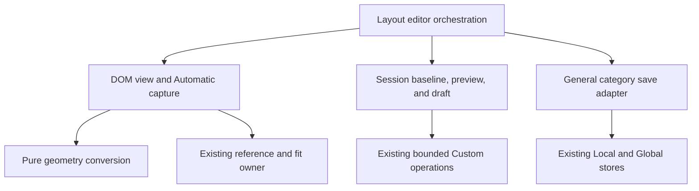

# Brooks-Lint Health Dashboard

- [Brooks-Lint Health Dashboard](#brooks-lint-health-dashboard)
  - [Scores](#scores)
  - [Module Dependency Graph](#module-dependency-graph)
  - [Findings](#findings)
    - [Warning](#warning)
  - [Test Strategy and Verification Limits](#test-strategy-and-verification-limits)
  - [Recommendation](#recommendation)

**Mode:** Health Dashboard

**Scope:** Plan review of `tasks/74-match-initial-edit-layout/2-plan.md` at `8b9ef7a`, checked against the goal and existing editor, view, session, geometry, and numeric input contracts. This is a prospective assessment, not implementation approval or a whole-project audit. No `.brooks-lint.yaml` was found; balanced defaults apply.

**Composite Score:** 99/100

**Trend:** 100 → 99 (−1) against the latest Health Dashboard record. The previous scope was task 73's implementation, so this is historical context rather than a comparable regression measurement.

The plan correctly separates live Automatic rendering from stored Custom geometry, but numeric validation at that boundary needs an explicit rule before implementation.

## Scores

- Code Quality: 100/100. The proposed entry change targets the actual grid-producing override, preserves source/revision ownership, and avoids unrelated runtime changes.
- Architecture: 100/100. DOM capture belongs to the view, geometry conversion stays pure, and preview state remains outside persistence schemas. No new dependency inversion is proposed.
- Tech Debt: 95/100. One R6 warning: exact Automatic measurements are not necessarily valid editable Custom numbers under the current native input constraints.
- Test Quality: 100/100. The proposed unit/view/session/browser layers protect distinct risks. Bounding-box and typography comparisons are stronger than testing only that editing opens. The numeric boundary examples in W1 should be made explicit in that coverage.
- Balanced calculation: one warning subtracts 5 points from Tech Debt only. Composite: `round(100 × 0.25 + 100 × 0.30 + 95 × 0.25 + 100 × 0.20) = 99`. Findings are not deducted twice.

## Module Dependency Graph

The proposed direction is appropriate: measured rectangles flow into session memory, not server schemas. The view must continue hiding DOM measurement details from the session. Explicit null overrides address the existing `override?.profile || state.layout[mode]` limitation, while retaining ordinary Custom projection and latest-confirmed-state restoration.

## Findings

### Warning

**W1 — R6 Domain Model Distortion: Define numeric validity separately for live Automatic baselines and Custom edits.**

Symptom: The plan explicitly permits short/offscreen Automatic rectangles and populates numeric controls from live measurements (`2-plan.md:31,38-40,48`), but does not specify the native `min`, `max`, and `step` policy or the order of no-op detection versus validity checks. Existing `public/index.html:25-28` requires nonnegative integer positions and sizes of at least 100 reference pixels. `public/dashboard-layout-editor.js:83-88` reinstates those bounds each render, and `commit` at lines 99-102 calls `input.checkValidity()` before handing the value to the session. Thus merely injecting measured geometry and changing session no-op comparisons is insufficient.

Source: *Domain-Driven Design* — Bounded Context and model translation; *Code Complete* — defensive programming and input-validation contracts. An exact observation of live flow is not the same value domain as an admissible Custom edit.

Consequence: A legitimate default height of 40 reference pixels, a scrolled bottom offset of −30, or an unrounded fractional measurement can make the editor's own displayed value invalid. Re-entering that unchanged value and saving can be blocked before the planned no-op comparison, or the implementation may clamp the baseline just to satisfy validation and recreate the entry jump. These outcomes violate the explicit unchanged-number/no-op contract despite correct overlay positioning.

Remedy: Add an explicit control/commit policy to the plan. Keep exact screen rectangles separate from displayed reference-pixel values, define rounding and units, and recognize unchanged intent against the displayed captured baseline before applying Custom-only validity constraints. State how pristine baseline values outside Custom bounds are represented without falsely reporting user error. Changed inputs must still be validated and materialized through bounded Custom rules; do not relax stored schema validation. Preserve dirty raw input during remeasurement. Add deterministic cases for subminimum size, negative/out-of-canvas position, and fractional conversion: re-entering an unchanged displayed value, changing focus, and Save must retain null Automatic and send no write, while a genuine edit applies the documented bounds.

## Test Strategy and Verification Limits

- Existing portfolio: 65 Node test files combining unit/controller and integration coverage, and 11 browser spec files. The repository does not formally partition unit and integration tests, so an exact split is not claimed.
- The planned pure conversion tests, session invariants, view lifecycle tests, and browser before/after geometry checks form sensible boundaries. Keep exact overlay assertions distinct from Custom conversion bounds, and ensure browser entry assertions fail against the current template implementation.
- Retaining an explicit inactive-profile template is a justified scope tradeoff: inactive Automatic geometry cannot be measured faithfully from the active DOM. Returning to active Automatic, Reset, and Reload still require live recapture after DOM restoration as specified.
- Reference/gesture locking, stable hidden-widget candidates, no-op Save, Custom isolation, observer cleanup, and delayed-content updates are explicitly addressed. No speculative persistence subsystem or layout migration is needed.
- W1's numeric examples should supplement the already planned short-widget, overflow, no-op, and raw-field tests; generic geometry-helper assertions alone cannot exercise native input validity and commit ordering.
- No tests were run for this documentation-only review. Prior task 73 recorded missing Chromium and Firefox executables. The plan correctly requires checking current prerequisites and reporting blocked browser execution rather than treating syntax checks or test collection as a pass.

## Recommendation

Clarify W1's numeric control and commit contract in `2-plan.md` before implementation. Retain the planned view/session separation and active-only fidelity scope. This review changed only `3-plan-review.md` and the health-history record; no implementation fixes or plan edits were applied.
