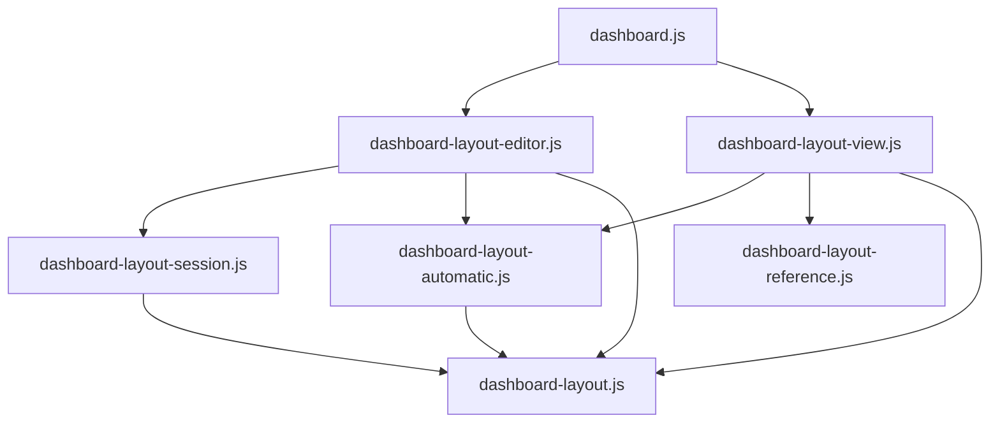

# Brooks-Lint Health Dashboard

- [Brooks-Lint Health Dashboard](#brooks-lint-health-dashboard)
  - [Dashboard](#dashboard)
  - [Module Dependency Graph](#module-dependency-graph)
  - [Top Findings](#top-findings)
  - [Test Suite Map And Verification](#test-suite-map-and-verification)
  - [Recommendation](#recommendation)

## Dashboard

**Mode:** Health Dashboard

**Scope:** All 22 changed paths on `74-match-initial-edit-layout` relative to `main`, merge base `9abb700ce9383f466af11dd04f37dbda9ec0a8b5`, through `7212a79`. Reviewed implementation commit `f506eb9` and verification commit `7212a79`, plus supporting layout geometry, reference, CSS, and coordinator contracts. This is a branch-scoped review, not a whole-project audit.

**Composite Score:** 100/100

**Trend:** 99 → 100 (+1) from the previous Health Dashboard record, which reviewed this task's plan rather than its implementation. Scores across different scopes are not directly comparable.

No `.brooks-lint.yaml` exists; balanced defaults apply. No actionable findings were identified in the reviewed changes.

| Dimension | Score | Top Finding |
|-----------|-------|-------------|
| Code Quality | 100/100 | Clean within reviewed scope |
| Architecture | 100/100 | Clean within reviewed scope |
| Tech Debt | 100/100 | Clean within reviewed scope |
| Test Quality | 100/100 | Clean within reviewed scope |

Each dimension starts at 100 with no finding deductions. Composite: `100 × 0.25 + 100 × 0.30 + 100 × 0.25 + 100 × 0.20 = 100`.

## Module Dependency Graph

Arrows represent imports; the editor receives its view through injection. The graph focuses on layout ownership rather than every dependency of the dashboard composition root.

The six reachable layout modules have no import cycles. Editor and view each import three modules; pure geometry/reference helpers import no infrastructure. DOM measurement remains in the view, preview/draft ownership remains in the session, and persistence remains behind the existing coordinator save callback. Passing saved Position into the view does not change storage ownership or schema.

## Top Findings

None. No Critical, Warning, or Suggestion findings were supported by the reviewed evidence.

- Code quality: active Automatic entry uses an explicit null override instead of a synthetic Custom projection. Exact screen rectangles, rounded numeric observations, and bounded candidates remain distinct. Genuine numeric changes validate against Custom bounds; unchanged observations bypass those bounds before materialization. Focus/raw ownership survives remeasurement, and mixed raw commits process unchanged observations first. This addresses the earlier plan-review W1.
- Architecture: explicit null overrides restore Automatic DOM before capture, while clearing overrides restores the latest confirmed state. Automatic observation is coalesced, disconnected after leaving live preview, and protected against stale observer callbacks. Custom drafts and saved geometry are not recaptured on later measurements.
- Debt: changes stay within the existing layout boundary. There is no new persistence format, duplicated responsive layout engine, polling owner, speculative abstraction, or provider request path. Inactive templates, hidden-widget fallback records, and constraints at first Custom materialization are deliberate, documented scope choices rather than defects.
- Tests: real browser geometry and native validity checks complement pure conversion/session tests and the editor DOM seam. Assertions check layout preservation and no-write behavior, not merely editor visibility. Existing saved-Custom, conflicts, cancellation, scope isolation, and lifecycle scenarios remain intact. The small DOM fake is not treated as proof of native browser behavior.

## Test Suite Map And Verification

- Focused unit and DOM-seam coverage: seven layout test files, 82 passing cases, covering activation, inverse geometry, editor handlers, session state, view lifecycle, reference locking, and bounded geometry.
- Integration coverage: `test/dashboard.test.js` adds HTTP serving/cache-header checks for the new helper and editor asset. Existing preference/category-scope tests continue protecting layout-only writes and source/token ownership within the full Node run.
- Browser coverage: two focused specs, 62 passing cases, covering layout and settings scope. This includes a dedicated Firefox/Chromium canonical-layout scenario; it does not mean all 62 cases ran independently under Firefox.
- Repository portfolio: 67 `*.test.js` files and 11 browser spec files. Node discovery reports 666 passing cases, including fixture-file entries and nested/parameterized cases; this total is not a pure unit-test count. The previously completed full browser run reports 191 cases.
- Fresh review verification: `npm run check` passed; the focused 82-case Node run passed; `npm test -- --test-concurrency=1` passed all 666 cases in approximately 48 seconds; `npm run test:browser -- e2e/dashboard-layout.spec.js e2e/settings-scope.spec.js` passed all 62 cases in approximately 1.2 minutes. No failures, cancellations, or skips were reported.
- Prior complete browser verification: the successful 191-case run, including two dedicated Firefox cross-browser scenarios, is recorded in `4-implemented.md` at reviewed commit `7212a79`. That complete run was not repeated during this review. The earlier timed-out run is not counted as a completed pass.
- Release metadata, README links, and versioned release notes consistently identify `0.17.43`; release-consistency checks passed in the full Node suite. `git diff --check` passed before committing the review records.

## Recommendation

No review-driven implementation changes are required before merging this branch. Keep the documented distinction between pristine live Automatic observations and bounded Custom geometry. This review does not certify every browser/device configuration or resolve the prior task 72 integration-draft discard and Calendar auto-close warnings, which remain outside this branch's scope. Only this review and the health-history record were changed; no fixes, merge, push, deployment, or publication were performed.
