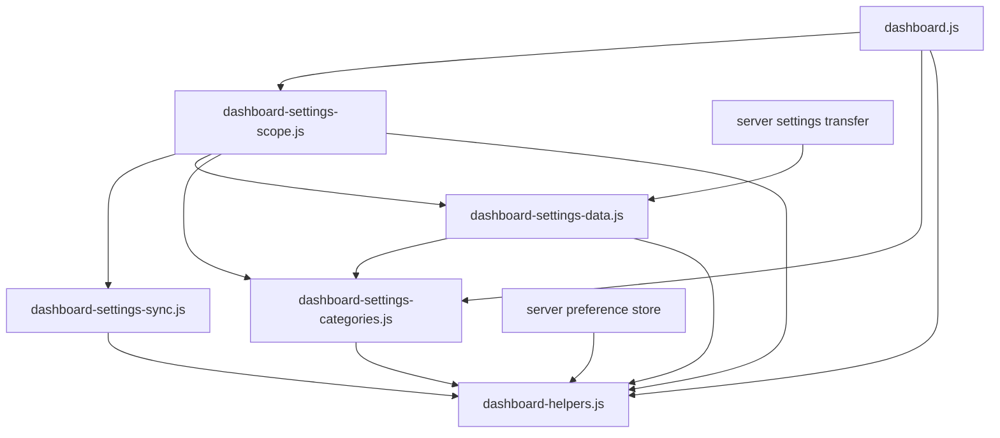

# Brooks-Lint Health Dashboard

- [Brooks-Lint Health Dashboard](#brooks-lint-health-dashboard)
  - [Dashboard](#dashboard)
  - [Module Dependency Graph](#module-dependency-graph)
  - [Top Findings](#top-findings)
    - [Warning](#warning)
  - [Test Suite Map And Verification](#test-suite-map-and-verification)
  - [Recommendation](#recommendation)

## Dashboard

**Mode:** Health Dashboard

**Scope:** Plan review of `tasks/75-bookmarks-ha-wol-scale/2-plan.md` at `bb729f8`, checked against `1-goal.md` and the existing preference, category, Local/Global, transfer, presentation, CSS, and browser-test contracts. Scores assess the proposed change, not an implemented feature or the entire repository.

**Composite Score:** 99/100

**Trend:** 100 → 99 (−1) from the previous Health Dashboard record. The previous record reviewed task 74's branch, so this is not a like-for-like quality regression.

No `.brooks-lint.yaml` exists; balanced defaults apply. The plan is actionable after correcting one presentation-lifecycle conflict.

| Dimension | Score | Top Finding |
|-----------|-------|-------------|
| Code Quality | 95/100 | W1: scale-only updates would restart the clock |
| Architecture | 100/100 | Existing category and persistence boundaries retained |
| Tech Debt | 100/100 | Compatibility and descendant typography risks addressed |
| Test Quality | 100/100 | Proposed coverage spans validation, storage, and real rendering |

One Warning deducts 5 from Code Quality; no other deductions apply. Composite: `95 × 0.25 + 100 × 0.30 + 100 × 0.25 + 100 × 0.20 = 98.75`, rounded half-up to 99. W1 is counted once, not duplicated across dimensions.

## Module Dependency Graph

Arrows summarize the existing import direction relevant to the plan. CSS and form markup remain dashboard presentation details rather than dependencies of preference policy.

The proposed six keys remain owned by three existing categories; General retains geometry. Compatible stored/import reads terminate at shared validation boundaries, while current writes and live snapshots stay strict. No new dependency cycle, persistence owner, endpoint, database schema, or controller is proposed. Separate Local decoding is justified because its current read path validates complete current preferences and would otherwise reject pre-upgrade records.

## Top Findings

### Warning

**W1 — Change Propagation (R2): Route scale-only updates without restarting the clock**

**Symptom:** `2-plan.md:43` directs all six new keys into the snapshot trigger for `applyPresentation()`, while `2-plan.md:44` requires scale-only changes not to reset clock ownership. In the current code, `public/dashboard.js:244-253` calls `startClock()` unconditionally from `applyPresentation()`. `startClock()` at line 122 clears the existing interval, updates clock DOM, and creates a new interval when Time is visible. Following the proposed routing therefore restarts the clock for a Bookmarks, Home Assistant, or Wake-on-LAN scale change, even though Time settings did not change.

**Source:** The Pragmatic Programmer — Orthogonality; Refactoring — Divergent Change. A presentation change in one category is routed through unrelated clock lifecycle work.

**Consequence:** Every effective scale-only save or remote update can clear and recreate the clock timer, reset its cadence, and unnecessarily update Time DOM. This directly violates the plan's ownership-isolation requirement. Tests checking only font sizes, saved preferences, or network traffic would not detect timer replacement.

**Remedy:** Clarify the plan before implementation: give the three new widget scales a presentation-only update path that sets their CSS variables and refreshes view measurements without calling `startClock()` or provider configuration. Alternatively separate CSS application from clock lifecycle in the existing presentation function, keeping startup, visibility, format, and breakpoint behavior explicit. Preserve simultaneous updates: a snapshot changing both new scales and Time settings must still execute the required Time lifecycle exactly as before. Add a browser regression for scale-only Local saves and Global confirmations that observes unchanged clock interval identity/count alongside unchanged photo/provider ownership; use the existing interval instrumentation in `e2e/dashboard-layout.spec.js:742-752` as a starting point. Include an actual Time change as a positive control so a test cannot pass by disabling clock updates entirely.

No Critical or Suggestion findings were identified. No separate architecture, debt, or test-structure findings are warranted from the plan alone.

## Test Suite Map And Verification

- Unit and presentation contracts: planned coverage in `test/dashboard.test.js`, `test/dashboard-display.test.js`, and `test/dashboard-settings-categories.test.js` protects defaults, strict numeric validation, profile selection, markup, and exactly-once key ownership.
- Controller/storage integration: planned API, sync, scope, and transfer tests protect old-record decoding without read writes, strict present-value rejection, Local/Global isolation, revisions, and complete transfer round trips. The explicit missing-new-scale-only Local/import upgrade avoids weakening unrelated required fields.
- Browser integration: planned populated bookmark, Home Assistant, and Wake fixtures cover descendant computed typography, desktop/intermediate/mobile layouts, 600/601 boundaries, scale limits, explicit Save, scope changes, remote updates, Custom geometry, and pristine Automatic editing. These checks distinguish root-variable assignment from visible scaling and account for the current fixed-rem descendant rules.
- Existing reference portfolio: the repository's latest verified baseline has 666 Node-discovered cases and 191 browser cases; task 74 separately verified 82 focused layout Node cases and 62 layout/scope browser cases. These are baseline results, not verification of task 75. Planned new test counts cannot be determined before implementation.
- Review verification was static: inspected the goal, plan, relevant implementation contracts, and the existing owner-preservation browser test. No implementation code or plan content was changed, and no test suite was rerun for this documentation-only review. `git diff --check` is required before committing these review records.

## Recommendation

Update the plan to resolve W1 before implementation, then follow its existing compatibility, typography, category-isolation, and verification work. The remaining scope is coherent: six additive preferences, strict writes, compatible reads/imports, widget-local CSS, and no geometry migration. A focused code-quality review of presentation update routing is the highest-value follow-up; a broader architecture redesign is not justified. This review does not reopen the unrelated integration-draft discard or Calendar auto-close warnings.
