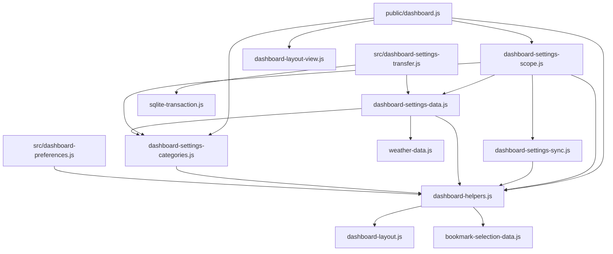

# Brooks-Lint Health Dashboard

- [Brooks-Lint Health Dashboard](#brooks-lint-health-dashboard)
  - [Dashboard](#dashboard)
  - [Module Dependency Graph](#module-dependency-graph)
  - [Top Findings](#top-findings)
  - [Test Suite Map And Verification](#test-suite-map-and-verification)
  - [Recommendation](#recommendation)

## Dashboard

**Mode:** Health Dashboard

**Scope:** All changes on `75-bookmarks-ha-wol-scale` relative to local `main`: `26ec4d4...a256fad`, one implementation commit, 27 changed files, 383 insertions and 34 deletions. The working tree was clean before review. Architecture, debt, and test scans assess the changed behavior and its immediate dependencies, not the entire project's historical debt.

**Composite Score:** 100/100

**Trend:** 99 → 100 (+1) from the previous Health Dashboard record. That record assessed this task's plan; this result assesses its implementation, so the scores are not directly comparable.

No `.brooks-lint.yaml` exists; balanced defaults apply. No actionable regression or structural finding was identified within this branch's scope.

| Dimension | Score | Top Finding |
|-----------|-------|-------------|
| Code Quality | 100/100 | No actionable findings; scale updates remain isolated from clock lifecycle |
| Architecture | 100/100 | Existing category, validation, and persistence boundaries retained |
| Tech Debt | 100/100 | Narrow compatibility decoding; no new geometry or controller ownership |
| Test Quality | 100/100 | Boundary, persistence, rendering, and ownership regressions covered |

No deductions apply. Composite: `100 × 0.25 + 100 × 0.30 + 100 × 0.25 + 100 × 0.20 = 100`. This is a scoped diagnostic score, not a guarantee that no defects exist.

## Module Dependency Graph

Arrows indicate imports in the relevant production paths. CSS and HTML provide presentation and form controls; they are not imported by preference policy.

A static relative-import scan across 74 JavaScript files in `public/` and `src/` found no cycles. This does not cover dynamic imports or external-package internals. The dashboard's broad import fan-out is existing composition-root wiring, not a new dependency inversion. Sharing pure preference/transfer validators between browser and server preserves their existing agreement without importing browser DOM or storage details into server persistence.

## Top Findings

No Critical, Warning, or Suggestion findings were identified. The abbreviated scans considered R1–R6 and test clarity/brittleness, with additional checks of changed boundary and failure-path coverage.

- Code quality: `public/dashboard.js:244-259,281-290` applies the new variables through a small helper and an independent snapshot condition. Scale-only changes do not call `startClock()`, bookmark presentation, provider configuration, or photo configuration. Existing presentation changes still apply all scales, while combined Time-format/scale snapshots execute both required paths. Plan-review W1 is resolved; the browser timer regression includes real Time changes as positive controls.
- Architecture: `public/dashboard-settings-categories.js:8-10` assigns each new pair to its existing category. Local/Global composition and revision checks remain authoritative. General continues to own layout geometry; no endpoint, database schema, new controller, or parallel settings owner was introduced.
- Compatibility and debt: `public/dashboard-helpers.js:68-84` defaults absent scale keys only at stored/import boundaries and rejects invalid present values through canonical validation. `public/dashboard-settings-data.js:25-38` separates compatible Local reads from strict constructed writes and retains transfer envelope/size checks. Database and shared-cache reads reuse the existing stored decoder. Tests verify unchanged raw records/revisions, strict live snapshots and PUTs, unrelated required fields, invalid values, and transfer round trips. The narrow decoder is justified compatibility work, not speculative abstraction.
- Presentation: `public/dashboard.css:61-84` scales widget roots and previously fixed-size descendants without a shared device scale or root transform. Existing Custom selectors continue to work after nodes move to the layout surface. Computed descendant sizes, independent mobile values, 600/601 boundaries, unchanged Custom bounds, and pristine editor entry are exercised in the browser. The retained Information overall scale does not leak into these roots.
- Test structure: parameterized cases name each category and store. Deterministic service fixtures exercise real application/storage paths; the Wake fixture refuses execution. Timer instrumentation observes the explicitly required lifecycle behavior rather than private helper names. Multiple assertions in the end-to-end save workflow protect one category-save isolation contract, so their count alone does not justify an Eager Test finding.

## Test Suite Map And Verification

- Repository inventory: 68 top-level Node `*.test.js` files and 12 Playwright `*.spec.js` files. Node files mix pure unit, controller/storage integration, HTTP/database, and process/network integration tests; no exact per-case unit/integration split is claimed. Playwright collection reports 200 browser cases. Node's 676 discovered cases also include fixture-file entries, so they are not 676 independent unit tests.
- Changed unit/controller coverage: `test/dashboard-widget-scales.test.js` tests six defaults, canonical steps, invalid and missing values, partial upgrades, independent profile projection, exactly-once category ownership, and native control bounds. Scope and sync additions test offline saves, storage events, strict live snapshots, opposite-store preservation, and stale tokens.
- Changed persistence/API coverage: API and transfer additions verify database read upgrades without writes, strict current PUTs, revisions/conflicts, reopen persistence, old-file imports, explicit exports, and rejection without state replacement. Existing `test/dashboard.test.js` projection expectations include the expanded contract.
- Changed browser coverage: nine cases in `e2e/widget-scales.spec.js` cover six Local/Global category workflows, Automatic/Custom rendering across five widths, and remote confirmations with Time/combined-update controls. The existing `e2e/dashboard-home.spec.js` change expands an exact control-count expectation without removing assertions.
- Independently rerun during this review: `npm run check` passed; `npm test -- --test-concurrency=1` passed all 676 cases with no failures, skips, or cancellations in approximately 49 seconds; `npm run test:browser -- e2e/widget-scales.spec.js` passed all nine Chromium cases in approximately 18 seconds. These commands ran sequentially.
- `npm run test:browser -- --list` collected 200 cases in 12 files; collection is not execution. The complete 200-case browser suite and dedicated Firefox scenarios were not rerun during this review. Their implementation-stage results remain recorded separately in `4-implemented.md` and are not presented as fresh review verification.
- `git diff --check` and `git diff main...HEAD --check` passed before report creation. Final review-record whitespace validation is required before commit. No packages were installed, real integrations contacted, or Wake packets sent by the focused fixtures.

## Recommendation

No fixes are requested from this branch review. Proceed with the normal merge workflow; no implementation code was changed here. The dedicated scale path addresses the prior clock-lifecycle warning, compatibility remains narrow, and the targeted browser run confirms rendered behavior and owner isolation. Scores do not reopen unrelated integration-draft discard or Calendar auto-close warnings, nor establish whole-project health. Full browser and broader cross-browser reruns remain optional additional release confidence beyond this review's verified scope.
