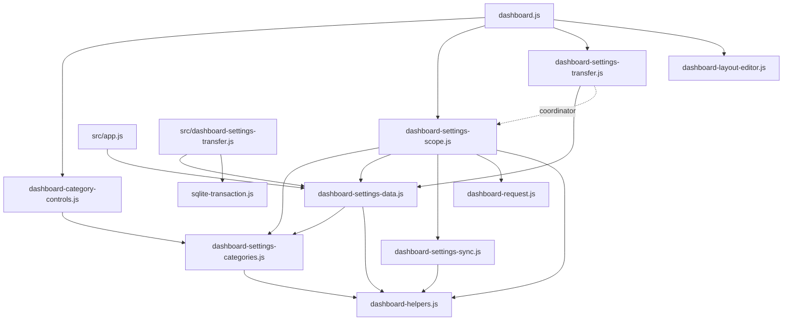

# Brooks-Lint Health Dashboard

- [Brooks-Lint Health Dashboard](#brooks-lint-health-dashboard)
  - [Dashboard](#dashboard)
  - [Module Dependency Graph](#module-dependency-graph)
  - [Top Findings](#top-findings)
  - [Test Suite Map And Verification](#test-suite-map-and-verification)
  - [Recommendation](#recommendation)

## Dashboard

**Mode:** Health Dashboard

**Scope:** Plan review of `tasks/76-remove-general-scope-selector/2-plan.md` at `5b0a1e3`, checked against `1-goal.md` and the current category controls, layout ownership, scope coordinator, shared synchronization, transfer controls, request transport, server API, and related tests. Scores assess the proposed change, not implemented behavior or whole-project health.

**Composite Score:** 100/100

**Trend:** Stable at 100 compared with the previous Health Dashboard record. That record reviewed task 75's implementation; this plan review is not a like-for-like comparison.

No `.brooks-lint.yaml` exists; balanced defaults apply. The plan is actionable under its explicit interpretation: remove General's selector, preserve its existing saved layout ownership, and make explicit Global transfers independent of that selector.

| Dimension | Score | Top Finding |
|-----------|-------|-------------|
| Code Quality | 100/100 | UI removal accounts for update callers and transfer coupling |
| Architecture | 100/100 | Presentation filtering stays separate from persisted category ownership |
| Tech Debt | 100/100 | No forced migration or speculative replacement scope system |
| Test Quality | 100/100 | Planned coverage protects admissions, ownership, retries, and real UI behavior |

No deductions apply. Composite: `100 × 0.25 + 100 × 0.30 + 100 × 0.25 + 100 × 0.20 = 100`. Code Quality assesses the proposed edits; the other dimensions assess their affected boundaries. A clean plan review does not establish implementation correctness.

## Module Dependency Graph

Solid arrows show current relevant imports. The dotted arrow shows the existing injected coordinator relationship, where the plan adds transfer preparation without moving HTTP or admission policy into DOM controls.

No new reverse dependency or import cycle is proposed in these paths. The dashboard remains the composition root; controls handle DOM, the coordinator owns storage/admission, shared sync owns ongoing Global reads, and server persistence retains transaction ownership. Existing broad dashboard fan-out is not itself a dependency finding.

## Top Findings

No Critical, Warning, or Suggestion findings were identified in the plan. The abbreviated scans considered R1–R6 and the proposed test structure; no implementation-level smell is asserted from future code alone.

- UI and change propagation: `2-plan.md:27-31` correctly separates seven visible selectors from eight policy categories and handles the current unconditional `categoryControls.update()` call in `public/dashboard.js:319-320`. Removing General from `CATEGORY_IDS` would break preference composition and stored-map validation; the plan explicitly excludes that shortcut.
- Compatibility and domain policy: `2-plan.md:35-38,80` preserves both raw stores and the existing General mode rather than selecting a new layout winner. Fresh layouts remain Local, saved Global layouts remain Global, and older-tab storage events still invalidate stale drafts. The consequence is explicit: new clients no longer offer a UI route to switch layout ownership. This is consistent with the stated selector-only goal, not an implicit migration or a promise that ownership switching remains available.
- Transfer isolation: `public/dashboard-settings-scope.js:133,147-152` currently derives transfer authority from General and rejects Local imports. `2-plan.md:42-49` replaces that coupling with raw Global revisions and transfer admission, while preserving independent Local saves and integration-category rules. This is necessary current functionality, not speculative generality introduced merely to remove markup.
- Read lifecycle: `public/dashboard-settings-sync.js:62-65` does not read when invisible, and `public/dashboard-settings-scope.js:68-79` suppresses Global polling for all-Local profiles. The plan explicitly requires a user-triggered bounded preparation path for that case, read coalescing when shared sync is active, no lasting all-Local preference poll, and no Global-to-Local projection. Existing request transport already supplies deadlines, byte limits, cancellation, and same-origin behavior; the plan does not require a new transport framework or endpoint.
- Conflict and recovery behavior: `2-plan.md:45-48,55-56` captures raw preference/weather revisions, rejects changed admissions, retains selected files after failure, and requires explicit retry/reload rather than silent rebasing. These requirements include the current `rebase()` and Reload integration in `public/dashboard-settings-transfer.js:7-9` and `public/dashboard.js:365-369`; an implementation must wire the promised fresh preparation into that explicit recovery path, not merely reuse its current synchronous token copy. Server import remains a two-revision transaction through the unchanged API.

## Test Suite Map And Verification

- Current inventory: 68 top-level Node `*.test.js` files and 12 Playwright `*.spec.js` files. Node tests mix pure unit, controller/storage integration, HTTP/database, and process/network coverage; no exact per-case unit/integration ratio is claimed. The task 75 branch review independently passed 676 Node-discovered cases and nine focused Chromium cases and collected 200 browser cases. These are prior baseline results, not fresh verification of task 76.
- Unit and DOM contracts: proposed focused control coverage checks selector absence, seven retained labels, and safe General updates. Existing category/schema tests continue checking eight complete owners. Those counts describe different contracts and should not be collapsed into one UI-driven schema assertion.
- Coordinator integration: planned scope/sync/transfer tests exercise all-Local and mixed preparation, persisted-map admission, raw revisions, late completions, duplicate work, failure recovery, and Local-store preservation. Existing injected storage, transport, and scheduler seams support deterministic tests without test-only production lifecycle APIs.
- Persistence/API integration: `test/dashboard-settings-transfer.test.js` already covers both revision conflicts, rollback between component writes, strict transfer validation, read-only exports, and host/origin protection. The plan retains those tests and adds client preparation/admission coverage rather than replacing transaction verification with mocked button assertions.
- Browser coverage: existing transfer tests currently call `setCategoryScope(page, 'general', 'global')` and assert that Local imports stay disabled. The plan intentionally replaces that obsolete behavior, preserves Global-peer and Local-follower checks, and seeds separate saved ownership contexts for layout tests. This is a requested observable behavior change, not a reason to flag the existing tests as brittle.
- Planned negative paths include malformed/oversized files, unavailable preparation, invalid maps/snapshots, superseded async work, dirty drafts, stale weather and preference revisions, and disposal. The all-Local test also observes request/timer ownership, avoiding a false pass based solely on button enablement. The planned focused Node tests, full Node run, focused browser specs, and full browser run distinguish inexpensive policy feedback from real rendering and end-to-end risk.
- Review verification was static. No implementation code or plan content was changed, and no test suite was rerun for this documentation-only stage. Final `git diff --check` is required before committing the review records.

## Recommendation

Proceed with the plan as written under its documented selector-only interpretation. Keep transfer preparation and retry orchestration inside the coordinator/control boundary, preserve captured revisions through background reads, and retain the no-lasting-poll assertion for all-Local clients. The implementation's highest-risk area is transfer lifecycle and admission, so a focused code-quality review there is more valuable than a broader architecture redesign. Removing the internal General storage policy or forcing every layout into one store remains outside this task and would require a separate migration decision.
